# UI audit findings

The baseline for the UI refinement pass. Each finding links to the screenshot that shows the problem and to the code that causes it. The fix for each finding uses the foundations in the shared brief (4 px spacing scale, the 12/13/14/16/20/24 type scale, lucide 14/16 icons, one popup shadow and one modal shadow, motion tokens, UI SDK behaviour, Sonner toasts).

## Summary

Status after the refinement pass (foundations, overlays, menus, controls, layout) and the verification pass. Each finding below pairs its before shot with the same shot in `after/`; the status comes from the after shots and the code, not from agent reports.

| Group | Fixed | Partly fixed | Not fixed | Total |
|---|---|---|---|---|
| Alignment | 10 | 1 | 0 | 11 |
| Spacing | 4 | 1 | 0 | 5 |
| Typography | 3 | 1 | 0 | 4 |
| Color and contrast | 3 | 1 | 0 | 4 |
| Motion | 2 | 2 | 0 | 4 |
| Consistency | 8 | 5 | 0 | 13 |
| Accessibility | 2 | 3 | 0 | 5 |
| **All** | **32** | **14** | **0** | **46** |

The keyboard-only check is in [keyboard.md](keyboard.md).

## Remaining work

Every finding that is not fully fixed, with what is left:

- **A9** (partly fixed): The phone thread header wraps "Claude Code" onto two lines. The phone meta line stays on one line and the harness truncates ("Claud…") with a title, but the state word is still cut to "Needs…" because the PR badge keeps its width before it; the after shot is hidden by the mock toast, so this was checked in a fresh capture.
- **S5** (partly fixed): Spacing is mostly set inline, off the 4 px scale. Inline `style={{…}}` dropped from 790 in 65 files to 513 in 58; most of the rest set spacing or size where a `quiet.css` rule would beat a Tailwind utility, so they move when those components leave `quiet.css`.
- **T4** (partly fixed): Mono and sans are mixed in the same control. The Model field is mono only for its slug value, but the Forges token placeholder "Paste a token" is still set in Geist Mono because `.q-input.q-mono` styles the placeholder too.
- **C3** (partly fixed): Focus rings: one button variant is nearly invisible, and the global ring changes element shapes. Components draw a 2 px `ring` outline with a 2 px offset (the verification pass fixed the UI SDK controls where `outline-none` hid it, `f7e6d140`), but the global `:focus-visible` rule in `tokens.css` still forces `border-radius: 6px` on any focused element without its own radius.
- **M2** (partly fixed): The custom popups animate inconsistently or not at all, and nothing has an exit. Menus, popovers, selects, the palette, toasts and phone sheets now share the UI SDK popup or modal motion with exits; the phone harness switch sheet and the composer's @ / slash menu are still hand-rolled with `q-fade` / `q-rise` and no exit.
- **M4** (partly fixed): Some animations move layout properties, and spinners are still in use. Progress bars grow by `scaleX` and the diff and search loaders show the breathing orb, but 9 spinners remain, most inside buttons for short work and a few for longer waits (`SubagentsPanel`, `ConnectSignIn`, `NetworkAccess`).
- **K3** (partly fixed): (P1) There are no styled tooltips: 140 native `title` attributes do the job. Icon buttons and truncated text use the UI SDK Tooltip (~320 ms open, ~20 ms between triggers, shown on keyboard focus, none on touch, with the shortcut), but 105 native `title=` attributes remain, including send and attach, which keep a native title because they are disabled.
- **K4** (partly fixed): Most primitives have two implementations. Dialog, Popover, Kbd, Toast, Tooltip, Menu and Select each have one implementation, but `.q-btn` (250 uses) still sits beside `<Button>` (62), and `.q-input` (57) and `.q-skel` (74) beside their components; `quiet.css` is down from 7,153 to 6,378 lines.
- **K8** (partly fixed): Phone screens have no shared structure. Usage, Pull requests, MCP and Skills share one phone screen header with a 16 px gutter and actions in the nav bar, but phone Settings pages still open on a desktop form heading with no nav bar or back control.
- **K9** (partly fixed): On phone, menus and dialogs use the desktop forms. On phone, dialogs are UI SDK Drawer bottom sheets and menus become action sheets on touch screens with 44 px rows (the headless shot has no touch, so it still shows the dropdown); the composer's @ / slash suggestions are still hand-rolled because they anchor to the caret.
- **K10** (partly fixed): Icons: wrong choices, text glyphs instead of icons, and many sizes. The "‹" and "+" glyphs are lucide icons and dense icons are 14 px, but "→" is still a text glyph between branch names (PR list and detail), the skill diff sizes and a terminal key, and 9 icons use stroke 1.75 or 2.5.
- **X1** (partly fixed): Hit targets are below 32 px on desktop and 44 px on phone. Buttons, Select triggers (28 px, and the 24 px compact size), menu items and toast/dialog close buttons have 32 px hit areas (44 px on touch), with no overlap on any settings page or in the New thread dialog. Still open: the settings nav rows are 28 px (26 px sub-rows) with no hit-area extension, and the 28 px `Input` can't take the `hit-area` utility, because an `<input>` has no `::after`; it needs a wrapper or a taller field (phone fields are already 44 px).
- **X2** (partly fixed): Composite widgets are hand-rolled with ARIA roles and mostly no arrow keys. Tabs, Segmented Control, Switch, Tree, Toolbar, Menu, Select and Drawer replace the hand-rolled roles, but native checkboxes and radios remain in 11 files (about 10 dialogs), two `role="radiogroup"` groups (Access, MCP conflicts) and the composer `listbox`/`option` and harness switch `dialog` are still hand-rolled, and the editor/terminal close buttons sit inside their tablists.
- **X4** (partly fixed): Truncated text has no way to see the full value. `TruncatedText` adds a tooltip only on overflow (row titles, header title and branch, model id, menu labels), but the phone Skills banner still truncates ("3 skills are in your harness fol…") instead of wrapping.

The keyboard pass adds two more, listed under "Failures to fix" in [keyboard.md](keyboard.md): Sonner's Tab loop in the toaster and the inline Revoke/Remove confirms that drop focus.

---

## How the shots were taken

The shots in `before/` (and the same set in `after/`) were captured from `bun run dev` in mock mode (`?mock=1`) with:

```sh
H4RN_AUDIT=1 H4RN_PHONE_FLOOR=0 H4RN_SHOTS_OUT=docs/ui-audit/before \
  node apps/ui/scripts/screenshots.mjs http://127.0.0.1:<port>
```

There are 112 PNGs: desktop at 1440×900 and phone at 390×844, each in light and dark. Names starting with `a-` are overlays (dialogs, open menus, tooltips, toasts, phone sheets). Names starting with `p-` are phone screens. The set includes the update states (`update-notice`, `update-downloading`), the empty, loading, error and offline states, and every settings page.

Mock-mode notes:

- The "Couldn't read shared tool approvals" error toast in most shots comes from a gap in the mock daemon. The message is not a finding, but where the toast sits is (K1).
- Five shots in `before/` don't show what their name says. Their `after/` versions were re-captured and do (the open model suggestions, the shortcuts sheet, a styled tooltip, the phone Subagents tab and a download percentage):
  - `a-model-select`: no menu is open after the "Harness and model" click.
  - `a-shortcuts`: the script presses Shift+?, but the binding is ⌘/ (Ctrl+/). No sheet opens.
  - `a-tooltip`: the hovered control only has a native `title`, which headless capture doesn't draw. That gap is itself evidence for K3.
  - `p-subagents`: shows the Changes tab, not Subagents.
  - `update-downloading`: shows "Installing h4rn 1.1.0 · restarting" rather than a download percentage.

Priority: the ten findings marked **(P1)** do the most to make the UI look generic or misaligned. Fix those first.

---

## Alignment

### A1 (P1) Menu items with and without icons share one group, so labels start at two x positions

In the thread actions menu, Keep in Working, Rename, Fork and Commit have icons. Move to Done, Settle now and Snooze sit in the same group without icons, so their labels start 24 px further left. The icon choices are also wrong: Share with guest and Copy thread link both use `Share2`, and Open in IDE uses `CircleSlash2` (a "no" sign). The "Started Nov 26, 21:04" footer is a disabled menu item, so it reads like an unavailable action. Icons default to 16 px (`size-4`) where dense menus need 14 px.

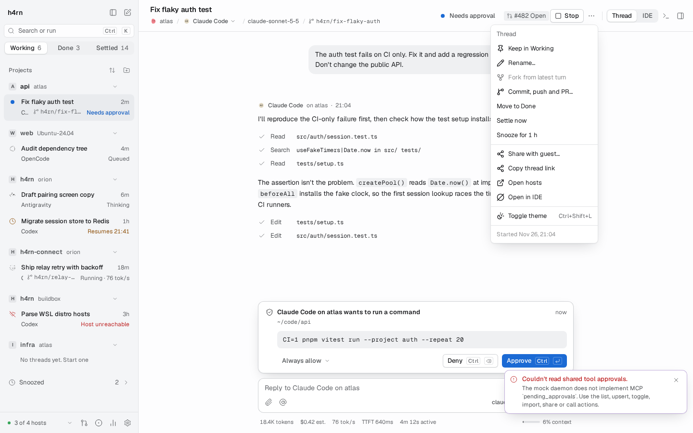 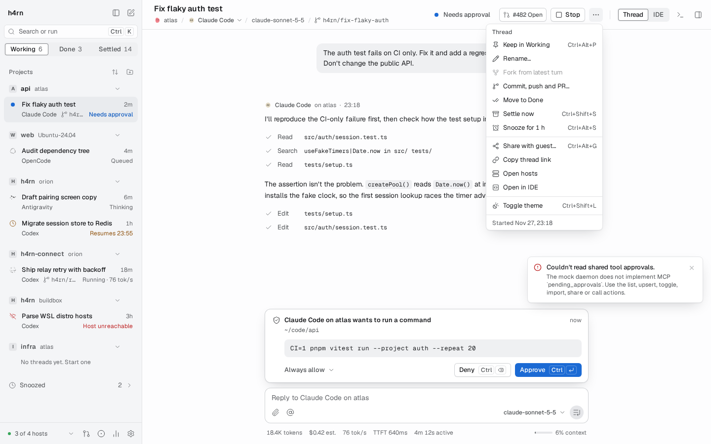

- Component: thread header overflow menu. `apps/ui/src/components/thread/ThreadHeader.tsx:191-263` (no icons at 214-226; `Share2Icon` at 230 and 241; `CircleSlash2Icon` at 249; disabled footer item at 259). Item styles: `apps/ui/src/components/ui/dropdown-menu.tsx:62` (`[&_svg:not([class*='size-'])]:size-4`).
- The row actions menu (`apps/ui/src/components/inbox/ThreadRow.tsx:223-262`) has no icons at all, so it disagrees with the header menu that holds the same commands.
- Fix: move to the UI SDK Menu. Lay each item out as a three-column grid: a 14 px icon slot reserved for every item in a group that has any icon, then the label, then a right-aligned muted shortcut. Use `Link` for Copy thread link and `Code`/`SquareCode` for Open in IDE. Render the started time as a non-interactive menu footer in `text-xs text-muted-foreground`. Give the header menu and the row menu the same items, order and icons.

**After: Fixed.** The header and row menus are on the UI SDK Menu with a reserved 14 px icon column, `Link` and `SquareCode` icons, plain muted shortcuts from the registry and a non-interactive "Started …" footer; the row menu shows the subset of the same items that applies to that thread's state.

### A2 (P1) Settings pages use five different column widths and left edges

The content column is 696 px wide on Appearance, General, Account and Harnesses, 796 on MCP, 816 on Hosts & devices, 856 on Skills and 876 on Forges. Moving between pages shifts the left edge by up to 90 px.

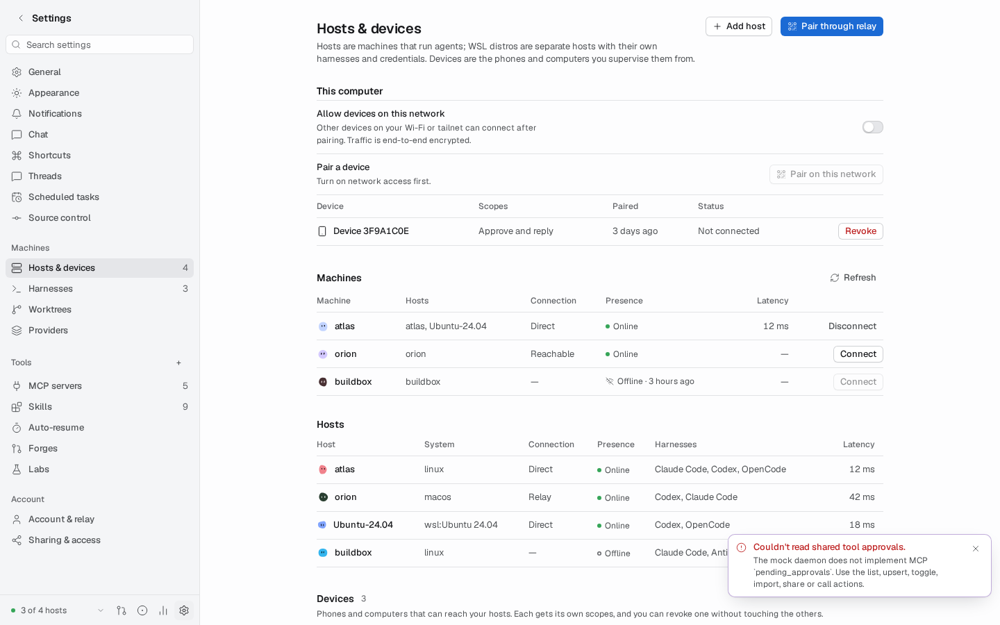 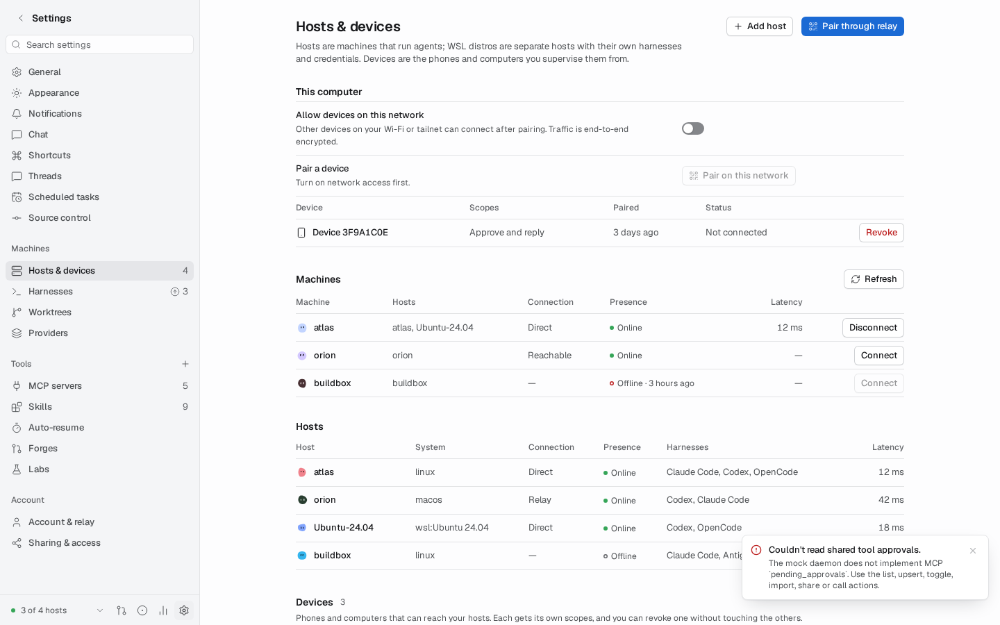 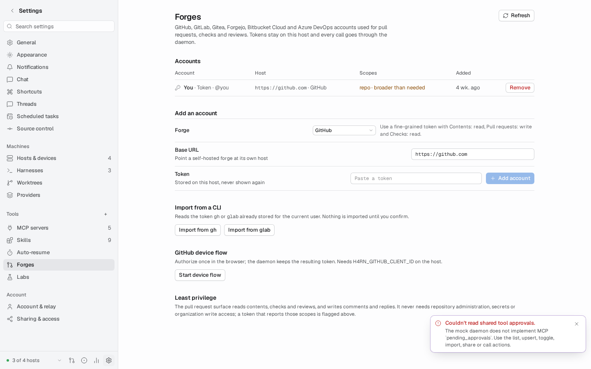 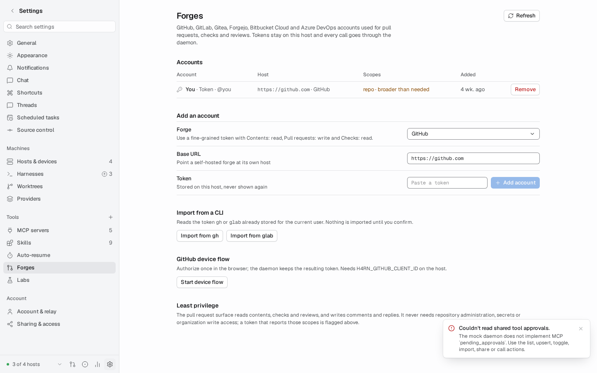

- Component: settings page containers. `.q-form` is 760 at `apps/ui/src/styles/quiet.css:4073-4077` and `.q-wrap` is 1080 at `quiet.css:2981-2985`. Each page then overrides inline:
  - `apps/ui/src/features/forge/ForgeSettings.tsx:649` (940)
  - `apps/ui/src/features/skills/SkillsPage.tsx:355` (920)
  - `apps/ui/src/features/mcp/McpPage.tsx:578,791,832` (860)
  - `apps/ui/src/features/remote/SettingsRemote.tsx:265` (880)
- Fix: define two widths: a form width for label/control pages and one wide width for pages built around tables (Hosts, MCP, Skills, Forges). Use them as Tailwind container tokens in `@theme`, not inline `maxWidth`. Keep the same 32 px gutter, so every settings page title sits at one x.

**After: Fixed.** Every settings page title now sits at x=426; label/control pages use one 696 px column and table pages (Hosts, MCP, Skills, Forges) one 876 px column.

### A3 (P1) Controls in settings rows start at different x positions

On Forges, the Forge select starts at x=762, Base URL at x=1002 and Token at x=854, all inside one form. On Auto-resume, a 180 px select, a 100 px number input and a 360 px textarea are each right-aligned. Values also float in a middle column ("2 online of 3", "1.1.0", "linux · web", the version arrows on Harnesses) about 340 px from the label, apart from the actions.

  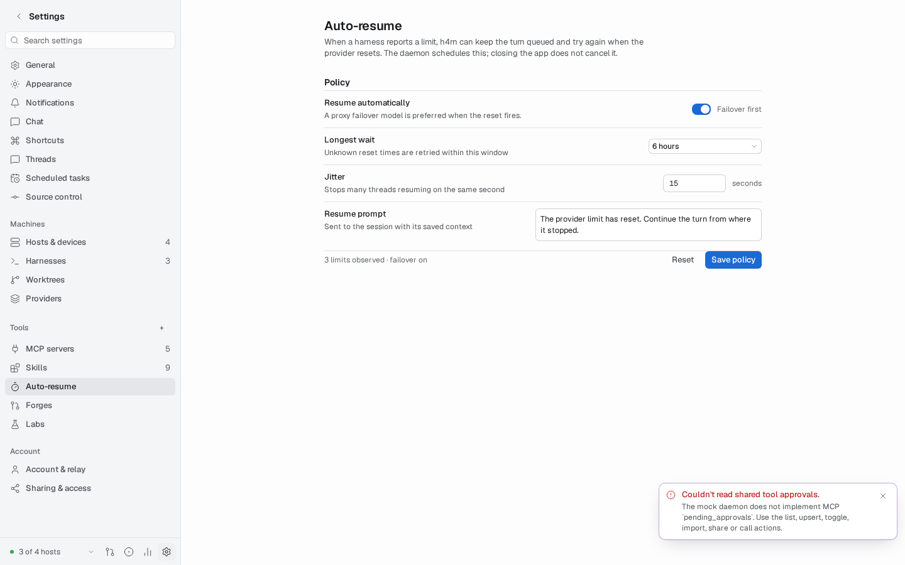 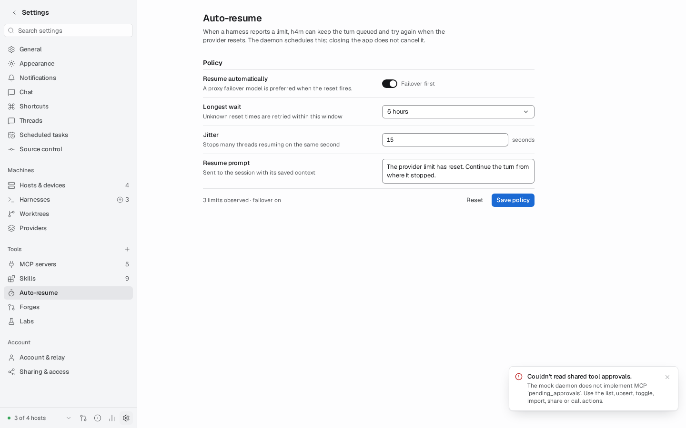

- Component: `.q-field` row: `quiet.css:4116-4187` (`.lab` is `flex: 0 1 320px` and `.ctl` uses `justify-content: flex-end`). Per-field inline widths:
  - `ForgeSettings.tsx:279,296,339` (300/300/320)
  - `ChipSelect width={300}` at `ForgeSettings.tsx:321`
  - `apps/ui/src/features/usage/AutoResumeSettings.tsx:139,167`
  - `apps/ui/src/features/harnesses/HarnessSettings.tsx:315,332,349,471`
  - `apps/ui/src/features/proxy/ProxySettings.tsx:311-359`
- Fix: one settings row layout (UI SDK `Field` with `FieldLabel`/`FieldDescription`). Use a fixed-width control column, left-aligned inside it, with every control filling that column. Read-only values sit in the same column. Row actions go in a trailing slot after the control column.

**After: Fixed.** Rows are one label column and one fixed control column; controls fill it from the same left edge (x=982 on Forges, x=802 on Auto-resume), and row actions such as Add account sit in a trailing slot.

### A4 (P1) The thread header and right panel hairlines differ by 6 px, and the header jumps 6 px after loading

The thread header's bottom hairline is at y=65 and the right panel's is at y=59 (measured in `panel-changes-1440-light.png`). DESIGN.md says they align. The loading skeleton header ends at y=59, so the header grows 6 px when the thread loads. Page headers (Pull requests, Usage) end at y=51, a third height.

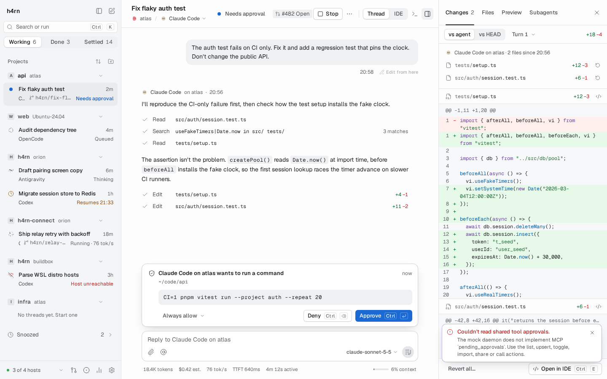 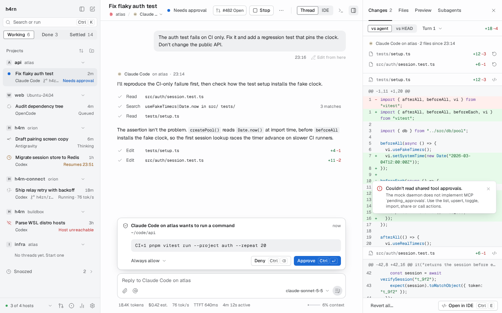  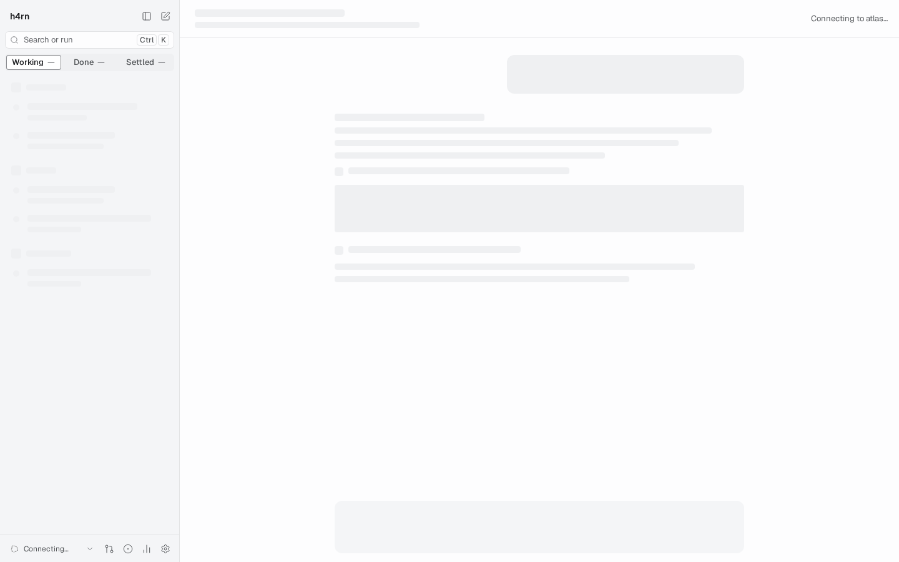

- Components:
  - `.q-th-head`: `quiet.css:1285-1293` (`min-height: 60px`, which grows to 66 from the title and provenance content)
  - `.q-rp-head`: `quiet.css:5311-5319` (`height: 60px`)
  - `.q-page-head`: `quiet.css:2963-2971` (`height: 52px`)
  - loading header: `apps/ui/src/components/thread/ThreadPane.tsx:40`
- Fix: one fixed header height token for the thread header, the right panel header and page headers (60 px fits a 16/20 title, a 12/16 provenance line and 2×10 padding). Set it as `height`, not `min-height`, and give the skeleton the same height.

**After: Fixed.** The thread header, right panel header and page headers share one fixed 60 px height (all hairlines at y=59), and the loading skeleton header matches, so nothing jumps on load.

### A5 (P1) Sidebar row line 2 cuts the harness name to one letter

Line 2 of a thread row shows the harness, the branch and the status. The harness gives up space first: "Claude Code" becomes "C…", and on "Ship relay retry with backoff" it is clipped to a sliver that reads as "(". Line 2 is aligned by baseline, so the 12 px branch icon, the 11.5 px mono branch and the 12 px status sit at different heights. The title truncates with no title attribute or tooltip.

 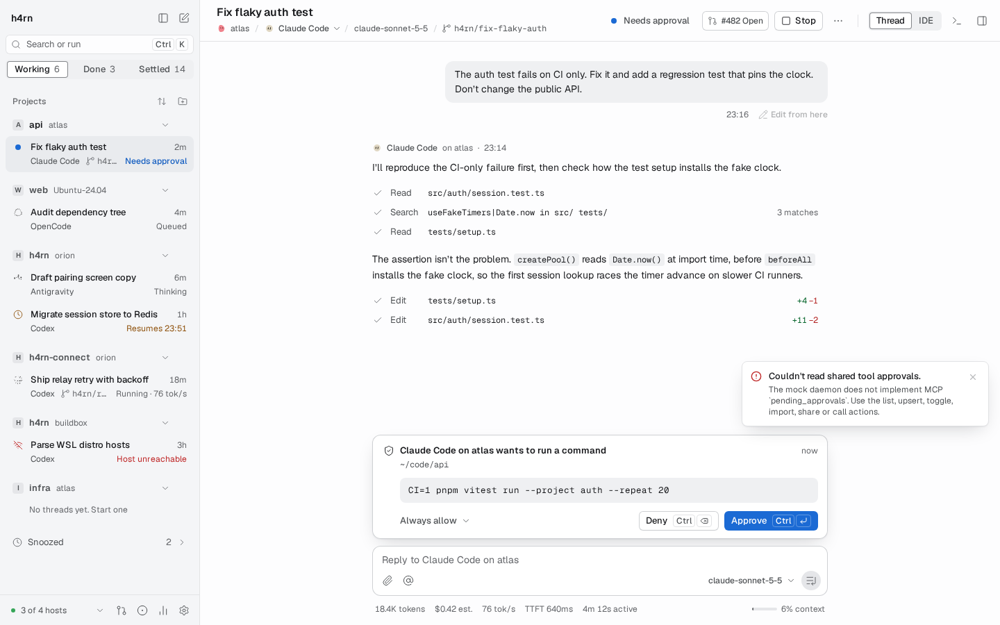 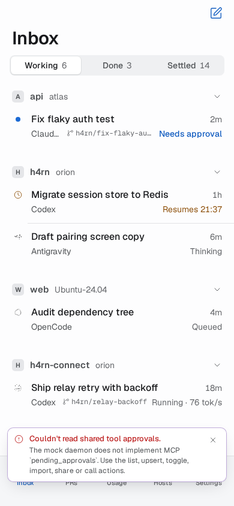 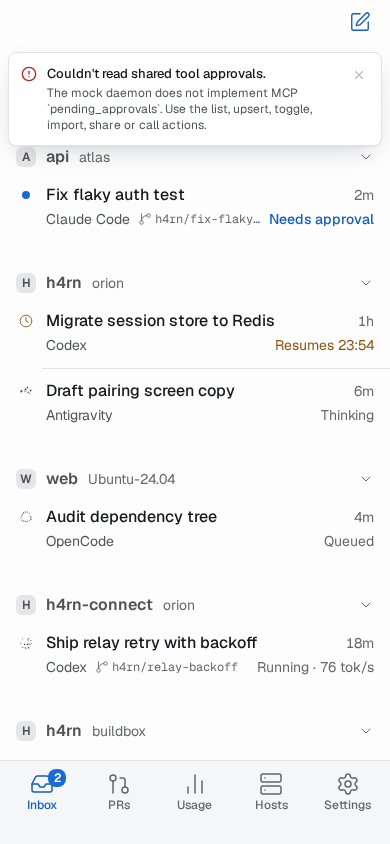

- Component: `ThreadRow`: `apps/ui/src/components/inbox/ThreadRow.tsx:152-167`. CSS:
  - `.q-row-l2` `align-items: baseline`: `quiet.css:1177-1183`
  - `.q-row-meta` `flex: 1; min-width: 0`: `quiet.css:1213-1221`
  - `.q-row-branch` `max-width: 46%`, 11.5 px: `quiet.css:1222-1240`
- Fix: make the harness `shrink-0`. The branch takes the remaining space with `min-w-0 truncate` and a tooltip. The status is `shrink-0`. Use `items-center` with a fixed line height, and an icon+text `inline-flex items-center gap-1` for the branch. Use `text-xs` for all of line 2. The row title gets a tooltip when it overflows.

**After: Fixed.** The harness name stays whole, the branch truncates first with a tooltip, the status stays at the trailing edge, and line 2 is centre-aligned `text-xs`.

### A6 Settings nav rows shrink when the MCP server list is open

On the MCP page, the settings nav rows are spaced 25.5 px apart instead of 30 px. The rows are flex items that shrink to fit the extra sub-rows, so the whole nav changes density between pages.

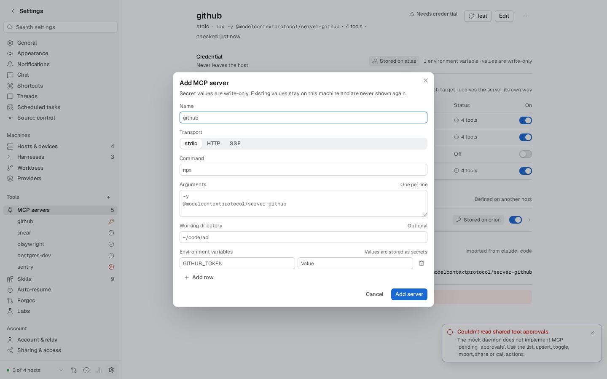 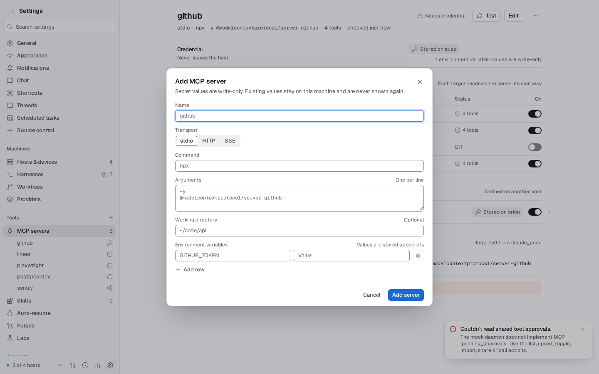 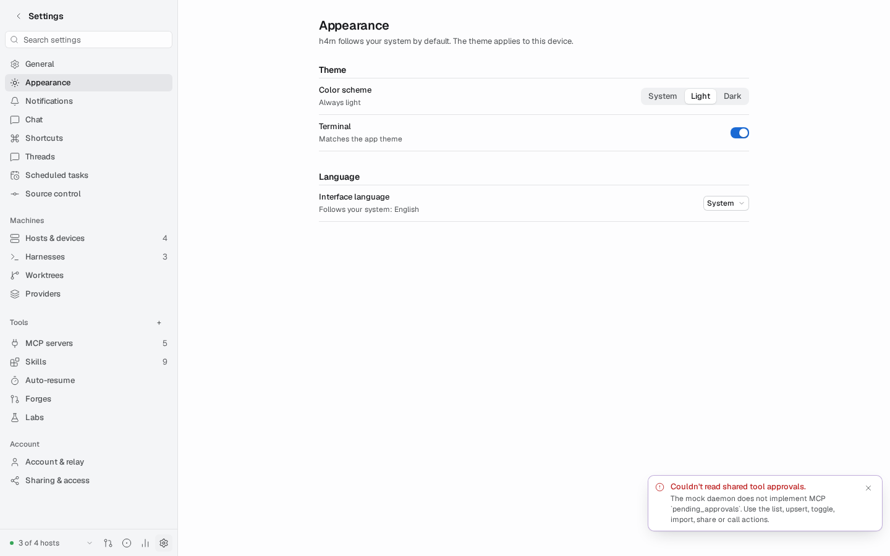 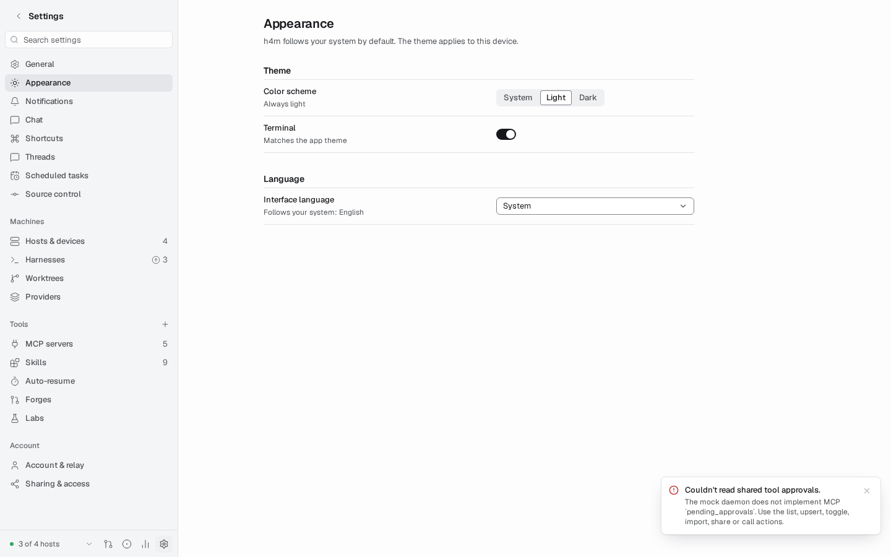

- Component: settings nav in `apps/ui/src/components/shell/Sidebar.tsx:970-1080`. `.q-side-list.setnav` is a flex column (`quiet.css:723-727`), and `.q-nav` sets `height: 28px` but not `flex: none` (`quiet.css:666-678`). `.q-set-subrow` is the same (`quiet.css:734-745`).
- Fix: make the nav rows `shrink-0` with a fixed height, so the list scrolls instead of compressing. Better still, make the nav a UI SDK list where row height is part of the component.

**After: Fixed.** Nav rows were already `flex: none`; the verification pass also fixed the group headers, which still shrank 3–6 px on the MCP page (`16bae384`), so Machines/Tools/Account now sit at the same y on every page.

### A7 Hosts menu: the active check isn't a reserved column, so the presence dots misalign

The atlas row has a dot and a check. The other rows have only a dot, so atlas's dot sits about 20 px left of the rest. The unreachable host stacks three cues in red: a red name, a wifi-off icon and a hollow red dot.

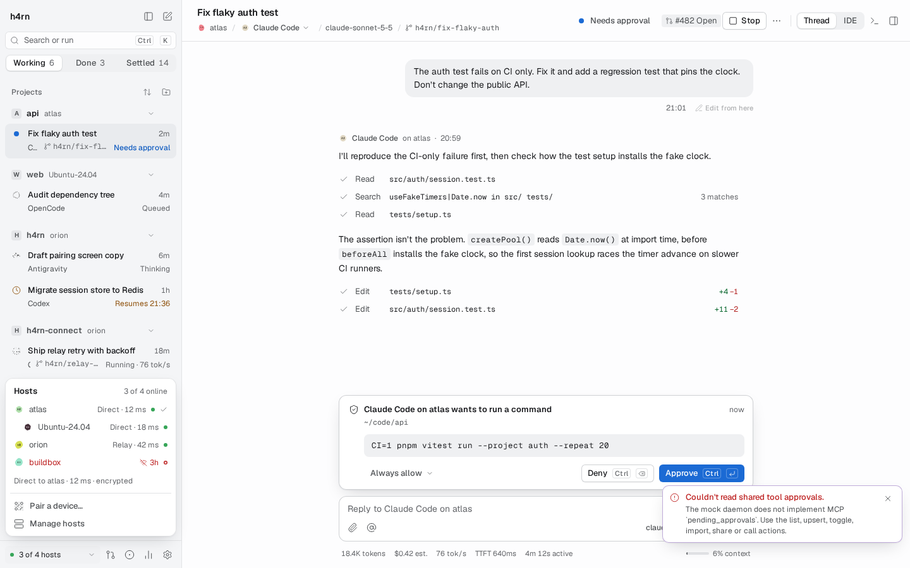 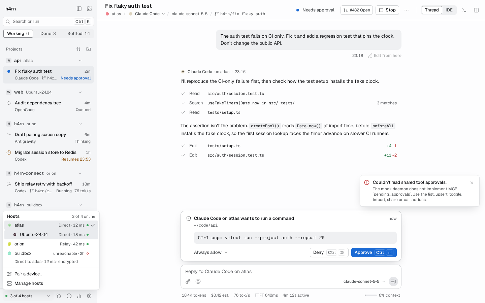

- Component: hosts menu, hand-rolled: `Sidebar.tsx:313-460`, row at `Sidebar.tsx:350-393` (the check renders only when `row.active`).
- Fix: on the UI SDK Menu, give every host row trailing slots of fixed width: meta, a dot, and a 14 px check slot that is always present. Show "unreachable" once, as the dot plus a muted word.

**After: Fixed.** The hosts menu is a UI SDK Menu with fixed trailing slots (meta, dot, a 14 px check column always reserved), and unreachable shows once as a hollow dot plus the muted word.

### A8 The New thread dialog grid is ragged

The first row (Host, Harness, Model) is three columns. Helper text under Model ("Effort", then a two-line proxy note) makes that column taller than its neighbours, and the word "Effort" reads as a stray label. Reasoning effort then sits alone in a half-width column with a right-aligned hint. Mode and Where use a third column ratio (`1fr_1.2fr`). Labels are 12 px `fg-3` and hints are 11.5 px.

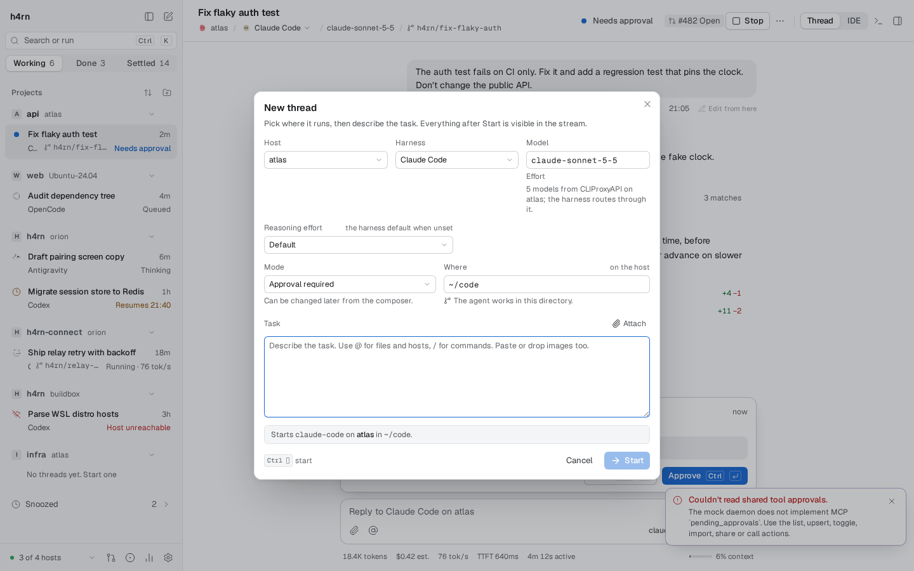 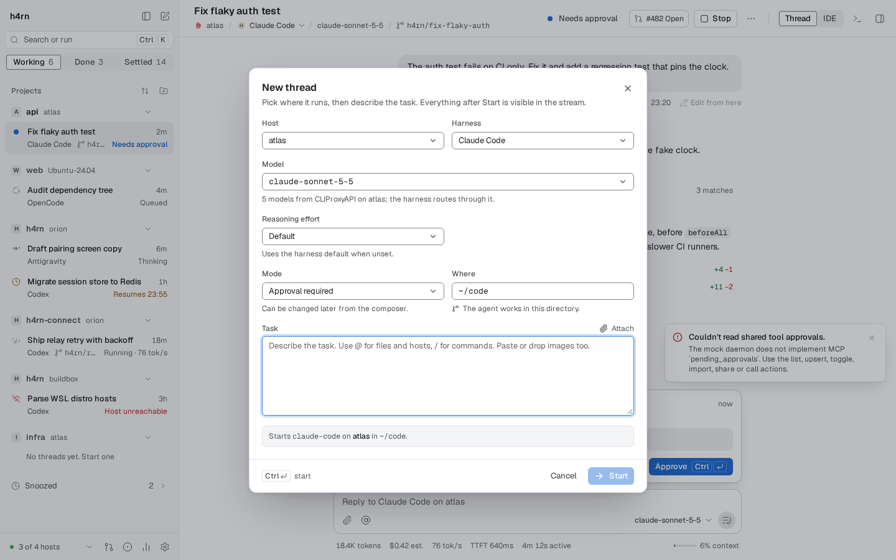 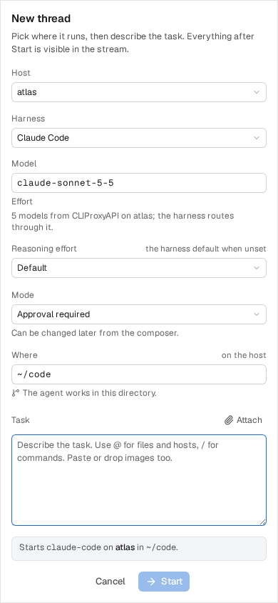 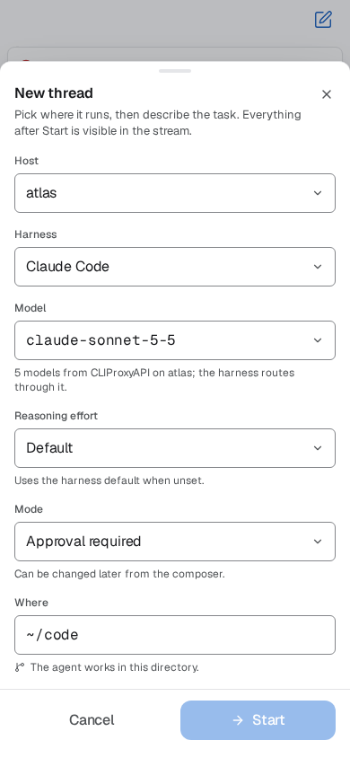

- Component: `apps/ui/src/components/dialogs/NewThreadDialog.tsx`:
  - `FieldLabel` at 86-101
  - first grid at 513
  - Model column at 580-627
  - effort grid at 629
  - Mode/Where grid at 666
- Fix: use UI SDK `Field` for every control and one grid: two equal columns, with Model on its own row as a Combobox. Put descriptions under the control in one slot style (`text-xs text-muted-foreground`). Fold the thinking hint into the Reasoning effort field description.

**After: Fixed.** One two-column grid: Host and Harness, Model on its own full row, Reasoning effort, then Mode and Where, each with one `text-xs` muted description slot under the control.

### A9 The phone thread header wraps "Claude Code" onto two lines

On phone, the provenance line wraps the harness name to "Claude / Code", so the header is taller and nothing in it lines up. The state word is cut to "Needs…".

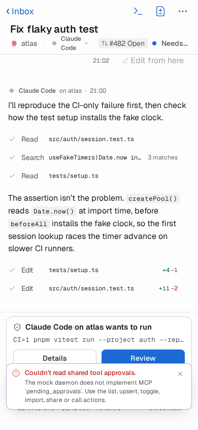 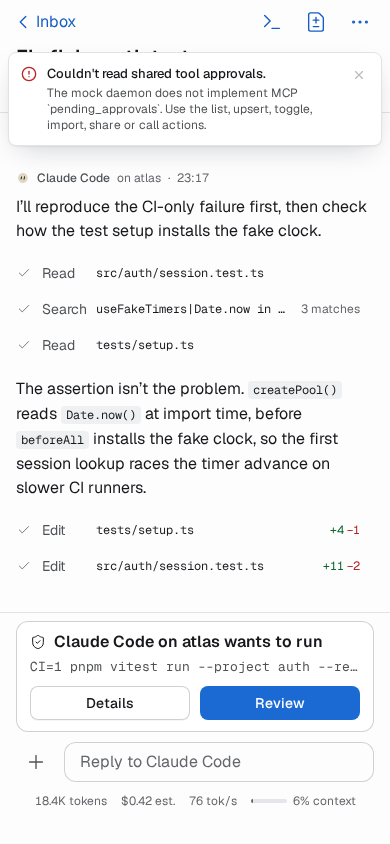

- Component: `ThreadHeader.tsx:314-342`. CSS `.q-ph-th-meta > span:not(.grow)` sets `white-space: nowrap` (`quiet.css:4494-4510`, with the rule duplicated at 4503 and 4507). The harness switch is a `button`, not a `span`, so the rule misses it.
- Fix: no-wrap on every child of the meta line. The harness label truncates with a tooltip. The state word takes priority over the branch.

**After: Partly fixed.** The phone meta line stays on one line and the harness truncates ("Claud…") with a title, but the state word is still cut to "Needs…" because the PR badge keeps its width before it; the after shot is hidden by the mock toast, so this was checked in a fresh capture.

### A10 Settings nav group headers are uneven, and one uses a literal "+"

The "Tools" group header has a text "+" button (not a lucide icon). The header is spaced with an inline `paddingTop: 18`, which no other group header has, so "Tools" sits at a different rhythm from "Machines" and "Account".

 

- Component: `Sidebar.tsx:976-980` (inline `paddingTop: 18`) and `Sidebar.tsx:1011-1024` (`className="q-ibtn s22"` with "+"; there is no `.q-ibtn.s22` rule).
- Fix: one group header component (`text-xs` muted, `pt-4 pb-1`) with an optional trailing icon button (lucide `Plus` at 14 px in a 24 px button with a 32 px hit area).

**After: Fixed.** Every group header has the same rhythm and Tools uses a lucide `Plus` icon button.

### A11 Page header content doesn't line up with page content

On Pull requests, the title sits at x=312 and the rows run from x=440 to x=1288, while Open PR and Refresh sit at the window edge (x=1410). Usage and the PR detail have the same split.

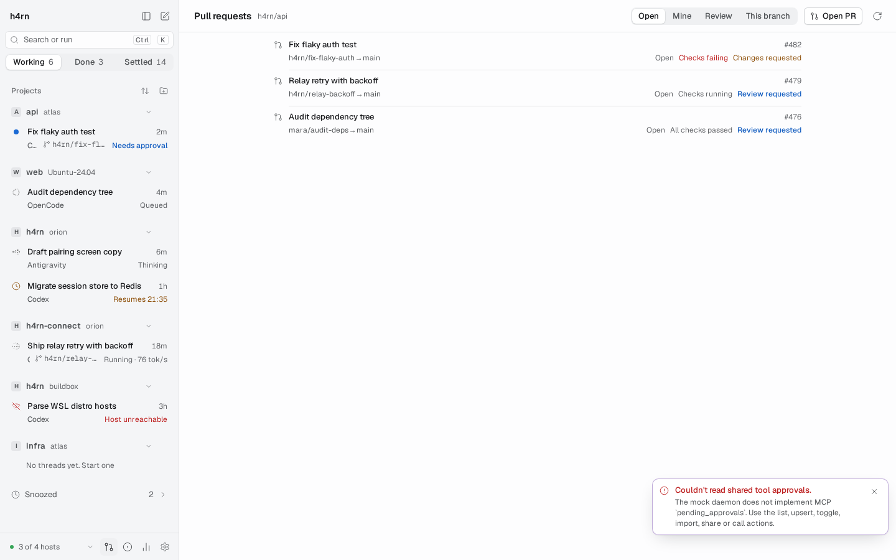 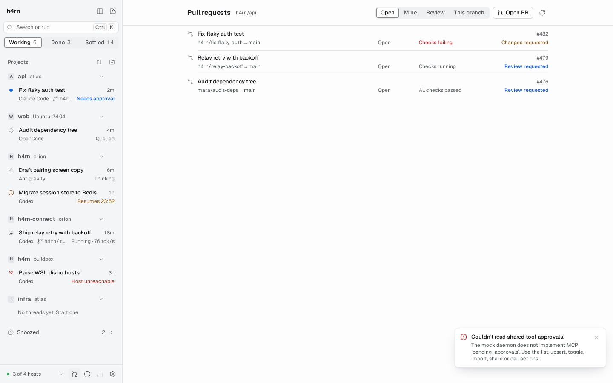 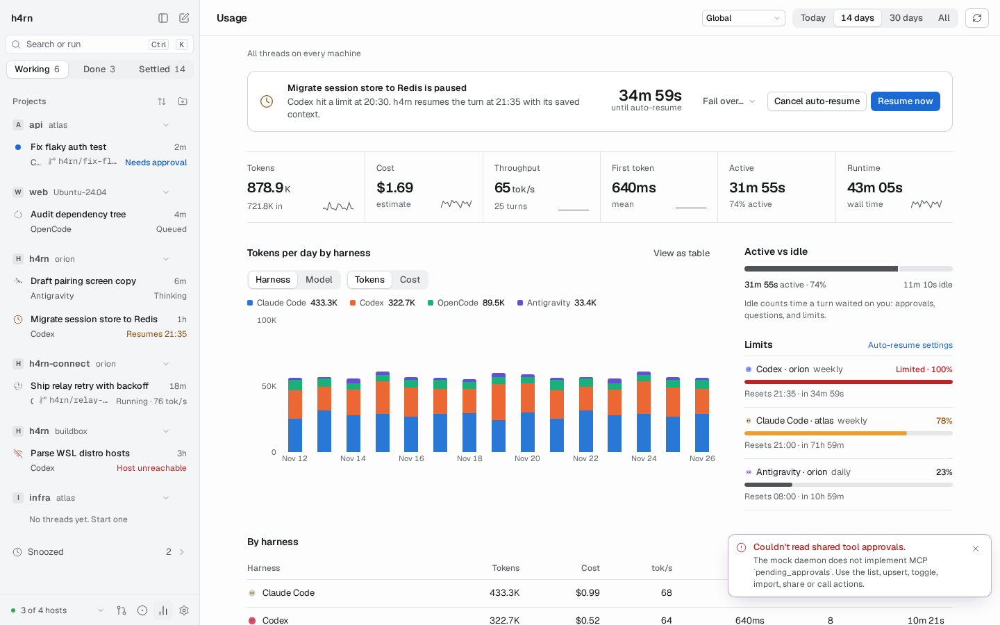 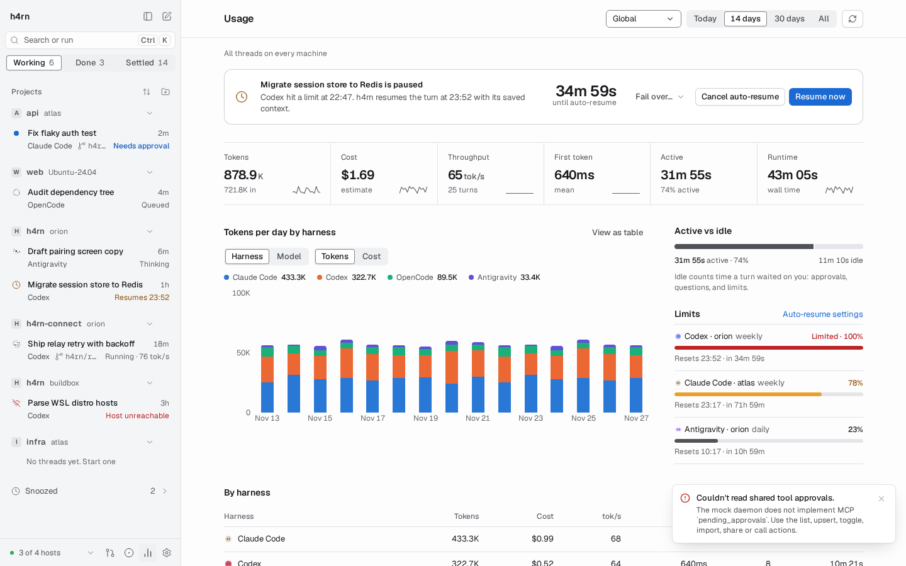

- Component: `.q-page-head` `padding: 0 16px 0 24px` (`quiet.css:2963-2971`). Content is capped at a different width:
  - `.q-pr-rows` `max-width: 880px` (`quiet.css:1126`)
  - PR detail header inline padding (`apps/ui/src/features/forge/PullRequestsPage.tsx:1232`)
  - Usage `q-wrap` (`apps/ui/src/features/usage/UsagePage.tsx:865-882`)
- Fix: page headers wrap their contents in the same container (max width and gutter) as the page body, so the title and actions align with the content edges.

**After: Fixed.** Page heads wrap their content in the body's container, so the Pull requests title (x=440) and the actions line up with the rows' edges; Usage matches.

---

## Spacing

### S1 The header action cluster has a 2 px gap, so the PR badge touches Stop

"#482 Open" and Stop are about 3 px apart, while the rest of the header uses 8 to 12 px.

 

- Component: `.q-th-actions` `gap: 2px`: `quiet.css:1374-1378`. Markup at `ThreadHeader.tsx:397-430`.
- Fix: `gap-2` between actions and `gap-1` only inside icon-button groups. Make the PR badge a small secondary button with the same height as Stop.

**After: Fixed.** The header actions use an 8 px gap and the PR badge is a small secondary button the same height as Stop.

### S2 Phone screens use four different side gutters

Inbox uses 20 px (large title) and 16 px (segment), MCP uses 16, Skills uses 32 and the PR detail uses 14.

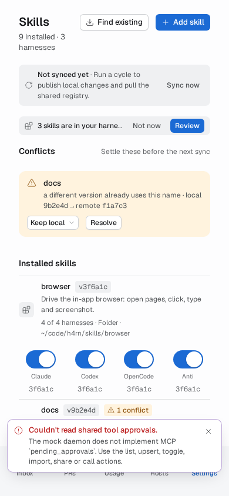 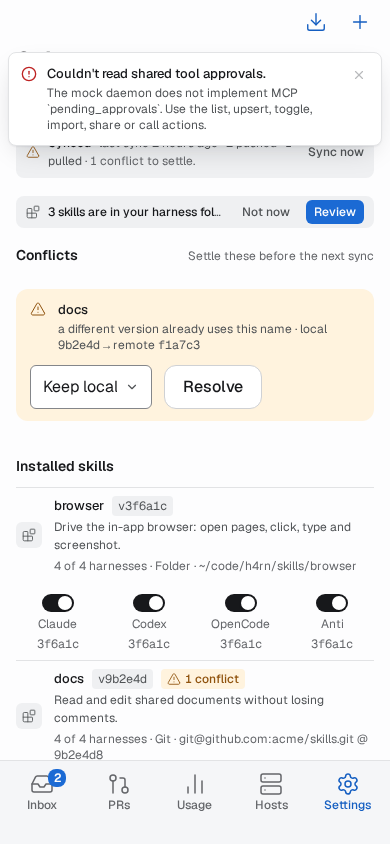 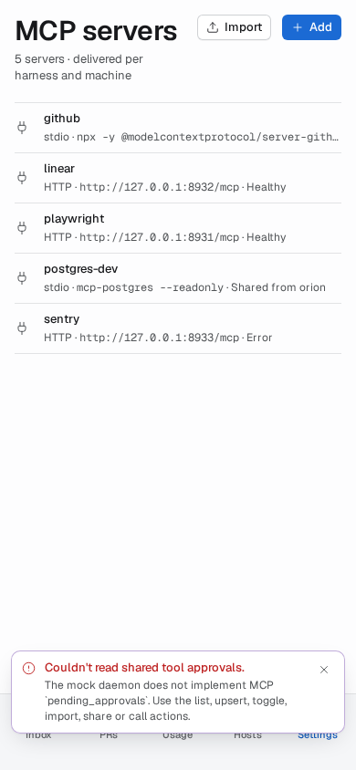 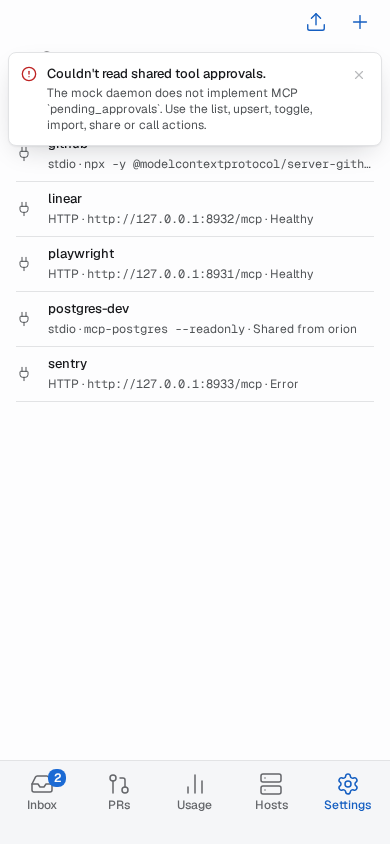

- Component:
  - `.q-ph-lt` `padding: 2px 20px 10px` and `.q-ph-seg` `padding: 0 16px`: `quiet.css:4736-4746`
  - `.q-wrap.q-wrap-phone` 16: `quiet.css:2986`
  - Skills uses plain `.q-wrap` (32 px) on phone: `SkillsPage.tsx:355`
- Fix: one phone gutter (`px-4`) applied by a shared phone screen layout, never chosen per page.

**After: Fixed.** Inbox, MCP, Skills and Pull requests all use the 16 px phone gutter through the shared phone screen header.

### S3 Dialogs: nine widths, one padding for header, body and footer, and a close button off the title row

Dialog widths in use are 420, 460, 520, 560, 600, 620, 640, 680 and 700 px. Every dialog is one `p-4` grid with no header/body/footer separation. The close X is placed `absolute top-3 right-3`, so it doesn't sit on the title's line (title at y=169, X at y=164 in New thread). Primary and secondary buttons aren't separated from the body.

   

- Component: `apps/ui/src/components/ui/dialog.tsx:41-73` (content, close). Per-dialog `max-w-[…]` in `McpDialogs.tsx`, `SkillDialogs.tsx`, `GitActionsDialog.tsx`, `DelegateDialog.tsx`, `AddProjectDialog.tsx`, `GuestShareDialog.tsx`, `LinkPullRequestDialog.tsx`, `RewindDialog.tsx`, `RenameThreadDialog.tsx`, `ShortcutsDialog.tsx`, `NewThreadDialog.tsx`, `ConfirmDialog.tsx`.
- Fix: UI SDK Dialog with a `size` variant (`sm` 420, `md` 560, `lg` 680). Lay it out as header (`px-5 pt-5`, title and close on one row), scrolling body (`px-5`), and footer (`px-5 py-4`, top hairline, primary on the right).

**After: Fixed.** Dialogs use the UI SDK Dialog with sizes sm/md/lg/xl, a header with the title and close X on one row, a scrolling body, and a footer with a hairline and the primary action on the right.

### S4 Done rows grow from two lines to three, with 24 px buttons inside the row

In Done, each row gets inline Acknowledge, Resume now and Acknowledge buttons. That changes the row height from 52 to 86 px and mixes secondary and ghost buttons in one row.

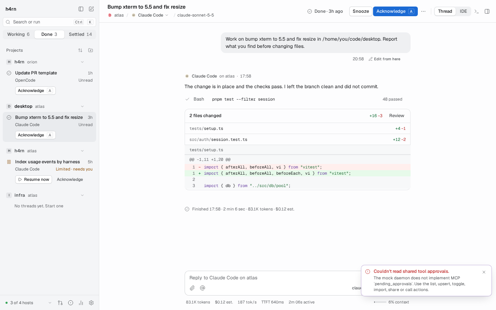 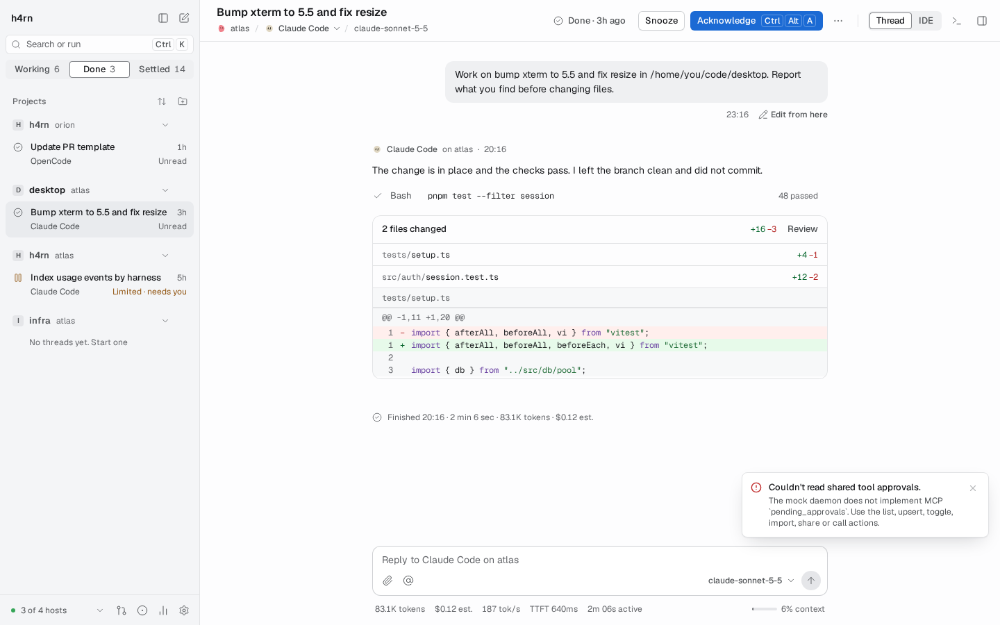

- Component: `ThreadRow.tsx:168-207`; `.q-row-act .q-btn { height: 24px }` at `quiet.css:1270-1279`.
- Fix: keep rows a fixed height. Show the acknowledge action as a trailing button on hover or focus, and put the rest in the row menu, or reserve a fixed third line with buttons of one variant. The selected thread's header already carries Acknowledge.

**After: Fixed.** Done rows keep the two-line 52 px height; Acknowledge lives in the thread header (with its real shortcut) and the rest in the row menu.

### S5 Spacing is mostly set inline, off the 4 px scale

790 `style={{…}}` objects in 65 files set spacing and size inline. These include `marginTop` (76 single-line occurrences), `gap` (70), `margin` (95) and `padding` (38), with values such as 3, 5, 6, 7, 9, 10, 14 and 18. See the code sweep. The worst files are `UsagePage.tsx` (61), `PullRequestsPage.tsx` (54), `SettingsRemote.tsx` (48), `McpPage.tsx` (34) and `ProxySettings.tsx` (33).

 

- Fix: replace inline spacing with Tailwind scale classes during each component's port. Half steps only where optical alignment needs 2, 6 or 10 px.

**After: Partly fixed.** Inline `style={{…}}` dropped from 790 in 65 files to 513 in 58; most of the rest set spacing or size where a `quiet.css` rule would beat a Tailwind utility, so they move when those components leave `quiet.css`.

---

## Typography

### T1 Text sizes are spread across 16 values, many off the scale

Sizes in use include 10, 10.5, 11, 11.5, 12, 12.5, 13, 13.5, 14, 15, 16, 17, 20, 22, 24 and 30 px:

- CSS (`quiet.css`): 12 px ×115, 13 ×40, 14 ×38, 11.5 ×19, 11 ×14, 12.5 ×13, 15 ×10, 17 ×9
- Inline `fontSize`: 12 ×149, 11.5 ×16, 12.5 ×10, 17 ×6
- Tailwind arbitrary: `text-[12px]` ×24, `text-[12.5px]` ×9, `text-[11.5px]` ×8

The usage line, row branches and toast descriptions are 11.5 or 12 px with ad hoc line heights.

 

- Component: everywhere. Named text utilities exist (`tokens.css:313-372`: `text-page` 20, `text-heading` 17, `text-title` 15, `text-label` 14, `text-compact` 13, `text-small` 12, `text-caption` 11, `text-code` 12.5) but don't match the brief's scale.
- Fix: redefine the text tokens as `text-xs` 12/16, `text-sm` 13/18 (default), `text-base` 14/20, `text-lg` 16/24, `text-xl` 20/26, `text-2xl` 24/30, all with fixed line heights. Map 11 and 11.5 → 12, 12.5 → 12 (mono) or 13, 15 and 17 → 16. See open question 1 for the phone large title (30) and tab labels (11).

**After: Fixed.** Every CSS font size is now on the scale (12/13/14/16/20/24); the 131 inline `fontSize` values left are all 12/13/14/16 and go with S5.

### T2 Shortcut hints are drawn four different ways

1. The `Kbd` component: Geist Mono 10 px, 20 px tall, `rounded-[3px]`, `bg-side` with a border. Used in the palette and the New thread footer.
2. `.q-kbd`: Geist 11 px, 16 px line, inset ring, `rounded 4px`. Used in Approve, Deny, Acknowledge and Search.
3. Plain text "Ctrl+Shift+L" in menus.
4. A bare letter ("A", "P"). See K6.

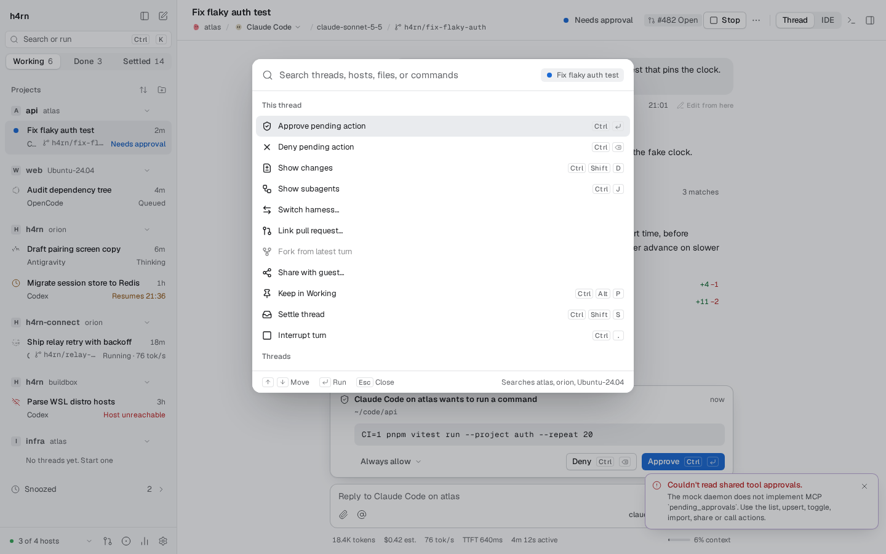 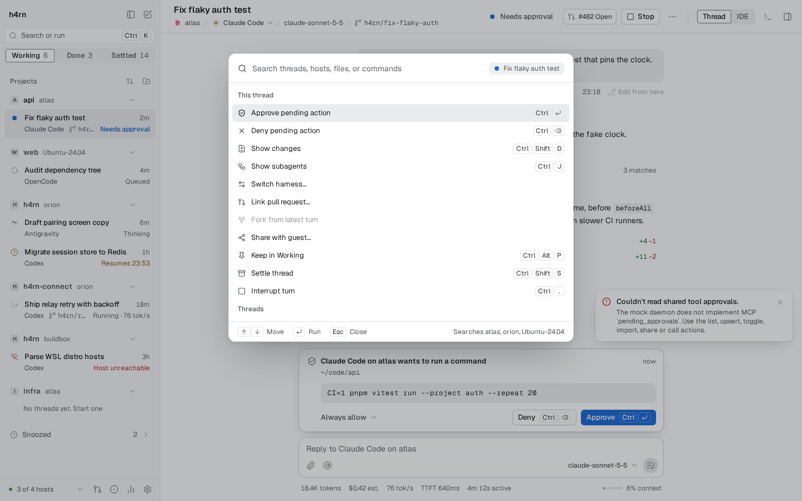  

- Component: `apps/ui/src/components/common/Kbd.tsx:110-122`; `.q-kbd` at `quiet.css:180-231`; menu text at `ThreadHeader.tsx:256` and `ThreadRow.tsx:234,250`.
- Fix: one `Kbd` primitive: `text-xs` Geist with tabular figures, `h-5`, `rounded-sm`, 1 px border, SVG key glyphs, and an inverse style inside primary buttons. Menus, tooltips, buttons and the palette all render shortcuts through it from the keybinding registry.

**After: Fixed.** One `Kbd` (`ui/kbd.tsx`) draws shortcuts in buttons, tooltips, the palette and the shortcuts sheet from the registry, with SVG key glyphs; menus show plain muted text by the owner's decision.

### T3 Some settings section headings render at body weight

"CLI versions" and "Local ACP agents" on Harnesses render at 13/400, while "Theme" and "Connection" render at 14/600. The heading style targets `.q-group > h2`, and headings wrapped in `.q-group-head` aren't direct children, so they fall back to the preflight reset.

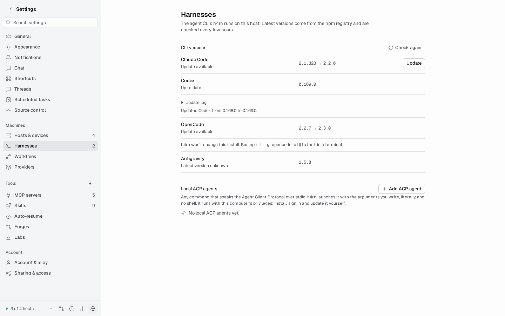 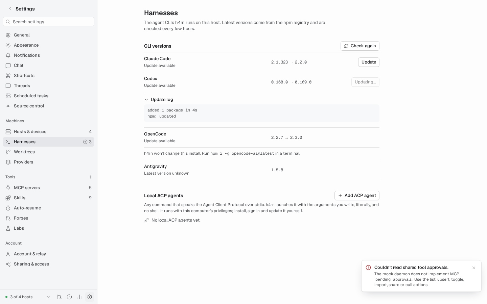

- Component: `.q-group > h2` at `quiet.css:4101-4108`; `.q-group-head` at `quiet.css:6197-6202` (9 uses); `HarnessSettings.tsx:524-547`.
- Fix: a `SectionHeading` component (`text-base font-semibold`, optional trailing action) used on every settings page.

**After: Fixed.** "CLI versions" and "Local ACP agents" now render at 14/600 like every other section heading.

### T4 Mono and sans are mixed in the same control

In New thread, the Model input is mono and the selects next to it are sans. The Forges token placeholder "Paste a token" is set in mono. Kbd hints are mono in one component and sans in the other.

   

- Component: `NewThreadDialog.tsx:583-589` (`className="font-mono"`), `ForgeSettings.tsx:337-345`, `Kbd.tsx:114`.
- Fix: mono only for the value when it is a slug, path or URL. Placeholders and hint text stay in Geist.

**After: Partly fixed.** The Model field is mono only for its slug value, but the Forges token placeholder "Paste a token" is still set in Geist Mono because `.q-input.q-mono` styles the placeholder too.

---

## Color and contrast

### C1 (P1) In dark mode the selected segment is nearly invisible

In dark mode the selected thumb is `fill-2` on a `fill` track with no shadow: 1.15:1. Working/Done/Settled, the MCP transport switcher, Usage ranges and Appearance's color scheme are all hard to read; the user can't tell which option is selected without the label weight. Light mode relies on a soft shadow, and the thumb itself is 1.14:1 against the track.

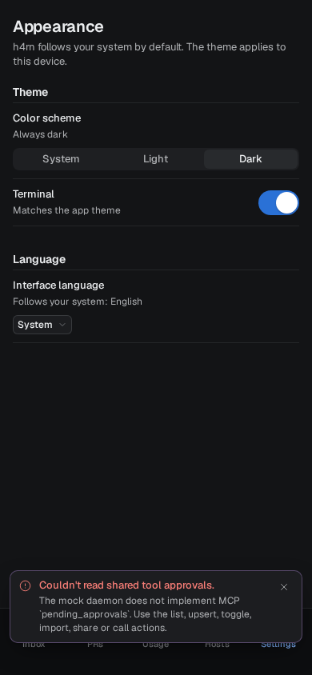 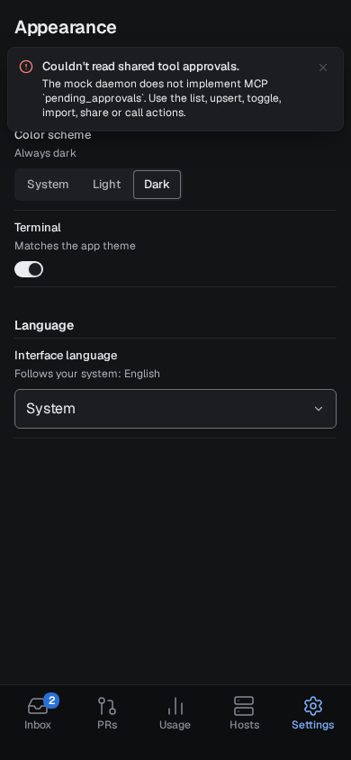 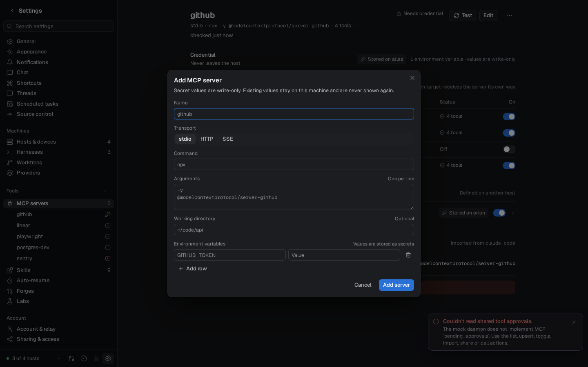 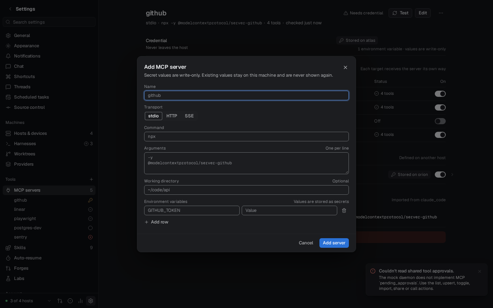

- Component: `.q-seg` at `quiet.css:273-336`; dark override at `quiet.css:312-317`.
- Fix: as part of the UI SDK Segmented Control, make the selected thumb `bg-raised` with a 1 px `line-2` ring in both themes, plus the popup shadow in light mode. Selected text is `fg` at weight 500 and unselected text is `muted-foreground`. Values stay within the Quiet native palette.

**After: Fixed.** The selected segment is a raised thumb with an `input` ring in both themes and is easy to pick out in dark (Working/Done/Settled, MCP transport, Usage ranges, Appearance).

### C2 Input outlines and off switches fall well short of 3:1

Inputs and select chips are outlined with `line-2`: 1.53:1 against `bg-raised` in light, 1.46:1 in dark. An off switch track (`fill-2`) is 1.23:1 against the page in light and 1.29:1 in dark. In dark, inputs read as empty patches and an off switch looks missing (the "Allow devices on this network" switch on Hosts & devices).

   

- Component: `.q-input` at `quiet.css:360-376`, `.q-chip` at `quiet.css:3259-3273`, `.q-switch` at `quiet.css:378-410`, `--line-2` / `--fill-2` in `tokens.css`.
- Fix: map the shadcn `--input` alias to a stronger outline derived from the Quiet native neutrals (a mix of `line-2` toward `fg-3`). Do the same for the off-switch track. This changes a palette value, so it needs the owner's decision (open question 2).

**After: Fixed.** Field outlines and off-switch tracks use the darkened `input` token (≥ 3:1), so dark inputs and the "Allow devices on this network" switch read clearly.

### C3 Focus rings: one button variant is nearly invisible, and the global ring changes element shapes

The shadcn `Button` draws its focus ring in `--accent-soft`, which is about 1.2:1 against the page. The global `:focus-visible` rule forces `border-radius: 6px` on whatever is focused, so switches, round icon buttons and avatars change shape while focused.

 

- Component: `apps/ui/src/components/ui/button.tsx:8` (`focus-visible:ring-[var(--accent-soft)]`); `tokens.css:295-299`.
- Fix: one focus style from the ring token (`--ring` = `--focus`, 2 px ring, 2 px offset) applied by each component, following the element's own radius. Remove the global radius override.

**After: Partly fixed.** Components draw a 2 px `ring` outline with a 2 px offset (the verification pass fixed the UI SDK controls where `outline-none` hid it, `f7e6d140`), but the global `:focus-visible` rule in `tokens.css` still forces `border-radius: 6px` on any focused element without its own radius.

### C4 Error toasts are red throughout

Error toasts set the whole title in `danger`, tint the border toward red, and use a circle icon of the same shape as the info toast. Two stacked errors give a large red block beside the blue Approve button and break the rule that status colour is rare.

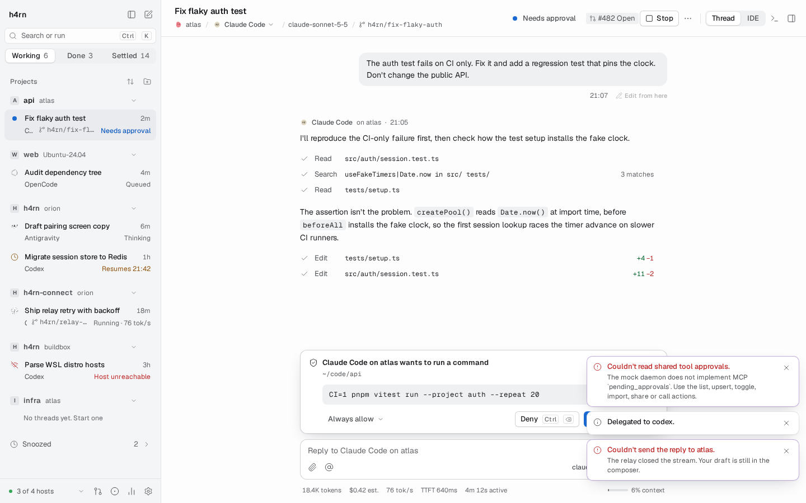 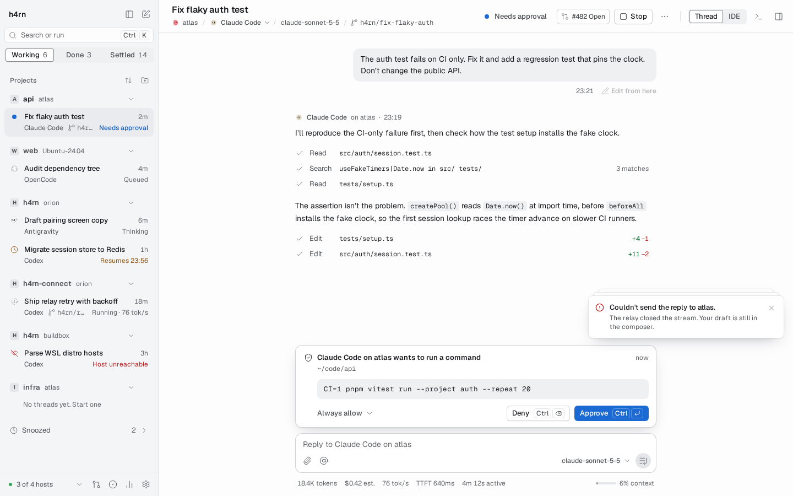 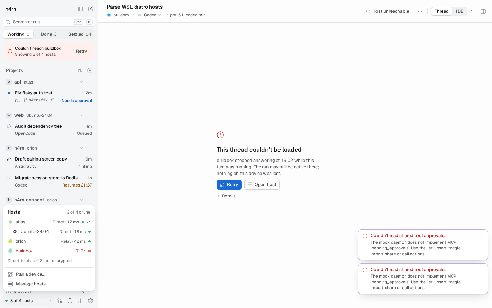 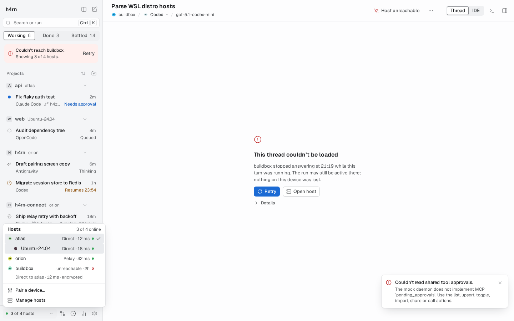

- Component: `apps/ui/src/components/shell/Toasts.tsx:22-46`.
- Fix: neutral toast surface and title (`fg`). Status shows only in the icon (danger `CircleAlert`, neutral `Info`, ok `CircleCheck`). See K1.

**After: Fixed.** Toasts are neutral with an `fg` title; only the icon carries the status colour.

---

## Motion

### M1 (P1) Dialog, sheet and menu animations never run because their duration tokens don't exist

The shadcn layer animates with `var(--dur-fast)`, `var(--dur-base)`, `var(--dur-slow)` and `var(--dur-instant)`, and none of those tokens are defined (the tokens are `--dur-1/2/3`). An `animation` declaration with an undefined variable is invalid, so dialogs, the overlay, sheets and dropdown menus appear and disappear with no motion. The `animate-in fade-in-0 zoom-in-95` classes on the same elements are dead: no animation utility plugin is installed.

 

- Component: `apps/ui/src/styles/globals.css:184-215`; `dialog.tsx:32,56,66`; `dropdown-menu.tsx:34`; `tooltip.tsx`, `sheet.tsx`.
- Fix: define the brief's tokens (`--duration-micro` 120, `--duration-popup` 180, `--duration-modal` 240, enter `cubic-bezier(0.2, 0, 0, 1)`, exit at about ⅔ of the duration with ease-in) and animate through UI SDK's `data-starting-style` / `data-ending-style`:
  - popups: fade plus scale from 0.96 at `--transform-origin`
  - modals: fade plus a small translate
  - sheets: slide from the edge

**After: Fixed.** The motion tokens exist and dialogs, sheets and menus animate through UI SDK `data-starting-style` / `data-ending-style`.

### M2 The custom popups animate inconsistently or not at all, and nothing has an exit

| Surface | Animation |
|---|---|
| Palette | `q-pop`: scale 0.98 plus −4 px, 180 ms (`quiet.css:3386,3399-3404`) |
| Phone sheets | `q-rise`: 40 px, 240 ms (`quiet.css:5046,5051-5056`) |
| Composer menu | fade, 120 ms (`quiet.css:2409`) |
| Harness switch | fade (`quiet.css:7078`) |
| `Popover` card `.q-pop` (`quiet.css:3507-3516`) | none |
| Hosts menu `.q-hostpop` (`quiet.css:1000-1012`) | none |
| Toasts | none |

None of these play an exit, and none set `transform-origin` at the trigger.

   

- Fix: all popups move to UI SDK parts that share the M1 popup motion. Sheets use the modal tokens. The palette uses the modal motion, since it has a scrim.

**After: Partly fixed.** Menus, popovers, selects, the palette, toasts and phone sheets now share the UI SDK popup or modal motion with exits; the phone harness switch sheet and the composer's @ / slash menu are still hand-rolled with `q-fade` / `q-rise` and no exit.

### M3 The easing tokens are defined twice and differ from the brief

`--ease-out: cubic-bezier(0.22, 1, 0.36, 1)` and `--ease-in` are defined at `tokens.css:69-70` and again in `@theme` at `tokens.css:254-255`. The brief's enter curve is `cubic-bezier(0.2, 0, 0, 1)`.

- Fix: define each token once, with the brief's names and values. Update DESIGN.md's motion table to match.

**After: Fixed.** Each easing and duration token is defined once with the brief's names and values.

### M4 Some animations move layout properties, and spinners are still in use

The attachment upload bar and the skill import progress bar animate `width` (`quiet.css:1697`, `quiet.css:6625`). `q-spin` and `Loader2` spinners appear in 24 places, for example `PreviewPanel.tsx:307`, `DiffView.tsx:514`, `ConnectSignIn.tsx:215`. DESIGN.md says skeletons or orbs, not spinners.

 

- Fix: progress bars animate `transform: scaleX()` from the left. Loading states use skeletons or a static glyph plus text. Any spinner that remains stops under reduced motion (it already does) and is only used inside buttons for under-a-second work.

**After: Partly fixed.** Progress bars grow by `scaleX` and the diff and search loaders show the breathing orb, but 9 spinners remain, most inside buttons for short work and a few for longer waits (`SubagentsPanel`, `ConnectSignIn`, `NetworkAccess`).

---

## Consistency

### K1 (P1) Toasts cover the composer, the Approve button and the phone tab bar; errors stack and vanish

Toasts are fixed 12 px from the right and 40 px from the bottom in every layout:

- Desktop: they cover the composer's model picker and send button, and with three toasts the Approve button too.
- Phone: they cover the approval card, the composer, the terminal key bar and the tab bar.

The store keeps the last three with no de-duplication, so the same error shows twice (`state-error`). Errors auto-dismiss after 4.5 s like info toasts. The close button is 22 px. There is no motion.

  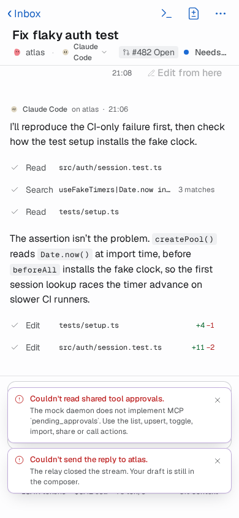 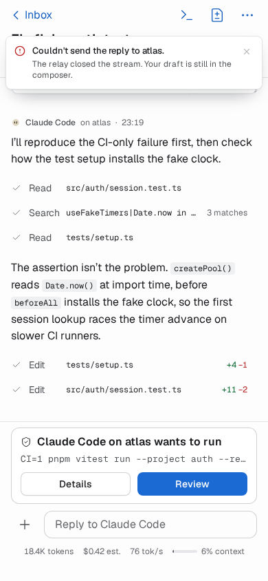  

- Component: `apps/ui/src/components/shell/Toasts.tsx:13-66`; `pushToast` / `dismissToast` at `apps/ui/src/lib/store/appStore.ts:393-414` (108 call sites).
- Fix: a Sonner wrapper in `components/ui/sonner.tsx` with Quiet native tokens and the popup shadow and motion. Desktop: bottom-right, offset to clear the composer and usage line. Phone: top-center below the safe area. De-duplicate by a stable id per message. Errors stay until dismissed, or longer than info. Hit areas are 32/44 px. Keep `pushToast`'s signature so call sites don't change.

**After: Fixed.** Toasts are Sonner: bottom-right above the approval card and composer on desktop, top-centre under the header on phone, de-duplicated, errors held for 8 s, 32/44 px close targets. (The keyboard pass found Sonner's Tab loop; see keyboard.md.)

### K2 (P1) Selects are menus styled as 24 px chips, next to 28 px inputs

`ChipSelect` (40 uses) is a Radix DropdownMenu styled as a 24 px, 12 px chip, with no typeahead or selected-value semantics. It sits beside 28 px inputs and 28 px buttons in the same rows (Longest wait vs Jitter on Auto-resume, Language on Appearance, Forge on Forges). Model pickers are native `<datalist>` comboboxes (5 places) that render OS chrome. On phone, the chips are the only small controls on screen (Usage "Global", Appearance language).

   

- Component: `apps/ui/src/components/common/ChipSelect.tsx:27-95`; `.q-chip` at `quiet.css:3259-3289`.
- `<datalist>` sites: `NewThreadDialog.tsx:590`, `HarnessSwitch.tsx:233`, `ThreadControls.tsx:157`, `SchedulesSettings.tsx:470,511`.
- Fix:
  - Selects become UI SDK Select and model pickers become UI SDK Combobox, with a shared trigger.
  - Inputs, select triggers and buttons share one control height: 32 px on desktop (28 px only inside dense rows that still give a 32 px hit area) and 44 px on phone.
  - Labels are 13 px. The chevron is a lucide 14 px icon in a reserved trailing slot.

**After: Fixed.** `ChipSelect` is built on the UI SDK Select at input height with typeahead and a reserved chevron slot, and the five datalists are now `SuggestInput`s.

### K3 (P1) There are no styled tooltips: 140 native `title` attributes do the job

`TooltipProvider` is mounted (`apps/ui/src/main.tsx:29`), but the `Tooltip` component is never used. Icon buttons, truncated text and status glyphs rely on `title=`, so tooltips:

- take about a second to appear and are drawn by the OS
- don't show shortcuts (DESIGN.md promises "tooltip with its shortcut")
- never appear for keyboard focus
- can't be captured, which is why `a-tooltip` shows nothing

 

- Component: 140 `title=` attributes in `.tsx` files, for example the footer icon buttons in `Sidebar.tsx`, the header view cluster in `ThreadHeader.tsx:115-126`, and the hosts menu rows `Sidebar.tsx:337`.
- Fix: UI SDK Tooltip with about a 300 ms open delay, instant when moving between triggers, none on touch, and label plus `Kbd` from the registry. Icon-only buttons take `aria-label` plus a tooltip. Truncated text gets a tooltip only when it actually overflows.

**After: Partly fixed.** Icon buttons and truncated text use the UI SDK Tooltip (~320 ms open, ~20 ms between triggers, shown on keyboard focus, none on touch, with the shortcut), but 105 native `title=` attributes remain, including send and attach, which keep a native title because they are disabled.

### K4 Most primitives have two implementations

| Primitive | Implementation 1 | Implementation 2 |
|---|---|---|
| Button | `.q-btn` ×279 | `<Button>` ×53 (different focus ring and radius syntax) |
| Input | `.q-input` ×59 | `<Input>` ×24 |
| Badge | `.q-badge` ×14 | `<Badge>` ×2 |
| Skeleton | `.q-skel` ×74 | `<Skeleton>` ×2 |
| Kbd | `.q-kbd` | `Kbd` (see T2) |
| Dialog | Radix `Dialog` ×24 | hand-rolled `role="dialog"` sheets ×5 |
| Popover | `common/Popover.tsx` ×5 | `.q-hostpop`, Radix menus used as popovers |

`.q-ibtn` is declared twice (`quiet.css:233` and `quiet.css:5256`). `quiet.css` is 7,153 lines, and rules for one selector are scattered: `.q-field` rules sit between unrelated `.q-ph-sheet-head` and `.q-tchip` rules at `quiet.css:4131-4187`.

 

- The hand-rolled `role="dialog"` sheets are `PhonePanelSheet.tsx:213`, `PhoneApproval.tsx:78`, `HarnessSwitch.tsx:372`, `ComposerMenu.tsx:271` and `Popover.tsx:105`.
- Fix: one implementation per component in `components/ui/`. Replace the quiet.css class as each component is ported, then delete the dead rules.

**After: Partly fixed.** Dialog, Popover, Kbd, Toast, Tooltip, Menu and Select each have one implementation, but `.q-btn` (250 uses) still sits beside `<Button>` (62), and `.q-input` (57) and `.q-skel` (74) beside their components; `quiet.css` is down from 7,153 to 6,378 lines.

### K5 Row actions mix button variants for the same kind of action

- Account & relay: "Sign out" is a ghost button with an icon, and "Manage hosts" / "Manage devices" are secondary.
- Hosts: "Disconnect" is ghost text, and "Connect" is secondary.
- Providers: "Replace" and "Remove" are ghost text.
- Forges: "Remove" is a red outline.
- Harnesses: "Update" is secondary and "Check again" is ghost with an icon.

   

- Component: `SettingsRemote.tsx` (Account, Hosts & devices), `ProxySettings.tsx`, `ForgeSettings.tsx`, `HarnessSettings.tsx`.
- Fix: one rule. Trailing row actions use the secondary small variant. Destructive actions use the destructive variant and open an Alert Dialog. Ghost is only for tertiary actions in toolbars.

**After: Fixed.** Trailing row actions use the secondary small button and removals use the destructive variant (Remove, Revoke); Forges' Remove and the Revoke, Sign out and Disconnect actions on Hosts, Account and Network access open an Alert Dialog that keeps focus (see keyboard.md).

### K6 Shortcut hints show keys that don't do anything

Acknowledge shows "A" and Keep in Working shows "P", but the bindings are ⌘⌥A and ⌘⌥P, and DESIGN.md rules out single-key shortcuts. The same command shows different hints in the row menu ("P"), the palette (Ctrl Alt P) and the header menu (none).

   

- Component: hard-coded letters at `ThreadRow.tsx:204,234,250` and `ThreadHeader.tsx:426`. Registry at `apps/ui/src/lib/keybindings.ts:195-211`.
- Fix: every hint comes from `bindingFor(id)` through the single `Kbd` (T2). There are no literal key letters in components.

**After: Fixed.** The letter hints are gone; Acknowledge shows Ctrl Alt A and every hint comes from `bindingFor`.

### K7 Disclosures use the browser's black triangle

Harnesses "Update log", Providers "Details" and the sign-in details are native `<details>` with the UA triangle (▶). The thread error "Details" uses the Quiet chevron.

   

- Component: `HarnessSettings.tsx:88`, `ProxySettings.tsx:803`, `ConnectSignIn.tsx:176`; `.q-disclosure` at `quiet.css:6169-6196`.
- Fix: UI SDK Collapsible with a 14 px lucide `ChevronRight` that rotates on open, and the trigger as an `inline-flex items-center gap-1.5` button.

**After: Fixed.** Update log, provider details and sign-in details are UI SDK Collapsibles with a 14 px chevron that rotates.

### K8 Phone screens have no shared structure

| Screen | Structure |
|---|---|
| Inbox | Large title (30 px) and a compose icon in the nav row |
| Usage | Large title under a floating 24 px "Global" chip |
| Pull requests | A 15 px title squeezed beside a 44 px "Open PR" button and a bare refresh glyph |
| MCP servers, Skills | Desktop page heads with a 24 to 30 px title and two buttons on one line; the description wraps at half width |
| Settings (Appearance) | Desktop form heading, no nav bar or back control |

     

- Component: `PhoneNav.tsx:113-118` (the shared nav and large title used by only some screens), `UsagePage.tsx:815`, `PullRequestsPage.tsx:474`, `SkillsPage.tsx:140`, `McpPage.tsx:578`, `SettingsPage.tsx`.
- Fix: one phone screen template:
  - a nav bar with 44 px targets (back, title, up to two actions)
  - a large title on top-level tab screens
  - a 16 px gutter
  - page actions in the nav bar or the bottom third, not beside the title

**After: Partly fixed.** Usage, Pull requests, MCP and Skills share one phone screen header with a 16 px gutter and actions in the nav bar, but phone Settings pages still open on a desktop form heading with no nav bar or back control.

### K9 On phone, menus and dialogs use the desktop forms

The thread actions menu opens as a desktop dropdown with 30 px rows, including the desktop-only "Toggle theme Ctrl+Shift+L". New thread is a centred modal stretched to the screen with a hairline border, not a sheet.

   

- Component: `ThreadHeader.tsx:181-265` (shared `threadMenu`); `dialog.tsx:41-73`; `NewThreadDialog.tsx`.
- Fix: on phone, dialogs render as a UI SDK Drawer (bottom sheet with grabber, header, 44 px actions in the bottom third). Long menus render as an action sheet in a Drawer. Hide desktop-only items (theme shortcut, Open in IDE) on phone.

**After: Partly fixed.** On phone, dialogs are UI SDK Drawer bottom sheets and menus become action sheets on touch screens with 44 px rows (the headless shot has no touch, so it still shows the dropdown); the composer's @ / slash suggestions are still hand-rolled because they anchor to the caret.

### K10 Icons: wrong choices, text glyphs instead of icons, and many sizes

- Wrong choices: see A1.
- Text glyphs: "‹" as the phone back icon (`ThreadHeader.tsx:286`) and "+" in the settings nav (`Sidebar.tsx:1022`).
- Sizes: `q-icon s12` ×100, `s14` ×217, bare `q-icon` (16) ×44, `s16` ×7 (no rule exists), `s18` ×3, `s20` ×4, `s22` ×17, `size={14}` ×35, `size-[15px]` ×2 (toasts), `size-3.5` ×6, `size-3` ×6.
- Stroke widths: 1.5 ×289, 2 ×28, 1.75 ×6.
- Default sizes: 51 lucide icons have no size and inherit a wrapper default (`size-4` in menus and buttons).

 

- Fix: lucide only, 14 px in dense UI (rows, menus, chips, toasts), 16 px default, 22 to 24 px phone nav and tab bar, stroke 1.5 everywhere (2 only for tiny check glyphs). Set the size through the component slot, not per call site.

**After: Partly fixed.** The "‹" and "+" glyphs are lucide icons and dense icons are 14 px, but "→" is still a text glyph between branch names (PR list and detail), the skill diff sizes and a terminal key, and 9 icons use stroke 1.75 or 2.5.

### K11 Eighteen radii, and popups use four of them

`border-radius` values in `quiet.css` are 6 ×40, 8 ×25, 12 ×19, 4 ×12, 2 ×10, 50% ×8, 3 ×5, 14 ×5, 5 ×4, 999 ×2, and one each of 1, 9, 10, 16 and 20 px. Popups alone use 8 (menus), 10 (toasts), 12 (`.q-pop`, hosts menu, dialogs) and 14 (palette). The token names don't match the brief: `tokens.css:243-247` defines xs 4, sm 6, md 8, lg 12, xl 14, but the brief has sm 4, md 6, lg 8, xl 12. Renaming changes every `rounded-md` (15 uses) from 8 to 6 px.

   

- Fix: adopt the brief's four radii. Controls use `md` (6), popups and toasts `lg` (8), dialogs, sheets and the palette `xl` (12), and dots and switches `full`. Re-check each `rounded-md` call site when the names change.

**After: Fixed.** Radii are collapsed onto 4/6/8/12 plus full; every popup uses 8 and dialogs, sheets and the palette 12.

### K12 Popup elevation is built three ways

| Surface | Elevation |
|---|---|
| Dropdown menus | 1 px `border-line` plus `shadow-[var(--shadow-overlay-low)]` |
| `.q-pop`, hosts menu, toasts | `--sh-pop` plus an inset 1 px hairline, no border |
| Dialogs | `--sh-dlg` plus an inset hairline |
| Segmented thumb, secondary button | their own hand-written shadows |

`--sh-pop` and `--shadow-overlay-low` are aliases of each other.

   

- Component: `dropdown-menu.tsx:34`, `quiet.css:1000-1012`, `quiet.css:3507-3516`, `Toasts.tsx:23`, `dialog.tsx:56`, `quiet.css:300-308`, `quiet.css:152-157`; tokens at `tokens.css:52-53,249-252`.
- Fix: two tokens, `shadow-popup` and `shadow-modal`, each paired with a 1 px `border-border`. Every popup (menu, select, popover, tooltip, toast) uses the first, and dialogs and sheets use the second. Delete the aliases.

**After: Fixed.** There are two elevation tokens, `shadow-popup` and `shadow-modal`, each with a 1 px border; the `--sh-*` and `--shadow-overlay-*` aliases are gone.

### K13 Sidebar settings counts mean different things

Hosts & devices shows a count of hosts (4), MCP servers and Skills show item counts (5, 9), but Harnesses shows the number of available updates (3 on most pages, 2 on the Harnesses page) in the same muted style.

 

- Component: `Sidebar.tsx:993-1007`.
- Fix: counts are always item counts. Show "update available" as a separate small marker with a tooltip, or drop it from the nav.

**After: Fixed.** Harnesses shows an update marker icon instead of a count, so the nav counts are always item counts.

---

## Accessibility

### X1 Hit targets are below 32 px on desktop and 44 px on phone

| Control | Size |
|---|---|
| `.q-btn` | 28 |
| `.q-ibtn` | 28 |
| `.q-seg > button` | 24 |
| `.q-chip` / `ChipSelect` | 24 |
| `.q-switch` | 30 × 18 |
| `.q-nav` | 28 |
| `.q-set-subrow` | 26 |
| Row Acknowledge buttons | 24 |
| PR badge button | about 20 |
| Toast close | 22 |
| Dialog close | a 16 px icon with no padding |

On phone, the only controls enlarged for touch are `.q-att-x`, `.q-turn-menu` and `.q-seg-choice`. Phone menu items stay 30 px, phone selects are 24 to 28 px, and the PR list's refresh is a bare 18 px icon.

   

- Component: `quiet.css:130-410`, `quiet.css:666-678`, `quiet.css:734-745`, `quiet.css:1270-1279`, `quiet.css:3259-3273`; coarse-pointer rules only at `quiet.css:1699-1708,1770-1784`; `dialog.tsx:66-72`; `Toasts.tsx:56-64`.
- Fix: a control-size token per density. Desktop hit areas are at least 32 px (the visible control can be 28 inside a 32 px hit box). Phone and `(pointer: coarse)` controls are at least 44 px, applied in the components rather than page by page.

**After: Partly fixed.** Buttons, Select triggers (28 px, and the 24 px compact size), menu items and toast/dialog close buttons have 32 px hit areas (44 px on touch), with no overlap on any settings page or in the New thread dialog. Still open: the settings nav rows are 28 px (26 px sub-rows) with no hit-area extension, and the 28 px `Input` can't take the `hit-area` utility, because an `<input>` has no `::after`; it needs a wrapper or a taller field (phone fields are already 44 px).

### X2 Composite widgets are hand-rolled with ARIA roles and mostly no arrow keys

36 files declare composite roles themselves:

| Role | Count |
|---|---|
| `tab` | 28 |
| `tablist` | 15 |
| `switch` | 16 |
| `radiogroup` | 7 |
| `radio` | 5 |
| `menu` | 4 |
| `menuitem` | 5 |
| `menuitemradio` | 2 |
| `listbox` | 3 |
| `option` | 4 |
| `dialog` | 5 |
| `tree` | 1 |
| `treeitem` | 2 |
| `toolbar` | 1 |

Of the 23 files that declare tablist, radiogroup, menu, listbox or tree, 18 have no arrow-key handling in the file. Examples: `StateTabs.tsx:34`, `RightPanel.tsx:40`, `UsagePage.tsx:150,172,192`, `PullRequestsPage.tsx:502,1337`, `TabStrip.tsx:29`, `WorkspaceFiles.tsx:268`, `ThreadControls.tsx:174,201`, and the hosts menu at `Sidebar.tsx:313`, which is a `role="menu"` holding non-item content inside a `role="dialog"` popover.

   

- Fix: map each one to the UI SDK component:
  - Tabs for the right panel, PR and terminal tabs
  - Segmented Control for the `.q-seg` groups
  - Switch, Radio Group, Checkbox
  - Menu for the hosts and thread-control menus
  - Listbox or Combobox for the composer menu
  - Tree for workspace files
  - Toolbar for the terminal key bar
  - Drawer for the phone sheets

  After the port, no component sets these roles by hand.

**After: Partly fixed.** Tabs, Segmented Control, Switch, Tree, Toolbar, Menu, Select and Drawer replace the hand-rolled roles, but native checkboxes and radios remain in 11 files (about 10 dialogs), two `role="radiogroup"` groups (Access, MCP conflicts) and the composer `listbox`/`option` and harness switch `dialog` are still hand-rolled, and the editor/terminal close buttons sit inside their tablists.

### X3 Row actions can't be reached by keyboard, and rows nest buttons inside `role="option"`

The row "More" button has `tabIndex={-1}`, so keyboard users can't open the row menu. Done rows put Acknowledge and Resume buttons inside an element with `role="option"`, which screen readers flatten.

 

- Component: `ThreadRow.tsx:132-145` (option), `ThreadRow.tsx:168-207` (nested buttons), `ThreadRow.tsx:217` (`tabIndex={-1}`).
- Fix: use the UI SDK list pattern with a row-level menu key (context menu key / Shift+F10) and the row menu as the single action surface. Visible inline actions sit outside the option element.

**After: Fixed.** The row's Actions button is in the Tab order, Shift+F10 on a focused row opens the same menu, and focus returns to the row on Esc (keyboard.md); the inline Done-row buttons are gone.

### X4 Truncated text has no way to see the full value

There are 56 truncation sites in TSX (`truncate`, `text-ellipsis`, `textOverflow`), none with a `title` on the same element, plus 51 `text-overflow: ellipsis` rules in `quiet.css`. Examples:

- thread row title (`ThreadRow.tsx:152`)
- chip select label (`.q-chip` `max-width: 220px`)
- the Skills banner "3 skills are in your harne…" on phone
- subagent titles ("Shrink the retry fixture so the timer can…")
- right panel diff hunk headers

   

- Fix: a `TruncatedText` helper that adds the K3 tooltip only when the text overflows. Primary labels, such as the phone Skills banner, should wrap instead of truncating.

**After: Partly fixed.** `TruncatedText` adds a tooltip only on overflow (row titles, header title and branch, model id, menu labels), but the phone Skills banner still truncates ("3 skills are in your harness fol…") instead of wrapping.

### X5 The New thread footer shows a missing-glyph box instead of ↵

The footer hint reads "Ctrl ▯ start". `<Kbd>{MOD} {ENTER}</Kbd>` passes an array of children, so `Kbd` skips its SVG glyph path and the `aria-label`. The raw "↵" then renders in Geist Mono, which has no glyph for it.

 

- Component: `NewThreadDialog.tsx:873-875`; `Kbd.tsx:110-121`.
- Fix: the single `Kbd` (T2) takes a binding id or a key array and always draws glyphs as SVG with an accessible label.

**After: Fixed.** The New thread footer shows Ctrl and an SVG ↵ glyph with an accessible label.

---

## Component inventory

| Component | Where it's used | Before the pass | Target | Status now |
|---|---|---|---|---|
| Button | 279 `.q-btn`, 53 `<Button>` | `.q-btn` (quiet.css:130) and shadcn wrapper `ui/button.tsx` on Radix Slot | One shadcn-styled `Button` (cva variants, `data-slot`) with UI SDK composition instead of Radix Slot | Partly: `ui/button.tsx` is the one cva Button on UI SDK composition, but 250 `.q-btn` uses remain (K4) |
| Icon button | 46 `.q-ibtn` | quiet.css class (declared twice) | `Button size="icon"` + UI SDK Tooltip | Partly: `.q-ibtn` (still declared twice in `quiet.css`) has 32/44 px hit areas and is wrapped in the UI SDK Tooltip (`Tip`); not yet `Button size="icon"` |
| Input | 59 `.q-input`, 24 `<Input>` | quiet.css class and shadcn wrapper `ui/input.tsx` | shadcn-styled `Input` inside UI SDK `Field` | Partly: `ui/input.tsx` on UI SDK; 57 `.q-input` remain |
| Textarea | composer, dialogs, 4 `<Textarea>` | shadcn wrapper `ui/textarea.tsx`, composer CSS | shadcn-styled `Textarea` in `Field` | Done: `ui/textarea.tsx`; the composer keeps its own CSS |
| Number input | Auto-resume jitter, schedules | `q-input type="number"` | UI SDK Number Input | Open: still `q-input type="number"` |
| Select | 40 `ChipSelect` | hand-rolled chip over Radix DropdownMenu | UI SDK Select | Done: UI SDK Select (`ui/select.tsx`); `ChipSelect` is built on it |
| Combobox | 5 `<datalist>` model pickers | native datalist | UI SDK Combobox | Done: `SuggestInput` (`ui/autocomplete.tsx`) replaces all 5 datalists |
| Menu | 15 Radix menus; hosts menu; thread controls; harness switch list | shadcn wrapper `ui/dropdown-menu.tsx` (Radix); hand-rolled `role="menu"` | UI SDK Menu / Trigger Menu | Done: UI SDK Menu (`ui/menu.tsx`) for every menu incl. hosts; the composer @ / slash menu stays hand-rolled (K9) |
| Dialog | 24 `<Dialog>` in 15 files | shadcn wrapper `ui/dialog.tsx` (Radix) | UI SDK Dialog (Drawer on phone) | Done: UI SDK Dialog (`ui/dialog.tsx`), Drawer on phone (`ui/sheet.tsx`) |
| Confirm dialog | 8 `<ConfirmDialog>` | `common/ConfirmDialog.tsx` on Radix Dialog | UI SDK Alert Dialog | Done: UI SDK Alert Dialog (`ui/alert-dialog.tsx`); three inline confirms remain (keyboard.md) |
| Phone sheet | panel sheet, approval, harness switch, composer menu | hand-rolled `.q-ph-sheet` with `role="dialog"`; `ui/sheet.tsx` (Radix) unused | UI SDK Drawer | Partly: UI SDK Drawer for panel sheet and dialogs; harness switch and composer sheets still hand-rolled |
| Popover | 5 `<Popover>`, hosts menu card | hand-rolled `common/Popover.tsx` (absolute, no portal, no collision handling) | UI SDK Popover | Done: UI SDK Popover (`ui/popover.tsx`) |
| Tooltip | 140 `title=` | native title; `ui/tooltip.tsx` (Radix), Provider only | UI SDK Tooltip | Partly: UI SDK Tooltip (`ui/tooltip.tsx`, `Tip`, `TruncatedText`); 105 native `title=` remain (K3) |
| Command palette | `CommandPalette.tsx` | shadcn wrapper `ui/command.tsx` on cmdk | UI SDK Command | Done: UI SDK Command (`ui/command.tsx`); cmdk removed |
| Tabs (underline) | right panel, PR, terminal, IDE tabs, phone panel sheet | hand-rolled `role="tab"`; `ui/tabs.tsx` (Radix) unused | UI SDK Tabs | Done: UI SDK Tabs (`ui/tabs.tsx`) |
| Segmented control | 18 `.q-seg` | quiet.css with `role="tablist"` or `"radiogroup"` | UI SDK Segmented Control | Done: UI SDK Segmented Control (`ui/segmented-control.tsx`) and segmented Tabs |
| Switch | 21 `.q-switch` in 16 files | quiet.css with `role="switch"` | UI SDK Switch | Done: UI SDK Switch (`ui/switch.tsx`) |
| Checkbox | 12 native inputs in 8 files | native `type="checkbox"` | UI SDK Checkbox | Partly: UI SDK Checkbox (`ui/checkbox.tsx`) exists; 12 native checkboxes remain (X2) |
| Radio group | 7 `role="radiogroup"` | hand-rolled | UI SDK Radio Group | Partly: UI SDK Radio Group (`ui/radio-group.tsx`) in Add project; 2 hand-rolled groups and 4 native radios remain |
| Tree | workspace files | hand-rolled `role="tree"` | UI SDK Tree | Done: UI SDK Tree (`WorkspaceFiles.tsx`) |
| Toolbar | terminal key bar | hand-rolled `role="toolbar"` | UI SDK Toolbar | Done: UI SDK Toolbar (terminal key bar) |
| Collapsible | 4 `<details>` | native details plus `.q-disclosure` | UI SDK Collapsible | Done: UI SDK Collapsible (`ui/collapsible.tsx`) |
| Resizable | sidebar and panel resizers | hand-rolled `shell/Resizer.tsx` | UI SDK Resizable | Done: UI SDK Resizable (`ui/resizable.tsx`) |
| Scroll area | native overflow | `ui/scroll-area.tsx` (Radix) unused | Native overflow, or UI SDK Scroll Area where custom scrollbars are needed | Done: UI SDK Scroll Area (`ui/scroll-area.tsx`) |
| Separator | `.q-vsep`, hairlines | `ui/separator.tsx` (Radix) unused | UI SDK Separator | Done: UI SDK Separator (`ui/separator.tsx`) |
| Toast | 108 `pushToast` calls | hand-rolled `shell/Toasts.tsx` plus store | Sonner via `components/ui/sonner.tsx` | Done: Sonner (`ui/sonner.tsx`, `lib/toast.ts`) |
| Badge | 14 `.q-badge`, 2 `<Badge>` | quiet.css and `ui/badge.tsx` | shadcn-styled `Badge` (cva) | Partly: cva `ui/badge.tsx`; 14 `.q-badge` remain |
| Kbd | palette, buttons, menus | `common/Kbd.tsx` and `.q-kbd` | One shadcn-styled `Kbd` fed by the keybinding registry | Done: one `ui/kbd.tsx` fed by the registry |
| Skeleton | 74 `.q-skel`, 2 `<Skeleton>` | quiet.css and `ui/skeleton.tsx` | shadcn-styled `Skeleton` | Partly: `ui/skeleton.tsx`; 74 `.q-skel` remain |
| Thread list | inbox rows | hand-rolled `role="option"` rows | UI SDK Listbox (rows stay custom-styled) | Partly: rows keep a hand-rolled `role="option"` list, now with a row-level menu (Shift+F10) outside the option |
| Table | 13 `.q-tbl` | quiet.css | shadcn-styled table classes (no behaviour needed) | Open: still `.q-tbl` |
| Empty state | 5 `<EmptyState>` | `common/EmptyState.tsx` | Keep; restyle with tokens | Done: kept, restyled with tokens |

Before the pass, Radix was imported only by the eight `components/ui/` wrappers, and cmdk only by `ui/command.tsx`. Once the targets above land, `@radix-ui/*` (7 packages) and `cmdk` can be removed from `apps/ui/package.json`. nothing imported `@ui-sdk/*` or `sonner` yet. **Now:** no source file imports `@radix-ui/*` or `cmdk`, both are gone from `apps/ui/package.json`, and the components above import `@ui-sdk/*` and `sonner`.

---

## Code sweep

Counts cover `apps/ui/src` `.tsx` files, excluding tests, unless a row names a CSS file. Line-based greps undercount multi-line JSX and multi-line CSS values.

| Check | Count | Examples |
|---|---|---|
| Arbitrary Tailwind px values (`-[Npx]`) | 107 in 29 files | `text-[12px]` ×24, `text-[12.5px]` ×9, `text-[11.5px]` ×8, `rounded-[6px]` ×5, `max-w-[560px]` ×5, `size-[15px]` ×2. Most: `DelegateDialog.tsx` 12, `SkillDialogs.tsx` 10, `McpDialogs.tsx` 10 |
| Other arbitrary values (`-[var(…)]`, `color-mix`, `calc`) | 97 | `bg-[var(--bg-raised)]`, `shadow-[var(--sh-pop),inset_…]` in `Toasts.tsx`, `button.tsx` |
| Inline `style={{…}}` | 790 in 65 files; 551 set a size or spacing property on the same line | `fontSize` ×185, `height` ×132, `width` ×99, `margin` ×95, `marginTop` ×76, `gap` ×70. Most: `UsagePage.tsx` 61, `PullRequestsPage.tsx` 54, `SettingsRemote.tsx` 48 |
| Inline `maxWidth` on page containers | 6 values | 860, 880, 920, 940 (see A2); field widths 100–360 (see A3) |
| Dialog widths | 9 values | 420, 460, 520, 560, 600, 620, 640, 680, 700 |
| Hand-rolled ARIA roles UI SDK should own | 36 files; 99 attributes | `tab` 28, `switch` 16, `tablist` 15, `radiogroup` 7, `menuitem` 5, `radio` 5, `dialog` 5, `menu` 4, `option` 4, `listbox` 3, `treeitem` 2, `menuitemradio` 2, `tree` 1, `toolbar` 1 |
| Composite-role files without arrow-key handling | 18 of 23 | `StateTabs.tsx`, `RightPanel.tsx`, `UsagePage.tsx`, `TabStrip.tsx`, `WorkspaceFiles.tsx` |
| Radix imports | 8 files (all in `components/ui/`) | dialog, sheet, dropdown-menu, tabs, tooltip, scroll-area, separator, slot |
| cmdk imports | 1 | `components/ui/command.tsx` |
| `@ui-sdk/*` / `sonner` imports | 0 / 0 | |
| Icon size classes | 13 variants | `q-icon s14` 217, `s12` 100, bare `q-icon` 44, `s22` 17, `s16` 7 (no rule), `s20` 4, `s18` 3, `s24` 2; `size={14}` 35, `size={16}` 7, `size={18}` 5, `size={12}` 4; `size-4` 9, `size-3.5` 6, `size-3` 6, `size-[15px]` 2; 51 icons with no size |
| Icon stroke widths | 3 | 1.5 ×289, 2 ×28, 1.75 ×6 |
| Font sizes in CSS | 14 values | 12px ×115, 13 ×40, 14 ×38, 11.5 ×19, 11 ×14, 12.5 ×13, 16 ×11, 15 ×10, 17 ×9, 20 ×7, 22 ×4, 13.5 ×3, 30 ×2, 24 ×1 |
| Font sizes inline (`fontSize`) | 9 values | 12 ×149, 11.5 ×16, 12.5 ×10, 13 ×9, 17 ×6, 11 ×6, 14, 13.5, 10.5 |
| Border radii in CSS | 18 values | 6px ×40, 8 ×25, 12 ×19, 4 ×12, 2 ×10, 50% ×8, 3 ×5, 14 ×5, 5 ×4, 999 ×2, 1/9/10/16/20 ×1 |
| Radii in TSX | 6 utilities plus inline | `rounded-md` 15, `rounded-sm` 11, `rounded` 9; inline `borderRadius` 4, 6, 8, 12, 14, 50% |
| Shadow tokens and hand-written shadows | 2 tokens, 2 aliases, 4+ hand-written | `--sh-pop` (5 CSS uses), `--sh-dlg` (3), aliases `--shadow-overlay-low/high`; hand-written on `.q-seg` thumb, `.q-btn.secondary`, `.q-switch::after`, `button.tsx` secondary |
| Animations referencing undefined tokens | 10 `var(--dur-fast/base/slow)` references, plus `--dur-instant` | `globals.css:184-215`, `dialog.tsx:66` |
| Icon+text rows aligned by baseline | 8 CSS rules | `.q-row-l1`, `.q-row-l2`, `.q-hp-h`, `.q-sec-h`, `.q-queued-h` |
| Flex containers with no `align-items` | 40 CSS rules; 43 inline `display: "flex"` | `AccessSettings.tsx:161`, `ProxySettings.tsx:380,754,1002` (not all hold icon+text) |
| Icon nudges with `vertical-align` | 6 CSS rules | `quiet.css:262,556,571,2632,2953` |
| Missing or weak `focus-visible` | 1 weak ring; 1 global radius override; 8 `outline-none` without a `focus-visible` style in the same class string (all in `components/ui/`, which rely on Radix data attributes) | `button.tsx:8`, `tokens.css:295-299`, `dropdown-menu.tsx:62,80,111,183` |
| Title-case labels in the en catalogue | 1 genuine case | `pairing.hostsPane.pairingLater` "Pairing arrives in Phase 2". The other 10 flagged strings contain proper nouns ("Edit from here", "Changes panel", "Linear team"). The catalogue is otherwise sentence case |
| Truncation without a title or tooltip | 56 TSX sites (0 with `title` on the same element); 51 CSS ellipsis rules | `ThreadRow.tsx:152`, `.q-chip-label`, `.q-sub-row .t` |
| Hit targets under 32 px (desktop primitives) | 11 primitives | See X1. Under 44 px on phone: menu items (30), ChipSelect (24), dialog selects (28), PR refresh (18) |
| Native controls UI SDK should replace | 12 checkboxes, 4 radios, 5 datalists, 4 `<details>` | `GitActionsDialog.tsx`, `McpDialogs.tsx`, `HarnessSettings.tsx:88` |
| Spinners | 24 | `PreviewPanel.tsx:307`, `DiffView.tsx:514`, `ConnectSignIn.tsx:215` |

---

## Open design questions

1. **Type sizes outside the six-step scale.** DESIGN.md specifies sizes the brief's scale doesn't have: a 15/600 thread title and page head, 17 px phone sheet titles, a 30 px phone large title and 11 px phone tab labels. Options: map them to 16, 16, 24 and 12, or allow a phone-only `display` size (30) and keep 11 px for tab labels as an iOS convention.
2. **Control outline contrast.** Inputs are outlined at about 1.5:1 and off switches at about 1.25:1 in both themes (C2), and the dark selected segment is 1.15:1 (C1). Fixing them means a stronger `--input` / off-track neutral derived from the Quiet native graphite. Is a slightly darker outline (≥ 3:1) acceptable within the approved palette, or should fields stay at hairline strength and rely on fill and focus instead?
3. **Switch-on colour.** Under "blue means you", accent appears only where the user is needed, but every switch that is on is filled with accent. That makes Skills (four switches per row) and MCP "Where it runs" the bluest screens in the app. Keep accent for switch-on (the DESIGN.md rule), or use `fg` for switches in dense tables and keep accent for one-off settings?
