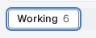
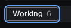
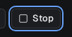
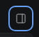

# Keyboard-only check

The verification pass for the UI refinement. Every shared surface was driven with the keyboard only: Tab to the trigger, open it, move with arrows or typeahead, act with Enter or Space, close with Escape, and check that focus lands back where it started with a visible ring. One pass per surface. The pointer is used in one place only, to time the tooltip's hover delay.

Run it against a dev server in mock mode:

```sh
cd apps/ui
bun run dev -- --port <port>
H4RN_KB_OUT=<dir> node scripts/keyboard-audit.mjs http://127.0.0.1:<port>
# One surface while iterating:
H4RN_KB="file tree" node scripts/keyboard-audit.mjs http://127.0.0.1:<port>
```

It prints the table below and exits 1 if any surface fails. Final run: **38 of 40 surfaces pass**. The two failures are listed under "Failures to fix".

## Results

| Surface | Steps | Result | Notes |
|---|---|---|---|
| New thread dialog | Tab to New thread, Enter, Tab ×20, Esc | Pass | starts on textarea "" |
| Shortcuts dialog | Tab to Right panel, Ctrl+/, Tab ×20, Esc | Pass | starts on dialog "Keyboard shortcuts" |
| Rename dialog | Thread actions, R…, Enter, Esc | Pass | starts on input "Thread title" |
| Git actions dialog | Thread actions, C…, Enter, Esc | Pass | starts on textarea "Commit message" |
| Guest share dialog | Thread actions, S…, Enter, Esc | Pass | starts on dialog "Share with guest" |
| Delegate dialog | Right panel, Subagents tab, Tab to Delegate, Enter, Esc | Pass | starts on textarea "" |
| Add project dialog | Tab to Add project, Enter, Tab ×20, Esc | Pass | starts on input "Folder path" |
| Add MCP server dialog | MCP page, Tab to Add MCP server, Enter, Esc | Pass | starts on input "" |
| Edit MCP server dialog | MCP page, Tab to Edit, Enter, Esc | Pass | starts on input "" |
| Skill import dialog | Skills page, Tab to Find existing, Enter, Esc | Pass | starts on input "" |
| Skill add dialog | Skills page, Tab to Add skill, Enter, Esc | Pass | starts on input "" |
| Confirm dialog (remove forge account) | Forges, Tab to Remove, Enter, Tab ×20, Esc | Pass | starts on button "Cancel" |
| Inline confirm (revoke device) | Hosts, Tab to Revoke, Enter, check focus | Fail | the inline confirm replaces the button and focus drops to the body; no Alert Dialog |
| Thread actions menu | Tab to Thread actions, Enter, ArrowDown, typeahead S, Esc | Pass | typeahead "s" → Settle now |
| Row actions menu (Shift+F10) | Tab to a thread row, Shift+F10, ArrowDown, Esc | Pass |  |
| Row actions menu (button) | Tab to the row's Actions button, Enter, ArrowDown, Esc | Pass |  |
| Hosts menu | Tab to the hosts button, Enter, ArrowDown, Esc | Pass |  |
| Project sort menu | Tab to Sort projects, Enter, ArrowDown, Esc | Pass |  |
| Project actions menu | Tab to <project> actions, Enter, ArrowDown, Esc | Pass |  |
| Turn picker | Right panel, Tab to Turn, Enter, ArrowDown, Esc | Pass | trigger is button; 1 enabled item(s) |
| Composer model chip | Tab to the model chip, Enter, Tab to Model, ArrowDown, Esc ×2 | Pass | chip "claude-sonnet-5-5" |
| Select (settings) | Tab to Longest wait, Enter, ArrowDown, Enter, check value | Pass | trigger "Longest wait: 6 hours" |
| SuggestInput (New thread model) | New thread, Tab to Model, ArrowDown ×2, Esc, Esc | Pass |  |
| Command palette | Tab to Search or run, Enter, type, ArrowDown, Esc | Pass | first Esc cleared the query, second closed (UI SDK Command behaviour) |
| Command palette (Ctrl+K) | Ctrl+K from the composer, Esc | Pass |  |
| Segmented control (inbox state) | Tab to Working, ArrowRight, check Done | Pass | Working → Done (aria-checked=true) |
| Tabs (Thread / IDE) | Tab to Thread tab, ArrowRight, Enter or auto-select | Pass |  |
| Tabs (right panel) | Right panel, Tab to Changes, ArrowRight ×3, Home | Pass | Changes → Subagents → Home: Changes |
| Switch | Appearance, Tab to Terminal switch, Space ×2 | Pass | true → false → true |
| Segmented control (color scheme) | Appearance, Tab to the scheme radios, ArrowRight | Pass | Light → Dark |
| File tree | Right panel, Files tab, Tab into tree, ArrowDown, ArrowRight, ArrowLeft | Pass | api → src; folder expanded false → true |
| Resizer (sidebar) | Tab to Resize sidebar, ArrowRight ×3, check width | Pass | width 288 → 336, valuenow 20 → 23, focus line in the ring colour |
| Settings form (Forges) | Tab through Forge select, Base URL, Token, Add account | Pass | Forge: GitHub → Forge base URL → Forge token |
| Settings nav | Tab into the settings nav, Enter on Appearance | Pass |  |
| Toaster | Tab past the last control into the toast, then Tab again | Fail | after Dismiss, Tab went to combobox "Interface language: System" (focus-visible false); Tab loops back into the toast (Sonner refocuses the last element on blur) |
| Tooltip delay | Hover Right panel, time until visible; move to Toggle terminal | Pass | first 318 ms, next 25 ms (pointer used only to time hover) |
| Tooltip on keyboard focus | Tab to Right panel, wait | Pass |  |
| No tooltip on touch | hasTouch context, tap Right panel twice | Pass |  |
| Focus ring screenshot (light) | Tab to Working segment, Stop button, Right panel; screenshot each | Pass | segment ring yes; stop ring yes; icon-button ring yes |
| Focus ring screenshot (dark) | Tab to Working segment, Stop button, Right panel; screenshot each | Pass | segment ring yes; stop ring yes; icon-button ring yes |

Notes on the table:

- "starts on dialog" (Shortcuts, Guest share): those dialogs have no field, so UI SDK focuses the dialog itself. Tab moves into it and stays trapped.
- The shortcuts sheet opens from anywhere except a text field: `shortcuts.open` is bound with `inInputs: false`, so Ctrl+/ in the composer types a slash. That's by design (see the sheet's own copy).
- Command palette: after typing, the first Escape clears the query and the second closes. That's the documented UI SDK Command behaviour. With an empty query one Escape closes, and focus returns to the trigger either way.
- Turn picker: the mock thread has one turn, so the menu has a single enabled item. It opens with Enter and closes with Escape, and focus returns to the trigger.
- Tooltips open after about 320 ms, move between triggers in about 20 ms, also open on keyboard focus, and never open on tap in a `hasTouch` context.

## Focus rings

Each control was focused with Tab and captured in light and dark.

| Control | Light | Dark |
|---|---|---|
| Segmented control (Working) |  |  |
| Secondary button (Stop) |  |  |
| Icon button (Right panel) |  |  |

## Fixed during this pass

| Commit | Problem | Fix |
|---|---|---|
| `f7e6d140` | Segmented controls, tabs, switches, checkboxes, radios, collapsibles, dialog close and `Button` showed **no focus ring**. Tailwind v4's `outline-none` sets `--tw-outline-style: none`, and `focus-visible:outline-2` only sets the width. | Added `focus-visible:outline-solid` in the 14 files, plus `src/components/ui/focus-ring.test.ts`, which fails if the pair comes back without it. |
| `a7e1a683` | ArrowRight on the Thread/IDE tabs switched the view and **dropped focus to the body**, because each view mounts its own switch. | The switch that mounts next focuses its selected tab when the change came from the tab list. Test in `ThreadHeader.dom.test.tsx`. |
| `16bae384` | The settings nav group headers still shrank 3–6 px when the MCP list opened (A6). | `.setnav .q-side-h` is `flex: none`. |
| `d7f2e628` | With the right panel open, the header's provenance line squeezed the harness name to zero width. | The branch shrinks first, then the harness name ellipsizes, with the full name in its title. |

## Failures to fix

Bigger than a small fix, so left for a follow-up:

1. **The toaster traps Tab.** After the toast's Dismiss button, Tab moves focus back to the element that was focused before the toast (without `:focus-visible`), and the next Tab goes into the toast again. So a keyboard user can't Tab past an open toast to wrap around the page. Shift+Tab still works, and dismissing the toast ends the loop. Error toasts are held for 8 s, so this happens often in practice. The cause is upstream: Sonner's list `onBlur` refocuses `lastFocusedElementRef` whenever focus leaves the toaster (`sonner/dist/index.mjs`, `onBlur`). Options: move the toaster before the main content in the DOM, wrap it so leaving it forward goes to the start of the page, or ask upstream for an opt-out.
2. **Inline confirms drop focus, and there's no Alert Dialog.** Revoke on Settings → Hosts & devices (`NetworkAccess.tsx:241-270`), the device row's Remove in `SettingsRemote.tsx:~612` and the sign-in Remove in `ConnectSignIn.tsx:262` replace the button with an inline "Cancel / Revoke" pair. The focused button unmounts and focus falls to `<body>`. K5 says destructive actions open an Alert Dialog, as Forges' Remove already does. Port these three to `ConfirmDialog`, which also returns focus to the trigger.
