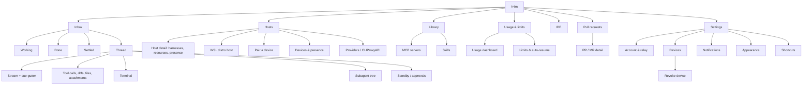
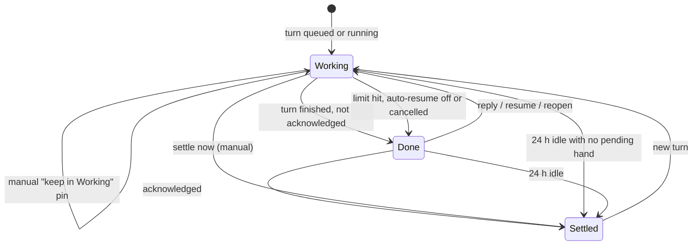
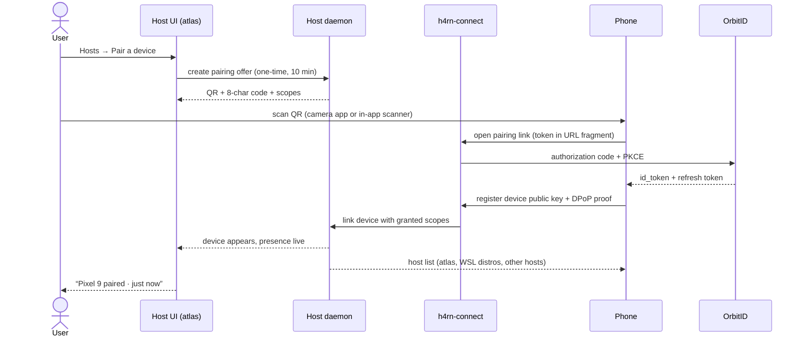
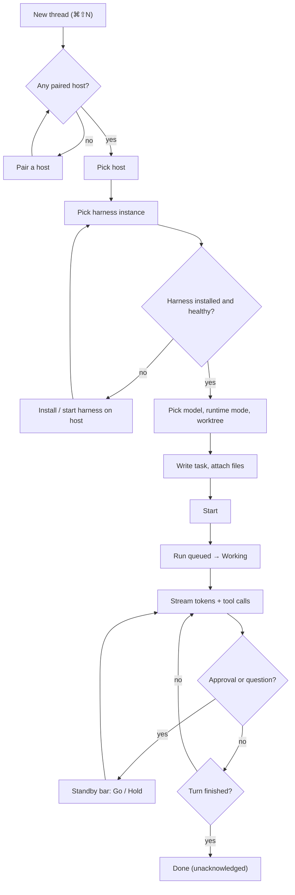
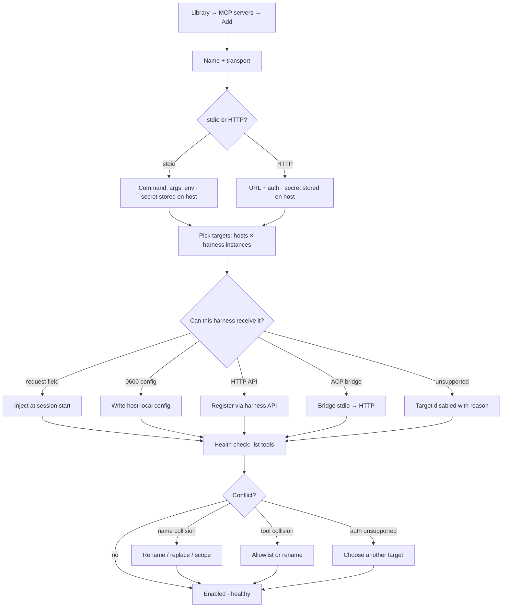
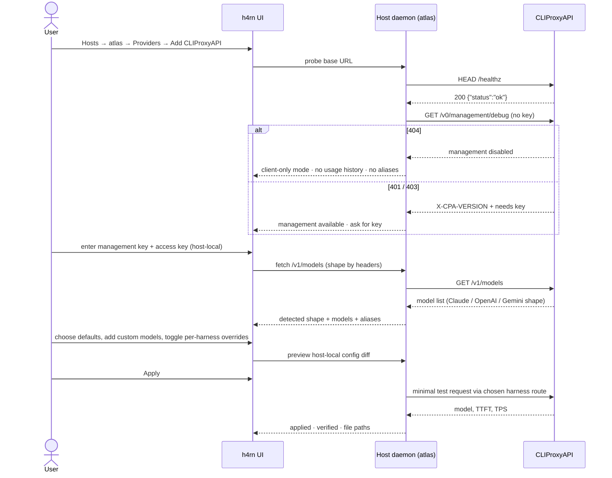
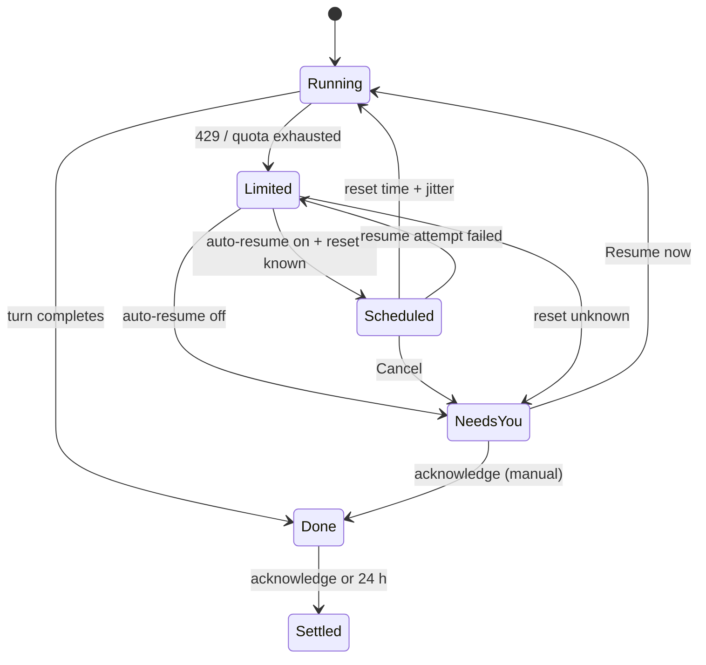
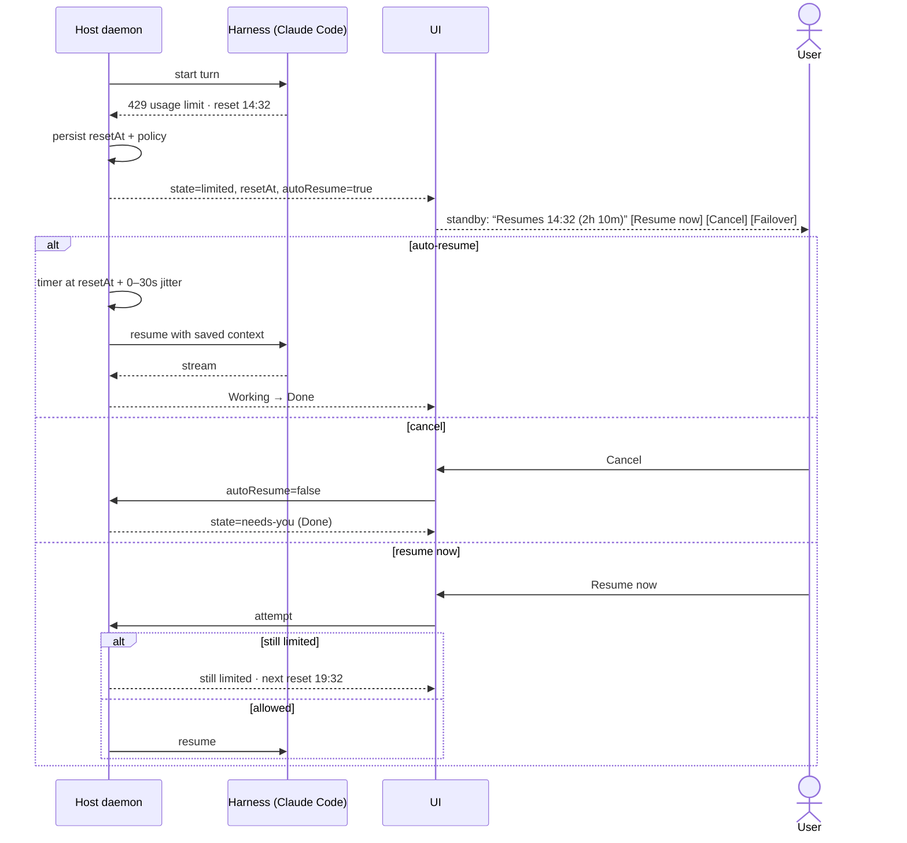

# h4rn UX

**Status:** greenfield specification, implemented in `apps/ui` as the Quiet-native direction. Wireframes below are structural, not pixel comps; they keep the original flow labels where a sketch needs a named region, but the shipped surface uses the visual language in the next section. Tokens, type and component rules live in [`DESIGN.md`](../DESIGN.md); product truth lives in [`PRODUCT.md`](../PRODUCT.md).

**Mode:** Operate. The user is in a task; familiarity is a feature. The product-specific grammar is limited to the thread lifecycle, the single-accent attention rule, the approval card above the composer, and provenance (host / harness / machine) shown at every decision.

**Three invariants**

1. **Nothing is silently stuck.** Every thread is in Working, Done or Settled, and anything that needs a human raises a hand in Working with an approval card above the composer (the "standby" region in older wireframes).
2. **Where it runs is visible.** A harness name is always accompanied by its host; a subagent by its machine and harness; an MCP server by the targets that can actually receive it.
3. **Every automated action is reversible.** Resume, settle, snooze, revoke, disable, cancel and fail over all have a manual counterpart and a stated consequence.

## Visual language (Quiet native)

The IA, flows and state vocabulary below are unchanged. The visual grammar is now the one in [`DESIGN.md`](../DESIGN.md):

- **One accent, and it only means "you".** 258° blue marks a needs-you dot, the primary answer action, focus and selection. Running, queued and done agents stay graphite; a screen with no blue is a screen that needs nothing from you.
- **Status colour is semantic and always paired with a word or glyph.** Amber is a limit or a pause, red is failure or an unreachable host, green is a pass or a healthy dot.
- **Hairlines, not boxes.** Panes are separated by 1 px lines and the sidebar/content tonal step. The only bordered objects are real objects: a change set, the composer, an approval request, a resume card.
- **Typography carries hierarchy.** Geist at 13/18 for UI, 14/22 for agent prose with a 720 px column, 15/17/20 for titles, weights 400/500/600. No uppercase eyebrows or numbered rows. Geist Mono only for code, paths, commands, model slugs, terminal output and diffs.
- **Provenance is one quiet line.** "atlas · Claude Code · claude-sonnet-5-5 · h4rn/fix-flaky-auth" sits under the title and drops items from the right on narrow widths; blobatars appear only where identity matters.
- **Liveness is truthful.** A 14 px orb moves only while work is happening; every terminal state is a static glyph; reduced motion freezes every orb without losing information.
- **Decisions get calm, competence gets density.** Tool rows are 28 px, table rows 40 px, phone list rows 66 px; approval, consent and resume surfaces keep whitespace.
- **Native before branded.** Desktop uses sidebar / list / detail / inspector / tabs; phone uses a large title, a 5-item tab bar, pushed screens and sheets. The wordmark is lowercase text, not a logo block.

Wireframe labels from the earlier drafts map to the shipped UI as follows: **RAIL** → sidebar; **cue gutter / cue bar / cue badge** → state glyph and the blue needs-you dot (no numbered turns); **standby bar / standby card** → approval card above the composer; **strike** → failed/danger; **stage status bar** → the 26 px neutral status line where one is still useful (IDE). Visual references in those sketches are historical; behaviour is normative.

---

## 1. Information architecture



### Surfaces and routes

| Surface | Route / deep link | Job | Primary action |
|---|---|---|---|
| Inbox | `/` · `h4rn://inbox` | Decide what needs attention now. | Open a thread / acknowledge Done |
| Thread | `/t/:threadId` | Supervise one run: stream, tools, approve, reply. | Reply / Go / Hold |
| Hosts | `/hosts` | See every machine, its harnesses and presence. | Pair a device / open host |
| Host detail | `/hosts/:hostId` | Inspect and configure one host. | Restart harness / add provider |
| Providers | `/hosts/:hostId/providers` | Set up CLIProxyAPI and per-harness overrides. | Apply / test |
| MCP servers | `/library/mcp` | Share servers across hosts and harnesses. | Add server / toggle target |
| Skills | `/library/skills` | Share skills and see where they run. | Add skill / toggle target |
| Usage | `/usage` | Read tokens, cost, TPS, TTFT, runtime, active vs idle. | Filter range / open thread |
| Limits | `/usage/limits` | See reset countdowns and auto-resume policy. | Resume now / cancel |
| IDE | `/ide` · `/ide/:hostId/:path` | Read and edit files, search, diff. | Save / diff / hand to agent |
| Pull requests | `/pulls` | Triage PRs/MRs across forges and repos. | Open PR / hand comment to agent |
| PR detail | `/pulls/:forge/:owner/:repo/:number` | Read comments and checks; reply; hand to agent. | Reply / hand to agent |
| Settings | `/settings/:tab` | Account, devices, notifications, appearance, shortcuts. | Save |
| Pair (host side) | `/pair` | Mint a one-time pairing link/QR. | Generate / copy link |
| Pair (device side) | `/pair/:token` | Scan/enter, sign in, grant scopes. | Pair device |

The command palette (`⌘K`) is an overlay, not a route. Every route above is deep-linkable and restores its pane selection when the app reopens.

---

## 2. Navigation model

### Desktop (≥1024 px): one sidebar, one main area, one collapsible panel

```
+----------------------+---------------------------------------+----------------------+
| SIDEBAR 288px        | MAIN                                  | PANEL 400px          |
| (240-420, ⌘B)        | flex, min 560px                       | (320-640, ⌘⌥B)       |
|                      |                                       |                      |
| h4rn        [▢] [✎] | Thread header: title, provenance,     | Changes Files Sub-   |
| Search or run    ⌘K  |   state, actions | Thread|IDE >_ ▢    | agents               |
| [Working][Done][Set] |                                       |                      |
|                      | Stream ─or─ IDE editor                | file list + diffs    |
| api     atlas    ⌄   |                                       |                      |
|  Fix flaky auth  2m  |                                       |                      |
|  Claude Code  ⬤ you  |                                       |                      |
| relay   orion    ⌄   |                                       |                      |
|  Ship relay retry 18m|                                       |                      |
| Snoozed (2)       >  | Composer                              | Revert all… Open in  |
| ● 3 of 4 hosts ▾ ··· |                                       | IDE                  |
+----------------------+---------------------------------------+----------------------+
| IDE status bar: h4rn/fix-flaky-auth · atlas · Ln 49, Col 31 · UTF-8 · TypeScript          |
+-------------------------------------------------------------------------------------------+
```

- **One left column, always the sidebar.** Nothing else docks on the left. Secondary
  destinations either take over the sidebar (Settings, including MCP servers and Skills, swaps
  the thread list for a settings nav with a back button) or render their list in the main area
  (Pull requests, Usage, MCP & skills).
- **Sidebar.** Header: wordmark, hide-sidebar and new-thread buttons. Then search/run, the
  Working / Done / Settled segment, threads grouped by project, Snoozed as the last row under
  Working, and a footer with `● N of M hosts ▾` (presence, latency, route, WSL distros, pair a
  device, manage hosts) plus icon buttons for Pull requests, MCP & skills, Usage and Settings.
  A project is a folder on a host, so the same repo on atlas and orion is two groups; the group
  header shows the name and a small grey host. Groups collapse, and a collapsed group keeps a
  blue dot when one of its threads needs you. The sidebar is resizable and ⌘B hides it; the
  show-sidebar button in the thread header keeps the blue dot.
- **Main area** shows one thing: the selected thread, the selected thread's project in the IDE,
  or a page. The `Thread | IDE` toggle (⌘E) sits in the same place in both views, next to the
  terminal and right-panel buttons.
- **One right panel, scoped to the selected thread.** Tabs: **Changes** (agent diff by turn or
  vs HEAD), **Files** (the thread's workspace tree), **Preview** (one HTML file, sandboxed), and
  **Subagents** (tree and details). Closed by default; open/closed state, width and last tab are
  remembered in `localStorage`. It never holds a second thread, app navigation, or the terminal.
- **Terminal** stays a bottom drawer under the composer (`T`), not a panel tab.
- **IDE.** ⌘E switches the main area to the IDE for the selected thread's project: tabs, the
  `Edit | vs HEAD | vs agent` strip, the "Changes by <agent> in <thread> since …" scope strip,
  the editor/diff and the status bar. Selecting a thread in another project switches the
  workspace and restores that project's tabs ("Restored N tabs" appears quietly at the end of
  the tab strip). The file tree lives in the right panel's Files tab. The header names the
  workspace (monogram, host, path) and carries a thread chip; clicking it, or ⌘E, returns to
  the thread.

### Tablet (768–1279 px): the same frame, tighter

- The sidebar starts at its minimum width and the right panel opens over the main area rather
  than pushing it below 560 px.
- The `Thread | IDE` toggle, terminal drawer and right panel behave exactly as on desktop.
- Dialogs become 480 px sheets; the command palette stays centered and 560 px.

### Phone (<768 px): one column, grouped inbox, sheets

- The inbox is grouped by project exactly as the sidebar is, with the host on each group header.
- A thread is a full-screen push: back chevron, title, state word, overflow. Bottom navigation is
  hidden; the composer sits above the safe area and standby is a sticky card above it.
- The right panel becomes **one** large-detent sheet over the thread with a `Changes | Subagents`
  segment (blue dot when a child needs you) and Done, plus **Preview** while an HTML file is open.
  Changes shows the file list and the first file's diff; Subagents shows the tree and details;
  Preview renders the page sandboxed. **Files and the IDE are desktop-only**, and the sheet says
  so.
- Terminal is a full-screen sheet with the key bar.
- **Touch**: 44×44 px minimum; no hover-only affordances; long-press opens the same context menu as right-click; swipe-back is supported but every screen also has a visible back button.
- **Pull to refresh** on Inbox, Hosts, Usage and PR list. It is the only gesture that mutates data by itself.

### HTML preview

Agents write HTML reports, charts and mockups. The right panel's **Preview** tab renders one
without leaving h4rn.

- Open it from the action on an `.html`/`.htm` row in **Files**, or from a relative `.html` link in
  an agent message. The tab names the file, has a reload button, and reloads itself when the file
  or one of its assets changes on disk.
- The file is read through the daemon's fs read request and drawn in an
  `<iframe sandbox="allow-scripts">` (never `allow-same-origin`) with a CSP of
  `default-src 'none'; img-src data: https:; media-src data: https:; object-src data:; style-src
  'unsafe-inline' https:; script-src 'unsafe-inline' https:; font-src data: https:; connect-src
  `https:`. The prepared document always starts with a trusted `<!doctype html>` and that policy
  meta; the workspace document follows, with its own leading doctype dropped and any leading
  comments now after the policy. Nothing scans the untrusted file for a doctype or a comment
  terminator, so a malformed prefix (`<!-->`, `<!--->`, `<!-- x --!>`) cannot put workspace bytes
  ahead of the policy. Page scripts run; the page cannot read h4rn, its cookies, its storage or its
  origin.
- The desktop and mobile shells serve the prepared document from their own `h4rn-preview` origin
  with that policy as a response header. A `srcdoc` frame would inherit the window's
  `script-src 'self'`, so page scripts would never run in a packaged build. The browser build has
  no such origin (and no CSP that blocks inline scripts), so it keeps `srcdoc`.
- Relative CSS, JS, images, fonts and media from the same folder or elsewhere inside the workspace
  are inlined as `<style>`, `<script>` or `data:` URLs. That covers `srcset` candidates, ``,
  `<source>`, `<video>/<audio>/<track>`, `<object data>`, `<embed src>`, SVG `href`/`xlink:href` and
  `url()` in styles. A workspace stylesheet reached through CSS `@import` is inlined as CSS text,
  keeping its media condition. The HTML file is read at most 400 KiB, which leaves room for the
  response envelope inside the secure transport's 512 KiB frame. Escaping counts against that
  frame, so a smaller file whose quotes, newlines or control characters need more than 512 KiB
  once serialized is refused as too large instead of being sent. That bound applies to the secure
  (Noise) transport, which closes a session on an oversized frame; the plain loopback WebSocket has
  no frame bound of its own, so a large thread listing or the editor's full 2 MiB read is delivered
  whole there. Each binary asset may be up to 360 KiB; all embedded copies together may be up to
  10 MB. The budget is charged for every copy at the moment it is inserted, including a file
  reached again through an imported stylesheet, and the page is never built past the cap: an
  insertion that would not fit is left out and reported as skipped. Assets are fetched until the
  budget is spent. A `srcset` keeps its `data:` and `https:` candidates as written and inlines (or
  removes and reports) each workspace candidate. Anything missing, outside the workspace root, or
  over a size limit is removed from the page (it is never left as a relative URL that would hit the
  preview origin) and the tab says how many files were skipped. Absolute `https:` assets load from
  their CDN.
- A link clicked in the page never opens by itself. The tab shows an inline bar — "Open
  example.com in your browser?" with **Open** and **Cancel** — and only that click hands an
  `http:`/`https:` URL to the system browser. The page controls everything inside the frame,
  including its bridge token, so the app never trusts a message alone.
- A relative `.html` link in a thread message opens the preview. Modifier-clicks are left alone,
  and PR bodies and comments keep their normal links.
- **Expand** opens the preview full-width in the main area; **Back to thread** returns it to the
  panel. On a phone it opens in the existing panel sheet, which gains a Preview segment while a
  file is open.
- A missing file, a file that is not UTF-8, or one the daemon cannot fit in one transport frame
  (over 400 KiB of text, or under it but too large once escaped) gets a plain inline message with
  Reload. The selected file stays watched on every outcome, so recreating it (or fixing its
  encoding) reloads the preview without closing the tab; after a reconnect, a sign-in or a machine
  switch the workspace watch is re-sent on the new connection.
- **Android WebViews without document-start scripts.** Wry 0.57 injects the shell's
  initialization scripts into HTML served from a custom protocol when the WebView lacks
  `DOCUMENT_START_SCRIPT`, and prepends their hashes to `script-src`; a CSP with hashes ignores
  `'unsafe-inline'`, so the page's scripts and the link bridge never run. The preview cannot opt
  out of that fallback from the shell side, so it detects it: the bridge posts
  `h4rn:preview-ready` when it runs, and if the frame loads without that message the preview is
  turned off with a plain notice asking for an updated Android System WebView. This was verified by
  reading Wry 0.57.2's Android `inject_scripts_into_html` path, by the shell's unit test that the
  served policy is the documented `script-src 'unsafe-inline' https:` header with no hashes (all
  desktop and current Android WebViews keep the frame), and by the panel test that a frame without
  a ready message is replaced by the notice. It cannot be verified on an old WebView in CI.
- Not supported yet: MCP Apps rendering, a headless browser, and proxying a page's own development
  server. A page that needs a dev server must use absolute `https:` URLs for its assets.

### Pane behaviour

| Event | Desktop | Tablet | Phone |
|---|---|---|---|
| Open thread | Main area replaces; sidebar selection persists | Main area replaces | Full-screen push |
| Back | Browser/app back returns to previous detail | Back returns to list | Back returns to list |
| New thread | 640 px dialog | 480 px sheet | Full-screen sheet |
| Delete/revoke | Alert dialog | Alert dialog | Confirmation sheet |
| Command palette | Centered 560 px | Centered 560 px | Full-height search sheet |
| Right panel | Third column or hidden | Overlay | `Changes \| Subagents \| Preview` sheet |
| Settings | Takes over the sidebar | Takes over the sidebar | Pushed page |
| Multi-select rows | `X`, shift-click | Long-press | Long-press → Select mode |

### Persistence

- Last route, last thread, last tab, list scroll position, context tab, pane widths and theme persist per device.
- Pane widths are per form factor, not global: a user can have a wide list on desktop and a default list on tablet.
- Selection is restored only if the object still exists; otherwise the list opens with a non-blocking notice: “That thread was settled and archived. Showing Working.”

---

## 3. Thread lifecycle and the attention model

Working / Done / Settled are the only tabs. They are a **state machine**, not folders. A thread appears in exactly one tab (or in the Snoozed section), and the tab is derived from facts, not from where the user last dragged it — except for an explicit manual override, which is labeled.



### Placement rules, in priority order

| # | Fact | Placement | Orb / glyph | Needs you |
|---|---|---|---|---|
| 1 | Manual `settled` override | Settled | static check | no |
| 2 | Pending approval, question, or failed turn | Working | held shape / strike glyph + word | **yes** |
| 3 | Turn running, tool call, streaming | Working | working orb | no |
| 4 | Turn queued behind another run | Working | slow breathing + “Queued” | no |
| 5 | Usage limit hit, auto-resume armed | Working | slow breathing + clock + countdown | no (cancel is available) |
| 6 | Usage limit hit, auto-resume off/cancelled | Done | strike/limit glyph + “Needs you” | **yes** |
| 7 | Host unreachable while a turn was active | Working | offline glyph + “Host unreachable” | **yes** (can’t act until host returns) |
| 8 | Turn finished, not acknowledged | Done | static check + “Unread” | **yes** (acknowledge) |
| 9 | Acknowledged | Settled | static check, dimmed | no |
| 10 | Idle 24 h with no pending hand | Settled | static check, dimmed | no |

- **Done is a debt, not an archive.** A Done row shows the elapsed time since the turn finished and an `Acknowledge` action. Acknowledging moves it to Settled. Opening a Done thread and reading to the end does **not** auto-acknowledge; the user must press `A` (or “Acknowledge”), so a skim does not erase a result they have not judged.
- **Approvals stay in Working.** A thread raising a hand is still Working, with a cue badge and a standby bar. It never silently drops into Done.
- **Snooze** removes a thread from all three tabs into the **Snoozed** section below the list, with the wake time. Snoozing an existing question means “ask me later”; a *new* hand raised after the snooze wakes the thread immediately. Run completion alone does not wake a snoozed thread. Presets: 1 h, 3 h, tomorrow 09:00, next week, custom date/time. Snoozed threads are excluded from tab counts.
- **Manual override** (row menu → Move to):
  - **Keep in Working** — a pin. It keeps an idle thread visible in Working with a `Pinned` marker; the orb shows the true state (`Idle`), never a fake running animation.
  - **Move to Done** — acknowledge; allowed only when no turn is active (otherwise disabled with the reason “A turn is running”).
  - **Settle now** — allowed at any time; if a turn is running, confirm: “Settling hides this thread and closes idle terminals. The running turn continues on atlas.”
  - **Reopen** — Settled → Done, or → Working if a turn is active.
- **Auto-settle** at 24 h of inactivity (default, configurable per host). Inactivity means no user-authored message and no turn activity. A pending approval, question, failure, queued turn, scheduled resume, PR watch or snooze holds settlement. Auto-settle closes terminals sitting at an idle prompt and keeps their output.
- **Clock truth:** the server owns the reset time and settlement; the client renders with a measured clock offset and shows “just now / 2 min ago” plus an absolute time on hover. A sleeping phone never computes a countdown from stale local time.

### Attention policy (notifications)

| Event | Desktop | Phone push | In-app |
|---|---|---|---|
| Approval / question | Yes, optional (default on) | Not yet | Cue badge + standby bar |
| Turn failed | Yes, optional (default on) | Not yet | Strike badge + standby bar |
| Usage limit, auto-resume armed | No | No | Countdown card |
| Turn finished (Done) | Yes, optional (default on) | Not yet | Done count |
| Host offline | Yes, optional (default off) | No | Offline banner on affected threads |
| MCP target unhealthy | No | No | Library badge |

Quiet hours collapse pushes into one digest. Every push deep-links to the thread and opens the standby action, not just the transcript.

On the desktop app and in the browser, a notification stays quiet while the person is already
looking at the thing it names: the window is focused and that thread is open, or the app is focused
for a host going offline. A burst in one thread waits for a quiet period (1 s without another
event, capped at 3 s) and then announces the latest message. Replay is decided by sequence, not by
arrival time: the subscribe answer names the journal head it served, and only events at or below
that boundary are history. A first connect asks from the live edge (`since_seq: null`), so the
daemon sends no history and every frame held during the handshake is news, including one whose
sequence already falls at or below the served head. After a reconnect the client asks for the gap,
and events at or below the answer's boundary are history while later ones are news. A live
approval that arrives while the subscribe is still in flight is therefore news on a first connect
and after a reconnect. A frame that reaches the socket just after the reply is news too: the head
the reply names is kept only as an acknowledged cursor for the next reconnect, never as a reason to
drop a frame this socket has not delivered. If a subscribe outlives its own request
timeout the client keeps holding the buffer until the answer names the boundary (or the socket
closes and the next subscribe replays the range); an older daemon that accepts a live-edge
subscribe with a plain ack, or with no boundary, delivers those frames untagged, since nothing was
replayed.
Finished and failed turns follow the
daemon's thread summary but need a live `turn_completed` for the current turn: a thread moved to
Done by another client, or a replayed completion followed by a live summary tick, stays quiet. A
summary names a manual placement (`placed_by_user`), so a `Finished` message is only ever the
daemon's own lifecycle transition: moving a thread into Done or Settled by hand, locally or from
another client, is a placement and never notifies, and a pin toggle is not a placement at all. The
flag is also set for the hand-set Working pin and a manual move to Working; those are per-thread
overrides, not a finished turn, so a failure that raises its hand while a thread is pinned still
notifies. A live completion is spent on the one daemon transition it caused; a manual tab move by
the person discards it once the daemon accepts the move (a failed move leaves no placement note),
and a reconnection clears every remembered completion. The notifier keeps the last streamed summary
per thread separately from list snapshots: a routine refresh only adds threads the stream has not
named yet, so a list that answers Done before the completion and its upsert cannot swallow the
finish. Both baselines are re-seeded when the client becomes ready, so a list-healed gap after a
failed subscribe cannot announce history. A turn that hands off to a queued turn says
nothing; an interrupted turn reads “Stopped: the turn was interrupted.”, and token and turn limits
say “Stopped”, never “Finished”. A subagent child thread never notifies on its own; the parent's
mirrored approval already covers it, and an approval that arrives before the child summary is
withdrawn once that summary names the child. An answered approval cancels that thread's queued
approval unless a newer one has already replaced it. Choices are stored per device.

A failure is the turn's own outcome, not a tab's reputation: a live completion that reports a
failure alerts even when the person already moved the running thread to Done, while a manual move
with no new failure stays quiet. One failure is announced once per turn, from the outcome or from
the summary's raised hand, whichever arrives first. A live failure can arrive before any summary
names its thread; the alert waits for that summary, keeping the failed turn's outcome by turn id so
a queued turn that starts in the meantime does not erase it, and is cancelled when the summary
names it a subagent child, whose parent mirrors the moment. A first-connect child failure therefore
stays quiet. The notifier's baseline is the last streamed summary, never a list snapshot for a
thread the stream has spoken about, so a list that answers Done before the completion cannot
swallow the finish.

Approvals and finished turns never wait for the host-presence check: a due thread message is shown
as soon as the OS permission allows, and the presence request for a host alert runs beside it. A
queued approval stays cancellable until it is delivered, so an answer that arrives while the
message is still waiting withdraws it. If the shell cannot answer the permission query, nothing
leaves the queue and the same drafts are retried a few seconds later.

Host offline uses the relay's presence for the machines this device is linked to: the live transport
decides the machine it is connected to. That machine comes from the peer, not the account's device
rows: a relay link names the machine pairing recorded from `machine_devices`, and a direct
connection uses the connect machine the daemon reports in `hello` from its own signed-in session.
Only when there is no such id does `hello`'s local host name stand in, and it then matches one
host; a name shared by two machines matches neither, so those hosts are left out of presence and
cannot raise an offline alert for the machine in use. That also means adding a second same-named
machine does not announce the first offline. A verified machine keeps all of its hosts online,
including WSL siblings, because the transport reached the machine rather than one row of it; a
name-only match is narrowed to the host it named, so working in a Windows host or one WSL
distribution does not mark its siblings online. A working connection is never announced as
offline. Before a due alert
is delivered, linked presence is fetched once more: the alert is dropped if the host came back,
the fetch failed or this client disconnected. Whether the relay honours `?linked=true` is
tri-state: unknown until a successful answer arrives, `false` only when that answer lacks the
filter marker. A failed fetch leaves it unknown, so a cached sign-in that is `signed_in` before the
refresh answers does not accuse a current relay; only a relay that answers successfully without the
marker gets the "update the relay" note. Such an older relay returns
every machine on the account without the filter marker the relay adds to a filtered answer;
presence then stands down rather than treating unrelated hosts as this device's links, and
Settings says the relay is too old for the alert. A direct-only session has no independent signal
for other hosts, so Settings hides the Host offline row and says why instead of showing a switch
that cannot fire. The row stays away until the account's first answer arrives, so loading does not
flash “no linked host”. In the browser, an OS permission that is still unknown (`default`) renders
the switches off without forgetting the stored preference; turning one on asks for permission, and
a granted answer applies the stored choices. A denied permission is shown as “Blocked in system
settings” rather than a switch that looks on. The desktop notification plugin always reports
granted, so the desktop app does not claim to know the permission state. A browser `Notification`
constructor that throws (permission revoked, or a context that forbids notifications) is reported
once to the console and the channel then stays quiet for the page instead of throwing on every
message. That failure is one page-level fact shared by the notifier and Settings: Settings says
“Notifications stopped working on this page. Reload h4rn to try again.” while the OS permission is
still reported as the OS reports it. On Linux the plugin also passes `replaces_id = 0`, so a later
message for the same key stacks instead of replacing; coalescing still limits a burst to one
message per thread. The mobile build does not send notifications yet and says so.

---

## 4. Keyboard and command palette

### Global rules

- Every action reachable by pointer is reachable by keyboard. Focus is always visible: 2 px cue ring at 2 px offset.
- Every command is a chord: `⌘` on macOS, `Ctrl` on Windows and Linux, plus one key, optionally with `⇧` or `⌥`. There are no single-key shortcuts and no `G`-sequences, so typing never runs a command.
- `⌘/` opens the shortcut sheet. Shortcuts are discoverable in tooltips and the palette; no hidden modes.
- A command that does not apply right now (approve with nothing pending, settle with no thread) leaves the key alone, so the browser or the focused editor still gets it. Code editors and the terminal handle their own chords first.
- Every shortcut is remappable in Settings → Shortcuts (stored per device). A new binding must include `⌘`/`Ctrl` and may not collide with another command. The registry in `apps/ui/src/lib/keybindings.ts` is the default.
- On the web build, browser-reserved combinations (`⌘N`, `⌘T`, `⌘W`, `Ctrl⇧N` in some browsers) cannot be intercepted; use the palette there.

### Shortcut map

| Action | macOS | Windows / Linux | Group |
|---|---|---|---|
| Search or run | `⌘K` | `Ctrl+K` | General |
| Keyboard shortcuts | `⌘/` | `Ctrl+/` | General |
| New thread | `⌘⇧N` | `Ctrl+Shift+N` | General |
| Settings | `⌘,` | `Ctrl+,` | General |
| Toggle light and dark | `⌘⇧L` | `Ctrl+Shift+L` | General |
| Go to threads | `⌘⇧H` | `Ctrl+Shift+H` | Navigate |
| Go to pull requests | `⌘⇧P` | `Ctrl+Shift+P` | Navigate |
| Go to usage | `⌘⇧U` | `Ctrl+Shift+U` | Navigate |
| Go to MCP servers and skills | `⌘⇧M` | `Ctrl+Shift+M` | Navigate |
| Show Working | `⌘1` | `Ctrl+1` | Navigate |
| Show Done | `⌘2` | `Ctrl+2` | Navigate |
| Show Settled | `⌘3` | `Ctrl+3` | Navigate |
| Next thread | `⌘⌥↓` | `Ctrl+Alt+↓` | Navigate |
| Previous thread | `⌘⌥↑` | `Ctrl+Alt+↑` | Navigate |
| Focus the composer | `⌘L` | `Ctrl+L` | Thread |
| Approve pending action | `⌘↵` | `Ctrl+Enter` | Thread |
| Deny pending action | `⌘⌫` | `Ctrl+Backspace` | Thread |
| Interrupt turn | `⌘.` | `Ctrl+.` | Thread |
| Previous message | `⌘[` | `Ctrl+[` | Thread |
| Next message | `⌘]` | `Ctrl+]` | Thread |
| Settle thread | `⌘⇧S` | `Ctrl+Shift+S` | Thread |
| Acknowledge (Done) | `⌘⇧A` | `Ctrl+Shift+A` | Thread |
| Snooze for an hour | `⌘⌥S` | `Ctrl+Alt+S` | Thread |
| Keep in Working | `⌘⌥P` | `Ctrl+Alt+P` | Thread |
| Reopen a settled thread | `⌘⌥U` | `Ctrl+Alt+U` | Thread |
| Attach files | `⌘U` | `Ctrl+U` | Thread |
| Toggle sidebar | `⌘B` | `Ctrl+B` | Panels |
| Toggle right panel | `⌘⌥B` | `Ctrl+Alt+B` | Panels |
| Switch thread and IDE | `⌘E` | `Ctrl+E` | Panels |
| Toggle terminal | <code>⌘`</code> | <code>Ctrl+`</code> | Panels |
| Show changes | `⌘⇧D` | `Ctrl+Shift+D` | Panels |
| Show subagents | `⌘J` | `Ctrl+J` | Panels |
| Find a file | `⌘P` | `Ctrl+P` | Panels |

Keys that edit text rather than run commands: `↵` sends, `⇧↵` adds a line, `↑` on the first line recalls an earlier prompt (`↓` walks forward and restores what you were typing), `@` opens the file picker, `/` at the start of the box opens the command menu, `↑`/`↓` move inside either menu, `↵` or `Tab` inserts the highlighted file or runs the highlighted command, and `Esc` closes a menu or overlay (or leaves Settings). In the IDE, `⌘S` saves and `⌘⇧F` searches files.

### Command palette

The palette is grouped, fuzzy, and context-aware: commands that apply to the focused object rank first, then recent, then global. Each row shows its shortcut. Destructive commands are marked and require a second `Enter` or an inline confirm. `⌘K` toggles; `Esc` closes and restores focus.

| Group | Command | Shortcut | Notes |
|---|---|---|---|
| Threads | New thread… | `⌘⇧N` | Opens host/harness picker |
| Threads | Search threads… | `/` | Searches title, host, harness, branch, latest message |
| Threads | Go to Working / Done / Settled | `⌥1/2/3` | Switches tab |
| Threads | Open thread: “Fix flaky auth” | — | Dynamic, recent threads |
| Threads | Snooze thread… | `S` | Presets + custom |
| Threads | Acknowledge | `A` | Done only |
| Threads | Settle now | `⇧S` | Confirms if running |
| Threads | Reopen thread | `U` | Settled → Done |
| Threads | Keep in Working | `P` | Pin; labeled |
| Threads | Approve pending action | `⌘⏎` | Context thread |
| Threads | Deny pending action | `⌘⌫` | Context thread |
| Threads | Interrupt turn | `⌘.` | Context thread |
| Threads | Resume now | `⇧R` | Limited only |
| Threads | Cancel auto-resume | `⌥R` | Scheduled only |
| Threads | Fail over to… | — | Only when limit is active |
| Hosts | Pair a device… | — | Opens QR/link |
| Hosts | Add host… | — | Tailscale, relay, SSH details |
| Hosts | Restart harness on atlas… | — | Per harness instance |
| Hosts | Revoke device… | — | Destructive confirm |
| Hosts | Copy connection details | — | Relay/direct URL, latency |
| Library | Add MCP server… | — | Host + transport |
| Library | Toggle MCP for target… | — | Host × harness |
| Library | Resolve MCP conflict… | — | Only when one exists |
| Library | Add skill… | — | Source path or repo |
| Library | Toggle skill for target… | — | Host × harness |
| Usage | Open usage | `G` `U` | Dashboard |
| Usage | Open limits | — | Reset countdowns |
| Usage | Set limit alert… | — | Threshold + channel |
| Usage | Set CLIProxyAPI override for… | — | Per harness |
| IDE | Open IDE | `G` `E` | Last file |
| IDE | Open file… | `⌘P` | Host + path |
| IDE | Diff vs HEAD | `⌥D` | Current file |
| IDE | Diff vs agent changes | `⌥A` | Current file |
| Pull requests | Open PR… | `G` `P` | Search across repos |
| Pull requests | Hand comment to agent | `H` | Comment focused |
| View | Toggle context panel | — | Diff/files/terminal |
| View | Toggle subagents | `⌘J` | Thread context panel |
| View | Toggle theme | `⌘⇧L` | Light/dark/system |
| View | Keyboard shortcuts | `⌘/` | Sheet |
| Account | Copy thread link | — | Deep link |
| Account | Copy diagnostics | — | Redacted, for support |
| Account | Lock app | — | Requires device auth |
| Account | Sign out | — | Relay account only; hosts stay paired |

---

## 5. Key flows

Each flow states the goal, the decision points, the wireframe for desktop and phone where they differ, and the failure paths. State coverage for every screen is consolidated in §7; this section names only flow-specific states.

### (a) Pair a device

**Goal:** a phone or second desktop gains scoped access to one or more hosts, without a VPN tutorial and without a shared password.

**Preconditions:** the host is running and unlocked; the relay account is signed in (or the device is on the same tailnet for direct pairing).



**Desktop wireframe** — Pair a device dialog (from Hosts or the rail’s “+”):

```
+-- Pair a device ------------------------------------------------+
|                                                                |
|  1  Scan with the h4rn app        2  Or enter the code         |
|  +----------------------+          +------------------------+  |
|  |  # #  #   # #  # #   |          |    7K4Q - 2M9P         |  |
|  |  #   # #  #   #  #   |          |    expires in 09:41    |  |
|  |  # #  #   # #  # #   |          +------------------------+  |
|  +----------------------+                                      |
|  Works once, for one device. The link opens h4rn and asks      |
|  you to sign in to h4rn-connect.                               |
|                                                                |
|  Access                                                        |
|  [x] View threads        [x] Approve and reply                 |
|  [ ] Terminal            [ ] Files and edits                   |
|  [ ] Manage hosts and devices (admin)                          |
|                                                                |
|  [ Copy link ]   [ Show code ]              [ Cancel ]         |
+----------------------------------------------------------------+
```

**Phone wireframe** — scan, then consent:

```
+-- h4rn ----------------------+     +-- Pair with atlas ----------+
| Pair a host                  |     | atlas · 192.168.1.24        |
|                              |     | Signed in as you@example.com|
| +--------------------------+ |     |                             |
| |                          | |     | This device gets:           |
| |      camera preview      | |     |  [x] View threads           |
| |      align the QR        | |     |  [x] Approve and reply      |
| |                          | |     |  [ ] Terminal               |
| +--------------------------+ |     |  [ ] Files and edits        |
|                              |     |                             |
| [ Enter code instead ]       |     | [ Pair device ]  [ Cancel ] |
|                              |     |                             |
|                              |     | Code 7K4Q-2M9P · 09:41      |
+------------------------------+     +-----------------------------+
```

**Rules**

- The pairing token lives in the URL **fragment**, is single-use, and expires in 10 minutes. `Show code` reveals the 8-character code for manual entry; it never appears in a log or a Referer.
- The pairing grant is per device, not per account. A device can hold grants for several hosts; revoking one does not affect the others.
- Default scopes are View + Approve/Reply. Terminal, Files and Admin are opt-in; Admin is labeled with its consequence (“can revoke other devices”).
- The device registers a public key and proves possession with DPoP; the host stores only the public key and a hashed grant.
- WSL distros appear as separate hosts in the phone’s host list. Pairing the Windows host does not automatically grant a WSL distro; the pairing dialog lists each host with its own checkbox if the daemon exposes several.
- Presence is a 6 px dot plus a word (`online`, `idle`, `offline`); never a dot alone.

**Failure paths**

| Failure | What the user sees | Recovery |
|---|---|---|
| QR expired | “This pairing link expired. Generate a new one on atlas.” | Regenerate in the same dialog |
| Relay unreachable | “The relay is unreachable. On the same tailnet, pair directly instead.” | “Use direct pairing” shows the host URL |
| Wrong account | “This link belongs to a different h4rn-connect account.” | Sign out / use the right account |
| Host asleep | “atlas didn’t answer. Wake it and try again.” | Retry; code stays valid until expiry |
| Device already paired | “This device is already paired with atlas. Re-pairing replaces its key.” | Confirm replacement |
| Revoked mid-session | “Your access to atlas was revoked.” | Re-pair; no retry loop |

### (b) Start a thread

**Goal:** go from “I have a task” to a running agent turn on a named host and harness in under 15 seconds, keyboard-first.

**Preconditions:** at least one paired host with at least one installed harness.



**Desktop wireframe** — New thread dialog. It is a form, not a chat hero:

```
+-- New thread ---------------------------------------------------+
|                                                                |
|  Host            Harness                  Model                |
|  [ (o) atlas  v] [ (o) Claude Code  v]    [ sonnet-5.5     v]  |
|    ( ) orion       ( ) Codex                                   |
|    ( ) atlas/WSL   ( ) OpenCode                                |
|                                                                |
|  Mode                         Where                            |
|  [ Approval required      v]  [ ~/code/api             v]      |
|                               [ main → new worktree   v]       |
|                                                                |
|  +----------------------------------------------------------+  |
|  | Describe the task. Use @ for files and hosts, / for       |  |
|  | commands.                                                 |  |
|  |                                                           |  |
|  +----------------------------------------------------------+  |
|  @ file or host    / command    [!] 2 attachments   ~0 tokens  |
|                                                                |
|  This will run Claude Code on atlas. Nothing runs until Start. |
|                                        [ Cancel ] [ Start ⌘⏎ ] |
+----------------------------------------------------------------+
```

**After Start** — the dialog closes, the thread is created and selected, and the list switches to Working. The first turn shows cue `01` and the orb before the first token arrives (a skeleton, not a spinner):

```
+------+----------------------------+-------------------------------------+
| RAIL | WORKING 4  DONE 2  SET 8  | < Inbox / Fix flaky auth            |
|      |                            | Fix flaky auth          (o) Working |
|      | 01 Fix flaky auth   00:02 | atlas · Claude Code · sonnet-5.5    |
|      |    atlas · Claude · run   | main → h4rn/fix-flaky-auth          |
|      |                            +-------------------------------------+
|      | 02 Ship relay retry 18:03 | 01 | You: The auth test fails on CI  |
|      |    orion · Codex · wait   |    |    only. Fix it and add a...    |
|      |                            |    +-------------------------------+
|      | 03 Audit deps       2h    | 02 | (o) Claude Code  thinking      |
|      |    atlas · OpenCode · don |    |    Reading auth/session.test.ts |
|      |                            |    |    [tool] Read  42 lines       |
|      | Snoozed (2)            >  |    |                               |
|      |                            |    |    ...streaming...             |
|      |                            |    +-------------------------------+
|      |                            | Standby: none                       |
|      |                            | +---------------------------------+ |
|      |                            | | Reply to Claude Code on atlas…  | |
|      |                            | +---------------------------------+ |
+------+----------------------------+-------------------------------------+
```

**Phone wireframe** — New thread is a full-screen sheet with the same fields stacked; the host and harness rows show blobatars and capability hints:

```
+-- New thread ----------------+
| Cancel            Start      |
|                              |
| HOST                         |
| (o) [blob] atlas      online |
| ( ) [blob] orion      idle   |
| ( ) [blob] atlas/WSL  online |
|                              |
| HARNESS · atlas              |
| (o) [blob] Claude Code       |
| ( ) [blob] Codex             |
| ( ) [blob] OpenCode          |
|                              |
| MODEL    sonnet-5.5       >  |
| MODE     Approval required>  |
| WHERE    ~/code/api       >  |
|          main → worktree     |
|                              |
| +--------------------------+ |
| | Describe the task…       | |
| +--------------------------+ |
|                              |
| [@ file]  [/ command]  [+]   |
|                              |
| [        Start           ]   |
+------------------------------+
```

**Rules**

- Host and harness are separate choices, always visible together. The harness list contains **instances** (a machine can run two Claude accounts); each row shows a blobatar, health and the model count.
- Only installed/healthy harnesses are selectable. A missing harness is an inline row with `Install on atlas` and a one-line reason; it never silently disappears.
- Runtime mode defaults to **Approval required**. `Auto` and `Full access` require an explicit selection and carry a one-line consequence under the field (“Runs tools without asking; still interruptible”).
- Worktree default: on for a git repo, named `h4rn/<slug>`; the branch line previews exactly where edits will land. “Run in current checkout” is available but labeled.
- Attachments: paste, drop, or `⌘U`; images get thumbnails, text over 32 KiB becomes a text-file attachment, and every attachment shows a size. A failed upload keeps the draft and shows a retry per file.
- The Start button states the consequence: “Runs Claude Code on atlas”. If the host is offline, Start is disabled with “atlas is offline — [Reconnect]”, not a generic error.
- Starting is idempotent per draft: double-Enter does not create two threads.
- The Task box keeps an unsent draft per host and folder on this device, so cancelling and reopening the dialog does not lose what you typed; the draft switches when you commit the folder (leave the field or press Enter), switching folders leaves the old folder's text saved there, and the last folder used on a host is remembered. Attachments are not persisted. The box stays disabled with a quiet “Connecting…” until a host is known, so text is never typed into a slot that does not exist yet. Start sends exactly what is on screen to the folder on screen, and clears only the draft the text came from. The empty inbox's Start a thread box is the same slot always on screen, so its text also survives a reload, a folder change and the dialog opening on top of it. It opens on the folder and draft last used on the host; the automatic first-project choice is never remembered as the last folder, but it shows that folder's draft and text typed while it is on screen is saved with that folder, so a reload shows the same folder and text. It waits while the box has unsent text. Pressing Start there blurs the folder field, and that blur does not swap the task box before the send, whether Start was clicked or reached with Tab, so the visible task goes to the folder as typed. The box blanks only when the draft it sent was really cleared, and it picks up the dialog's text when the dialog closes, as well as another tab's text for the same slot.

**Failure paths**

| Failure | Copy | Recovery |
|---|---|---|
| No hosts | “No hosts yet. Pair a host to start a thread.” | Pair a host |
| Harness stopped | “Claude Code isn’t running on atlas. Start it to use this host.” | Start harness |
| Model unavailable | “sonnet-5.5 isn’t available on atlas. Pick another model or refresh the list.” | Refresh / pick |
| Worktree conflict | “`h4rn/fix-flaky-auth` already exists on atlas.” | Reuse / rename |
| Host goes offline at Start | “atlas went offline before the turn started. Nothing is running.” | Retry when online |

### (c) Spawn a subagent on another harness

**Goal:** split work without losing provenance: a child runs on a different harness (and possibly a different machine) while the parent keeps its thread, context and completion semantics.

**Preconditions:** the parent thread is open; at least one other harness instance is reachable. The parent agent can also request a subagent through h4rn’s orchestrator MCP tools; the same tree and approvals apply.

```mermaid
sequenceDiagram
    actor U as User
    participant P as Parent (Claude Code · atlas)
    participant H as Host daemon (atlas)
    participant R as Relay / tailnet
    participant C as Child (Codex · orion)
    participant T as Subagent tree

    U->>P: Delegate task… (⌘K or + in tree)
    P->>H: read capability matrix
    H-->>P: targets, models, context policies
    U->>P: target orion / Codex, brief, budget, approvals
    P->>H: create child run
    H->>R: route to orion
    R->>C: spawn with brief + context
    C-->>R: stream status and tool calls
    R-->>H: child events
    H-->>T: add node, orb, host/harness chips
    H-->>P: child status (non-blocking)
    C-->>R: result
    R-->>H: result
    H-->>P: tool result + lineage
    P-->>U: parent continues; tree marks child done
```

**Desktop wireframe** — context panel → Subagents. The tree is a real hierarchy, not a flat list of “tasks”:

```
+-- SUBAGENTS ------------------------------------------ [ + Delegate ] --+
|                                                                       |
| (o) Fix flaky auth          atlas · Claude Code · running   00:04:12  |
|  |  cue 02 · 18.4k tok · approval required                           |
|  |                                                                    |
|  +-- (o) Audit test helpers atlas · Codex · done            00:01:48  |
|  |    result returned · 6.2k tok · native resume                    |
|  |                                                                    |
|  +-- (o) Reproduce CI fail   orion · OpenCode · running      00:00:31 |
|       context: summary (1.2k tok) · budget 20 turns · 2.1k tok        |
|                                                                       |
|  +-----------------------------------------------------------------+  |
|  | Child needs approval: run `pnpm test --filter auth` on orion    |  |
|  | [ Go ]  [ Hold ]                          on parent standby bar |  |
|  +-----------------------------------------------------------------+  |
+-----------------------------------------------------------------------+
```

**Delegate sheet** — the decision that matters is *where* and *with what context*:

```
+-- Delegate task ------------------------------------------------+
| Parent: Fix flaky auth · atlas · Claude Code                   |
|                                                                |
| Task                                                           |
| +------------------------------------------------------------+ |
| | Reproduce the CI-only failure and report the smallest      | |
| | failing case. Do not edit files.                           | |
| +------------------------------------------------------------+ |
|                                                                |
| Target                         Model                           |
| [ (o) atlas  v]                [ gpt-5.1-codex          v]     |
|   ( ) orion                                                   |
|   ( ) atlas/WSL                                               |
| Harness: [ (o) Codex  v]  (only installed, capable targets)   |
|                                                                |
| Context                        Budget                          |
| ( ) Native resume  (same host+harness only)                   |
| (o) Summary (1.2k tokens)      [ 20 turns ] [ 15 min ]        |
| ( ) Fresh                      [ 50k tokens ]                 |
|                                                                |
| Approvals: [ Inherit parent (required) v]                     |
| Where: [ orion · ~/code/api ]   [ new worktree v]             |
|                                                                |
| This child runs Codex on orion. Its credentials stay on orion. |
|                                  [ Cancel ] [ Delegate ⌘⏎ ]   |
+----------------------------------------------------------------+
```

**Phone wireframe** — subagents as a full-height sheet; indent + connector, tap to open the child thread:

```
+-- Subagents ----------------+
| Fix flaky auth        + Add |
| atlas · Claude Code         |
|                             |
| (o) Parent          running |
|  |  00:04:12 · 18.4k tok    |
|  |                          |
|  +- (o) Audit helpers  done |
|  |     atlas · Codex        |
|  |                         |
|  +- (o) Reproduce CI  run   |
|        orion · OpenCode     |
|        summary · 2.1k tok   |
|                             |
| +-------------------------+ |
| | Child needs approval    | |
| | pnpm test --filter auth | |
| | [ Hold ]      [ Go ]    | |
| +-------------------------+ |
+-----------------------------+
```

**Rules**

- **Capability is checked before the sheet opens.** A target is disabled with a reason when the harness is stopped, the model is unavailable, the target host lacks the credential, or the harness cannot receive the required context policy. Disabled rows stay visible; they do not vanish.
- **Context policy is explicit.** Native resume is offered only for the same harness on the same host. Cross-harness or cross-machine always uses `Summary` or `Fresh`, with the estimated token count shown. h4rn never implies a native session moved between harnesses.
- **The child is a real thread** with its own cue gutter, terminal and diff, opened from the tree. It does not get a top-level Inbox row; its needs bubble to the parent’s standby bar and tree badge, so the inbox is not flooded by every helper.
- **Parent completion is independent.** A child finishing never completes the parent; a child failing never fails the parent. The parent receives a tool result with the child’s outcome and can retry, re-delegate, or continue.
- **Approvals inherit by default.** A child’s approval appears as “+1 subagent needs approval” on the parent standby bar, with the child’s host and command named. The user can Go/Hold from the parent or open the child.
- **Secrets and model access are target-local.** The delegate sheet shows which credential will be used and where it lives; if the target lacks one, “Add credential on orion” is the only path — never a copy from atlas.
- **Budget** caps turns, wall time and tokens. Hitting a cap stops the child with a stated reason; it does not silently continue.
- **Cancelling** a child stops only that child. The parent stays running; the tree marks the child `cancelled` and the result says so.
- **Lineage is permanent.** Even after settlement, the tree records parent, target host, harness, model, context policy and budget. This is what makes “where did this come from?” answerable a week later.

**Failure paths**

| Failure | Copy | Recovery |
|---|---|---|
| Target host offline | “orion is offline. Codex can’t start there right now.” | Pick another target / retry |
| Harness lacks context | “Codex can’t resume a Claude Code session. Use a summary handoff.” | Switch policy to Summary |
| Missing credential | “Codex on orion has no credential for gpt-5.1-codex.” | Add credential on orion |
| Child fails | “Reproduce CI failed on orion after 3 turns. The parent is still running.” | Open child / retry |
| Budget reached | “Reproduce CI reached its 20-turn budget and stopped.” | Raise budget / re-delegate |
| Child approval denied | “Hold sent to orion. The child stopped; the parent continues.” | Re-delegate |

### (d) Share an MCP server across machines

**Goal:** define one MCP server once, then enable it on the hosts and harnesses that can actually receive it — with the secret staying on each host and the delivery mechanism visible.

**Preconditions:** at least one host; a server definition (stdio command or HTTP URL) or an existing config to import.



**Desktop wireframe** — Library → MCP servers. List + detail, with the target matrix as the core object:

```
+-- LIBRARY / MCP SERVERS -------------------------------- [ + Add ] -----+
|                                                                        |
| +---------------------+  +-------------------------------------------+ |
| | playwright    http  |  | playwright                                | |
| | linear        http  |  | HTTP · https://mcp.linear.app/sse          | |
| | postgres      stdio |  | Auth: stored on atlas    [ Replace ]      | |
| | sentry        http  |  | Tools: 14 · last check 12s ago · healthy  | |
| |                     |  |                                           | |
| |                     |  | TARGETS                     MECHANISM     | |
| |                     |  | atlas · Claude Code   [ on ]  0600 config | |
| |                     |  | atlas · Codex         [ on ]  request field| |
| |                     |  | atlas · OpenCode      [ off]  HTTP API    | |
| |                     |  | orion · OpenCode      [ on ]  HTTP API    | |
| |                     |  | orion · Antigravity   [!]     ACP bridge  | |
| |                     |  | atlas/WSL · Codex     [ on ]  request field| |
| |                     |  |                                           | |
| |                     |  | [!] orion already has a server named      | |
| |                     |  |     "playwright". Rename or replace.      | |
| |                     |  | [ Resolve conflict ]                      | |
| +---------------------+  +-------------------------------------------+ |
+------------------------------------------------------------------------+
```

**Phone wireframe** — list, then a detail sheet; targets are cards, not a squeezed matrix:

```
+-- MCP servers -------------+     +-- playwright ----------------+
| [MCP]  Skills             |     | HTTP · mcp.linear.app/sse    |
|                           |     | Auth: stored on atlas        |
| playwright        healthy |     | Tools 14 · checked 12s ago   |
| 5 targets · http          |     |                              |
|                           |     | TARGETS                      |
| linear            healthy |     | atlas · Claude Code    [on]  |
| 3 targets · http          |     |   0600 config                |
|                           |     | atlas · Codex          [on]  |
| postgres          needs    |     |   request field              |
|   credential · stdio      |     | orion · OpenCode      [off]  |
|                           |     |   HTTP API                   |
| sentry            error    |     | orion · Antigravity   [!]    |
| 1 target · http           |     |   ACP bridge only            |
|                           |     |                              |
| [ + Add server ]          |     | [!] Name collision on orion  |
|                           |     | [ Resolve ]                  |
+---------------------------+     +------------------------------+
```

**Rules**

- **A server has one definition and many targets.** Editing the URL/command updates every enabled target; the target list is where enablement lives.
- **Secrets are host-local.** The client shows `stored on <host>` with a Replace action. Adding a target on another host never copies the secret; that target shows `Credential required on orion` with “Add on host”. The relay carries references and capability, never the secret.
- **Mechanism is visible per target.** `0600 config`, `request field`, `HTTP API`, `ACP bridge`, `unsupported`. This is not implementation trivia: it explains why a target needs a restart or cannot support a transport.
- **Unsupported is a state, not an omission.** A target that cannot receive the server stays in the list, disabled, with the reason and the closest alternative (“Use the stdio bridge”).
- **Conflicts are resolved before enable.** Name collision, tool-name collision, transport unsupported, auth type unsupported, and “already present in the harness’s own config” each get a specific resolution: rename, replace, allowlist, scope to host, or import and manage.
- **Health is a tool-list check**, not a TCP ping. `healthy` means the server returned its tools; `degraded` means it connected but some tools failed; `error` carries the last error and a retry.
- **Disable vs delete.** Disabling stops injection on the next session and leaves running sessions alone. Deleting removes the definition and every grant; it lists the affected targets in the confirmation.
- **Skills follow the same shape** without secrets: source (host path or repo), per-harness toggles, conflict by content hash, and a “where it runs” list. A skill that exists on only one host is labeled, not silently global.
- **Apply is per target and idempotent.** A failed apply leaves other targets untouched and shows the failing target inline; retry re-applies only that target.

**Failure paths**

| Failure | Copy | Recovery |
|---|---|---|
| Host unreachable | “atlas is offline. playwright stays enabled but won’t load until atlas returns.” | Retry / disable |
| Bad command | “The server exited immediately on atlas: `command not found: mcp-postgres`.” | Edit command |
| Auth rejected | “Linear rejected the credential stored on atlas.” | Replace credential on atlas |
| Tool collision | “Two tools are named `search`. Rename one or allowlist this server’s tools.” | Allowlist / rename |
| Harness needs restart | “Codex on atlas picks this up on its next session. [ Restart now ]” | Restart / wait |
| Secret missing on target | “The credential for linear isn’t stored on orion. Add it there to enable this target.” | Add on host |

### (e) Set up CLIProxyAPI

**Goal:** put CLIProxyAPI in front of one or more harnesses on a host, choose which harnesses inherit it, define custom models, and prove the route works — without exposing the management key or access key to the client.

**Preconditions:** CLIProxyAPI is reachable from the host (usually `127.0.0.1:8317`); the user can obtain the management key and an access key on that host.



**Desktop wireframe** — provider setup is a stepper with a persistent probe panel:

```
+-- atlas / Providers / CLIProxyAPI --------------------------------------+
|                                                                        |
|  (1) Connect  —  (2) Models  —  (3) Overrides  —  (4) Verify           |
|                                                                        |
|  Base URL                          Probe                               |
|  [ http://127.0.0.1:8317       ]   healthz        ok                    |
|  Management key  stored on atlas   management     enabled · v8.0.69     |
|  [ Replace ]                       usage history  unavailable (≥6.10)  |
|  Access key      stored on atlas   layout         v8 · ETag            |
|  [ Replace ]                       fork           no                   |
|                                                                        |
|  (2) MODELS                                                            |
|  Shape detected from headers: Claude                                   |
|  [x] claude-sonnet-5-5        alias: sonnet        ctx 200k            |
|  [x] claude-opus-5-1          alias: opus          ctx 200k            |
|  [ ] claude-haiku-5           alias: haiku         ctx 200k            |
|  + Add custom model                                                    |
|                                                                        |
|  (3) OVERRIDES                                                         |
|  Harness              Inherit host   Model            Config path       |
|  Claude Code          [ on  ]        sonnet           ~/.claude/...     |
|  Codex                [ off ]        gpt-5.1-codex    ~/.codex/...      |
|  OpenCode             [ on  ]        sonnet           opencode.jsonc    |
|  Antigravity          [ off ]        gemini-3-pro     settings.json     |
|                                                                        |
|  Preview diff for Claude Code (host-local, secrets redacted)           |
|  +------------------------------------------------------------------+  |
|  | + ANTHROPIC_BASE_URL=http://127.0.0.1:8317                       |  |
|  | + ANTHROPIC_AUTH_TOKEN=••••••••                                  |  |
|  | + CLAUDE_CODE_ENABLE_GATEWAY_MODEL_DISCOVERY=1                   |  |
|  +------------------------------------------------------------------+  |
|                                                                        |
|  (4) VERIFY   model resolved: claude-sonnet-5-5 · TTFT 412ms · 61 TPS  |
|                                               [ Cancel ] [ Apply ]     |
+------------------------------------------------------------------------+
```

**Phone wireframe** — vertical stepper; each step is a card, overrides are a list of harness cards:

```
+-- CLIProxyAPI ---------------+
| atlas                       |
|                             |
| [1] Connect            done |
|  healthz ok                 |
|  management enabled v8.0.69 |
|  usage history unavailable  |
|                             |
| [2] Models            done  |
|  Claude shape · 4 enabled   |
|  [ Manage models ]          |
|                             |
| [3] Overrides         open  |
|  Claude Code     inherit on |
|   sonnet · ~/.claude/...    |
|  Codex           override   |
|   gpt-5.1-codex             |
|  OpenCode        inherit on |
|  Antigravity     override   |
|                             |
| [4] Verify                  |
|  [ Test request ]           |
|                             |
| [ Apply ]                   |
+-----------------------------+
```

**Rules**

- **Probe before asking for secrets.** Show liveness and management availability first. A `404` on management means “disabled”, not “wrong key”; a `401` means “enabled, needs key”. Never conflate them.
- **Two auth planes, two fields.** The management key controls configuration; the access key is what harnesses use. Both are stored host-local and displayed only as `stored on atlas` + Replace.
- **Client-only mode is a valid outcome.** If management is disabled, the user can still route harnesses with a manually supplied model list; the UI hides usage/alias features and says why.
- **Model shape is detected, not assumed.** The probe reports `Claude`, `OpenAI` or `Gemini` shape from headers. Custom models expose `name`, `alias`, `display name`, `context length`, `force mapping` and `fork` (keep the original ID and add the alias). The preview shows the alias the harness will see.
- **Per-harness override is a toggle, off by default.** Off = inherit the host default. On = a compact form for base URL, model mapping and headers, plus the exact config path and a redacted diff. There is no hidden global rewrite of a harness the user did not toggle.
- **Path math is shown, not guessed.** Help text per harness: Claude base URL omits `/v1`; Codex ends at `/v1`; OpenCode uses the OpenAI-compatible or Anthropic-compatible package; Antigravity uses `GEMINI_API_KEY` + `GOOGLE_GEMINI_BASE_URL` and may append `/v1beta` (verify with the test request).
- **Usage history is not promised.** On CLIProxyAPI ≥ 6.10 the upstream `/usage` route is gone; h4rn’s dashboard uses harness-side events and its own request accounting. Cooldowns and per-credential counters are shown as provider facts, labeled with their source and reset behavior.
- **Apply is verified.** A test request must resolve the intended model and return a first token. Failure shows the route actually attempted, the status, and the path hint; it never reports “saved” when the route is unproven.
- **Restart is explicit.** If a harness only reads its config at startup, the Apply result says so and offers `Restart harness`, naming the host and the running turns that will be interrupted.

**Failure paths**

| Failure | Copy | Recovery |
|---|---|---|
| Unreachable | “Can’t reach CLIProxyAPI at 127.0.0.1:8317 on atlas.” | Check the process / URL |
| Management disabled | “Management is disabled on this CLIProxyAPI, so aliases and usage aren’t available. You can still route models with a manual list.” | Continue client-only / enable management |
| Bad management key | “CLIProxyAPI rejected the management key stored on atlas.” | Replace key |
| Model list empty | “CLIProxyAPI returned no models for this shape. Add a custom model or check the upstream credentials.” | Add custom / check upstream |
| Test 404 | “The test request reached CLIProxyAPI but the path was wrong. Claude Code expects a base URL without `/v1`.” | Fix base URL / re-test |
| Test 429 | “CLIProxyAPI is cooling down this credential until 14:32.” | Wait / failover |
| Harness needs restart | “Codex on atlas reads this at startup. Restarting interrupts 1 running turn.” | Restart / apply later |

### (f) Resume after a usage limit

**Goal:** turn a hard stop into a scheduled, cancellable, visible state — and never let a limited thread masquerade as finished.

**Preconditions:** a turn was running and the provider returned a usage/limit response.





**Desktop wireframe** — the thread stays open; the standby bar is the decision surface, and the context panel keeps showing the last work:

```
+-- Fix flaky auth --------------------------------- (o) Limited ---------+
| atlas · Claude Code · sonnet-5.5 · main → worktree                     |
+------------------------------------------------------------------------+
| 01 | You: The auth test fails on CI only...                            |
| 02 | (o) Claude Code  usage limit reached                              |
|    |    claude-sonnet-5-5 · resets 14:32 · 2h 10m                      |
|    |    Last completed tool: Read auth/session.test.ts                 |
|    |    +-----------------------------------------------------------+  |
|    |    | Auto-resume is on. h4rn will continue this turn at 14:32.  |  |
|    |    | [ Resume now ]  [ Cancel auto-resume ]  [ Fail over… ]     |  |
|    |    +-----------------------------------------------------------+  |
|    |                                                                   |
+------------------------------------------------------------------------+
| STANDBY  Usage limit reached · resumes 14:32 (2h 10m)                   |
|          [ Resume now ]   [ Cancel ]   [ Failover v ]                   |
+------------------------------------------------------------------------+
| Reply to Claude Code on atlas…                                         |
+------------------------------------------------------------------------+
```

**Phone wireframe** — the standby card sits above the composer; the countdown is the largest number on screen:

```
+-- Fix flaky auth       Limited --+
| atlas · Claude Code · sonnet     |
|                                  |
| 02  Usage limit reached          |
|     claude-sonnet-5-5            |
|                                  |
|     2h 10m                       |
|     resumes at 14:32             |
|     auto-resume on               |
|                                  |
| +------------------------------+ |
| | [ Resume now ]   [ Cancel ]  | |
| | [ Fail over… ]               | |
| +------------------------------+ |
|                                  |
| Last tool: Read auth/session...  |
|                                  |
| +------------------------------+ |
| | Reply to Claude Code…       | |
| +------------------------------+ |
+----------------------------------+
```

**Rules**

- **A scheduled limit is Working, not Done.** The orb is a slow, stalled breath; the state word is `Limited`; the countdown is text, never implied by the animation. A cancelled or unknown-reset limit is **Done** with `Needs you`, because a decision is required.
- **The server owns the clock.** The client renders `resetAt` with a measured offset and updates the countdown at most once every 30 s (once a minute is enough); it never runs a local timer that can drift while the phone sleeps.
- **Auto-resume is explicit and off-by-default only where the host says so.** The thread header and standby bar both state whether it is on. Toggling it is a real action with immediate feedback.
- **Resume now may fail.** If the window has not reset, the thread stays Limited and the copy names the next reset; it does not silently retry in a loop.
- **Failover is opt-in.** The menu lists only pre-approved targets (another credential, harness, model or machine), states the model and cost implication, and records the lineage on the new run. Automatic failover, if enabled, uses the same list and is labeled in the thread header.
- **Cancel is reversible.** Cancel moves the thread to Done (`Needs you`); `Resume now` re-arms it. There is no state where the user has to delete and recreate the thread.
- **Unknown reset is honest.** If the provider does not return a reset time, show `Reset time unknown`, do not arm auto-resume, and put the thread in Done with a `Resume now` action and a link to the provider’s usage page.
- **App-closed resume works.** The daemon resumes even if every client is closed; on return the thread is Working or Done with a timeline entry (“Resumed automatically at 14:32”).
- **One retry after a reset.** If the automatic resume fails (credential expired, model removed), h4rn retries once, then moves to Done with the actual reason and a `Retry` action. It never leaves a thread “Working” forever with no timer.

**Failure paths**

| Failure | Copy | Recovery |
|---|---|---|
| Still limited on Resume now | “Still limited. The next reset is 19:32 (5h 00m).” | Wait / failover |
| Reset unknown | “Claude Code didn’t return a reset time. Auto-resume is off.” | Resume now / check provider |
| Credential expired | “The credential on atlas expired during the wait. Re-authenticate to resume.” | Re-auth |
| Model removed | “sonnet-5.5 is no longer available on atlas.” | Pick model / failover |
| Failover target offline | “orion is offline. Pick another failover target.” | Pick another |
| Auto-resume disabled by host policy | “Auto-resume is disabled on atlas. Resume manually or ask the host owner.” | Resume now |

---

## 6. Screen specifications

Wireframes are structural. Every screen uses the same pane grammar, the same row heights and the same state vocabulary; a screen that invents a new control vocabulary is wrong even if it looks polished.

### 6.1 Inbox

**Job:** answer “what needs me?” in one scan. The list is the product’s front door.

```
+------+--------------------------------------------------------------+
| RAIL | WORKING 3   DONE 2   SETTLED 8        [filter v]      [+ New]|
|      |--------------------------------------------------------------|
| Inbox| 01  Fix flaky auth test                          [Go] 00:42  |
| Hosts|     (o) atlas · Claude Code · needs approval                 |
| Libr | 02  Ship relay retry                     (o) running  18:03  |
| Usage|     orion · Codex · 61 TPS · 12.4k tok                       |
| IDE  | 03  Audit dependency tree                (o) queued    2m    |
| PRs  |     atlas/WSL · OpenCode · waiting for a slot                |
|      |--------------------------------------------------------------|
|      | DONE — 2 unacknowledged                                      |
|      | 04  Migrate session store                ( ) done     1h     |
|      |     atlas · Claude Code · [ Acknowledge ]                    |
|      | 05  Update PR template                   ( ) done     3h     |
|      |     orion · OpenCode · [ Acknowledge ]                       |
|      |--------------------------------------------------------------|
|      | Snoozed (2)                                             >    |
|      | Direct · atlas 12ms · 1 queued                          v0.10|
+------+--------------------------------------------------------------+
```

- **Counts** in tabs are live and tabular; Done is visually a debt (“2 unacknowledged”), not an archive.
- **Rows** are two lines: title + meta. Meta order is fixed: host blobatar, host name, harness blobatar, harness, state orb + word, then timing. On approval rows, the cue badge and `Go` action sit at the right so the decision is reachable without opening the thread.
- **Selection** is a 2 px cue bar plus panel background; `J/K` moves, `Enter` opens, `A` acknowledges the focused Done row.
- **Bulk mode** (`X`) replaces the status bar with “2 selected · Acknowledge · Snooze · Settle · Cancel”; bulk settle names the count and the consequence.
- **Snoozed** is a collapsible section below the tabs, not a fourth tab; it shows wake time and wakes on a new hand-raise.
- **Filter** is a popover: host, harness, needs-me, unread, branch, label. The active filter is a removable chip row under the tabs; filters never persist invisibly across launches without a visible chip.

**Phone:** tabs become a swipeable segmented row under the header; rows are 64 px; the `Go` action becomes a 44 px button that opens the approval sheet, not an inline approve. Done rows show a full-width `Acknowledge` on swipe or in the row menu. `Snoozed` is a row that opens a sheet.

### 6.2 Thread

**Job:** supervise one run end to end: read the stream, inspect tool calls and diffs, approve, reply, interrupt, open terminal, see subagents.

```
+------+----------------------------+-----------------------------------------------------+------------------+
| RAIL | LIST                       | THREAD                                              | CONTEXT          |
|      |                            |                                                     | [Diff][Files]    |
|      | WORKING 3 DONE 2 SET 8     | < Inbox / Fix flaky auth        (o) Working         | [Term][Subagents]|
|      |                            | atlas · Claude Code · sonnet-5.5 · worktree         |------------------|
|      | 01 Fix flaky auth   00:42  |                                                     | auth/session.ts  |
|      | 02 Ship relay retry 18:03  | 01 | You                                 12:04      | @@ -18,7 +18,9   |
|      | 03 Audit deps        2m    |    | The auth test fails on CI only...              | - expect(...)    |
|      |                            |    | [attached: failure.log]                        | + expect(...)    |
|      |                            |    +-------------------------------------------------+ |               |
|      |                            | 02 | (o) Claude Code · atlas             12:04      | [Open in IDE]    |
|      |                            |    | thinking · reading auth/session.test.ts        |                  |
|      |                            |    | [tool] Read 42 lines                      0.4s |                  |
|      |                            |    | [tool] Grep "flaky" 3 matches             0.2s |                  |
|      |                            |    | +---------------------------------------------+|                  |
|      |                            |    | | diff: auth/session.test.ts                  ||                  |
|      |                            |    | | + expect(session).toBeDefined()             ||                  |
|      |                            |    | +---------------------------------------------+|                  |
|      |                            |    | I found the race in the test setup...          |                  |
|      |                            |    +-------------------------------------------------+ |               |
|      |                            | 03 | (o) Claude Code · atlas             12:06      |                  |
|      |                            |    | running · 61 TPS · 18.4k tok                   |                  |
|      |                            |                                                     |                  |
|      |                            | STANDBY  none                                       |                  |
|      |                            | +-------------------------------------------------+ |                  |
|      |                            | | Reply to Claude Code on atlas…                   ||                  |
|      |                            | | @ file  / command  [+]                  [Send]   ||                  |
|      |                            | +-------------------------------------------------+ |                  |
+------+----------------------------+-----------------------------------------------------+------------------+
| Direct · atlas 12ms · cue 03/03 · 18.4k tok · $0.42                                                        |
+------------------------------------------------------------------------------------------------------------+
```

- **Header** is 56 px: back (phone), title, host/harness/model/branch chips, state orb + word, actions (`Interrupt`, `Terminal`, `Diff`, `Subagents`, overflow). The state word is always present next to the orb.
- **Cue gutter** numbers user and assistant turns; the current cue has a 2 px amber bar; clicking jumps. `[`/`]` move cue to cue. Struck/settled cues dim; they are never removed.
- **Turns**: user turns are compact (no avatar, right-aligned label “You”, timestamp). Assistant turns start with orb + harness + host + time; the state line is one line (`thinking · reading file`, `running · 61 TPS`, `waiting for approval`). Tool calls collapse to one line (icon, name, target, duration, status); expanding shows args and a bounded result. Diffs inline show file + hunk + `Open in IDE`; full diff lives in the context panel.
- **Approvals** render as a standby bar and an inline card at the cue that raised them. Go/Hold are the only primary actions; “Always allow this command” is an overflow choice with a scope (“for this thread” / “for this harness on atlas”).
- **Composer** auto-grows 1–6 lines, keeps drafts per thread on this device (they survive a reload, an app restart or Android killing the webview; each draft is its own key, so one tab never erases another thread's draft, and for the same thread the most recent edit wins, including when two tabs type within one debounce window: the tab whose queued edit lost shows the winning text instead of a stale box; drafts untouched for 30 days are dropped, a write that failed on a full quota does not count against the 200-draft cap, and attachments are not persisted), shows attachments as removable chips, and states the target (“Reply to Claude Code on atlas”). With the caret on the first line, `↑` recalls an earlier prompt sent in this thread and `↓` walks forward to the text you were typing; recalling never replaces the stored draft, so a reload keeps what you were writing, and sending a recalled prompt unedited puts that preserved draft back when the send finishes unless you recalled again while the send waited, in which case the newer recall stays on screen. A draft for a thread the daemon is still creating stays in memory under its temporary id and moves to the real id when the daemon returns it. Send is disabled only with a reason (“atlas is offline”).
  - **`@` files.** Typing `@` after any non-identifier character — a space, `(`, `[`, `{`, a quote, a comma — or pressing the `@` button opens a list of files in the thread's workspace, anchored at the caret. Inside a word (`me@example.com`, `café@src`, or an `e` followed by a combining acute) it stays plain text. The button separates itself with a space from the text on either side of the caret, so a mention never glues to the word before it or swallows the word after it. Typing filters the list by a path-aware fuzzy match, so `src/comp` finds `apps/ui/src/components/…`; dependency, build and metadata folders are skipped and the daemon already applies the repository's ignore rules. The list always ranks the query on screen, so `↵` or `Tab` during a fast edit accepts the row for what was typed, never a row left over from the previous keystroke. A quoted mention is one token: while `@"src/with space…` is still open the picker keeps filtering on the text inside the quotes, and once the closing quote is typed the mention is finished and no picker opens anywhere inside it. Quotes never pair across a newline, so an unfinished `@"` on one line does not hide a finished mention on the next. The popover measures itself before placing: it stays inside the viewport, moving left and, when there is no room above the caret, opening below it with the caret line's measured height; it follows the caret's actual line, including when the textarea is wrapped and scrolled. Switching to another thread or workspace clears the list before the new index lands — it reads as loading, not as an empty workspace, until then — so the previous workspace's files never flash in the picker. `↑`/`↓` move and scroll the highlighted row into view, `↵` or `Tab` inserts, `⇧↵` inserts a newline even with the list open, `Esc` closes and leaves the typed text, and a click inserts. The token becomes the workspace-relative path followed by a space; paths with spaces are quoted (`@"src/with space.ts"`). The prompt is sent as typed: the harness reads the path as a mention. The index is capped at 3,000 files, 250 folder listings and 8 levels deep; failed listings spend the same folder budget, ignored folders are checked before the depth cap (a deep `node_modules` is not an omitted part of the index), and a batch stops adding files the moment the file cap is reached, so the index never grows past it. A workspace with exactly 3,000 files is a complete index: the quiet note beside the footer (“Showing the first 3,000 files.”) appears only when an entry or folder was actually skipped, or a folder could not be listed, instead of claiming no file matches. If the workspace root itself cannot be read, the list shows that error instead of “No files in …”.
  - **`/` commands.** Typing `/` as the first character opens the commands h4rn itself has for this thread: stop the turn (while it is working), open changes or subagents, show or hide the terminal, switch between the thread and the IDE, and start a new thread in the same workspace. Choosing one runs it and removes the `/…` text; the command that runs is always the one ranked for the query on screen, so pressing `↵` mid-edit cannot run the row the previous keystroke highlighted, and a query that matches nothing leaves the typed text alone. On a phone, Changes and Subagents open the phone panel sheet on their segment, as the header button does, and the IDE command is not offered because the phone shell never shows the IDE. A command that opens a dialog or sheet keeps focus there instead of pulling the caret back into the composer; the panel sheet focuses its own container when it opens, so typing no longer edits the draft behind it. There is no invented command list: harness-native slash commands and skills appear only when the harness publishes them through h4rn, which it does not today.
  - While either menu is open its arrows and accept keys belong to it; prompt history and send wait until it closes, and the textarea names the highlighted row (`aria-activedescendant`). IME composition never opens or drives a menu and never triggers prompt history. On a phone the same list is a sheet above the composer, not a bottom sheet over it, sized to the visible viewport (keyboard included) so its header and Done stay on screen even with an expanded composer. Its bottom edge stops at the composer, or at the visible viewport's bottom when the keyboard covers the composer, and when the header plus one row cannot fit above it covers the composer inside the visible viewport instead of collapsing. Its Done button dismisses it like `Esc` (the same `@…` token does not reopen it on the next keystroke).
- **Context panel** tabs are `Diff`, `Files`, `Terminal`, `Subagents`; the last tab is remembered per thread. On tablet it becomes a tab in the detail header; on phone a sheet.
- **Status bar** carries connection, host latency, cue position, token count and cost. Cost is estimated and labeled; it never pretends to be billing truth.
- **Empty thread** (just created, no tokens): static skeleton of one assistant turn + “Waiting for Claude Code on atlas…” and a `Cancel` action. No spinner.
- **Terminal** opens attached to the thread’s worktree; it warns when a phone is the smallest viewer (“Terminal is sized to this phone; desktop viewers see the same columns”). Key bar on phone: Esc, Tab, Ctrl, arrows, paste.
- **Interrupt** asks for confirmation only if a tool is mid-write (“Interrupt while `pnpm install` is running? The process group will be stopped.”); otherwise it is immediate with an undo-less consequence stated.

**Phone:** header 52 px, state row below it, no list pane and no rail. Cue gutter collapses to a 4 px rail; the header shows `Cue 03/03`. The context panel is a full-height sheet with the same tabs. The composer sticks above the safe area; the standby card sits directly above it. Bottom nav is hidden.

### 6.3 Subagent tree

Covered structurally in flow (c). Additional rules:

- The tree is a **hierarchy with connectors**, not a flat task list. Depth is capped at 4 visible levels; deeper nodes collapse into “+3 descendants”.
- Each node shows: orb, short title, host blobatar + host, harness blobatar + harness, state word, elapsed, tokens. The parent node is always visible at the top.
- Cross-harness and cross-machine nodes carry a `summary` or `fresh` context chip; native-resume nodes carry `native`.
- A child needing approval shows a cue badge on its node and a single aggregated line on the parent standby bar (`+1 subagent needs approval`). Opening the parent bar’s action opens the child’s approval, not a generic list.
- Empty state: “No subagents. Delegate part of this task to another harness, or let the agent do it.” + `Delegate` and a one-line explanation of context handoff.
- Failed/cancelled children stay in the tree with their reason; they are never removed, because the parent’s result may refer to them.

### 6.4 MCP servers and Skills

Covered structurally in flow (d). Additional rules:

- Library has two tabs: `MCP servers` and `Skills`, same list/detail grammar.
- The list shows health as a word + icon (`healthy`, `degraded`, `error`, `needs credential`), target count, transport, and a `where` summary (`3 hosts · 5 harnesses`).
- The detail header shows the definition, secret location, last health check and `Test` action. The target list is the primary body; the definition is secondary and editable.
- Skills detail adds `source` (host path or repo + ref), `content hash`, and a conflict row when two versions differ. A skill with no targets is `defined, not running` — not “enabled”.
- Conflict resolution is a sheet with the exact difference and three actions: `Keep target’s version`, `Replace with this version`, `Disable on target`. Never auto-merge.

### 6.5 Usage dashboard

**Job:** answer “what did this cost, how fast was it, and what is about to run out?” — with provenance, not a vanity chart.

```
+-- Usage ----------------------------------------------------------------+
| [Today] [7d] [30d] [Custom]     Host: all v     Harness: all v          |
+-------------------------------------------------------------------------+
| TOKENS 1.24M   COST $18.42   TPS p50 54 / p95 71   TTFT p50 0.8s       |
| +2.1M last 7d  +$31.20       ▁▂▃▅▆▇█ (24h)        ▁▂▃▄▅▆▇              |
+-------------------------------------------------------------------------+
| Tokens by harness (stacked)                    Active vs idle (30d)     |
| 1.5M |        ▄                                 ██████░░░░  62% active |
| 1.0M |   ▄  ▄ █ ▄                               ████████░░  38% idle   |
| 0.5M | ▄ █ ▄ █ █ ▄ ▄                                                    |
|      +-------------------                                               |
|       Mon Tue Wed Thu Fri Sat Sun                                       |
+-------------------------------------------------------------------------+
| RESET WINDOWS                                                           |
| Claude Code · atlas   weekly   78% used   resets Mon 09:00 (2d 14h)     |
| Codex · orion         5h       41% used   resets today 19:32 (5h 10m)   |
| [ Manage auto-resume ]                                                  |
+-------------------------------------------------------------------------+
| HOST / HARNESS / MODEL        TOKENS   COST    TPS    TTFT   RUNS  ERR  |
| atlas · Claude · sonnet-5-5   820k     $12.10  58     0.7s   142   2    |
| orion · Codex · gpt-5.1-codex 310k     $4.80   61     0.9s   66    1    |
| atlas/WSL · OpenCode · ...    110k     $1.52   44     1.4s   21    0    |
+-------------------------------------------------------------------------+
```

- **KPI strip** is six values maximum. Each large number has a 24 px sparkline and a labeled comparison (“last 7d”); a number that moves shows its recent history. No donut charts, no gauge.
- **Charts** use the same state palette: harness series use cue/standby/prompt/strike + neutrals, always labeled; the legend is a ranked table, not floating dots. Hover shows a crosshair and a value row; keyboard focus moves point by point.
- **Active vs idle** is a single proportion bar with both numbers in text; it is not a pie.
- **Reset windows** are cards with a `Progress` bar, percentage, reset countdown and a link to Limits. `78% used` is text + bar + color; never color alone.
- **Table** is sortable, 32 px rows, right-aligned tabular numbers, host/harness/model as chips. Rows link to the filtered thread list.
- **Estimates are labeled.** Cost is derived from token counts and the configured price table; if pricing is unknown, show `—` with “price not configured”, not `$0.00`.
- **Phone:** KPI cards 2×3, one chart at a time with a segmented control (Tokens / Cost / Speed / Active), reset cards full width, table becomes a list of host/harness rows with a `Details` disclosure.

### 6.6 IDE

**Job:** inspect and edit code in the same window as the agent, with two diffs that answer different questions: “what changed since HEAD?” and “what did the agent change?”.

```
+------+----------------+--------------------------------------------------------------+
| RAIL | FILES          | [session.ts ×] [auth.ts ×] [ + ]            [Diff v] [Search]|
|      | src/           | src/auth/session.ts · main · L42:8                           |
|      |  auth/         |--------------------------------------------------------------|
|      |   session.ts • |  38  export async function verifySession(token: string) {    |
|      |   auth.ts      |  39    const now = Date.now()                                |
|      |  tests/        |  40    if (!token) return null                               |
|      |   auth.test.ts |  41                                                          |
|      | package.json   |  42    const session = await db.session.find(token)          |
|      |                |  43    if (!session) return null                             |
|      | AGENT CHANGES  |  44    return session                                        |
|      | 2 files  +18−4 |  45  }                                                       |
|      | [ Review diff ]|                                                              |
|      |                |--------------------------------------------------------------|
|      |                | [ HEAD ] [ Agent changes ]   auth/session.ts  +12 −4         |
+------+----------------+--------------------------------------------------------------+
| main · 2 files changed by Claude Code · Ln 42, Col 8 · UTF-8 · TypeScript            |
+--------------------------------------------------------------------------------------+
```

- **Layout:** file tree 240 px, editor flexible, diff/search as a right-side panel (360 px) or a full-width mode; the context panel is not reused here.
- **Tabs** show a dirty dot; closing a dirty tab asks once (“Save, discard, cancel”), and `Esc` cancels the close.
- **Diff vs HEAD** is the repo state; **Diff vs agent changes** is scoped to the current thread’s checkpoints. Both are labeled with their scope and time; neither pretends to be the other.
- **Agent changes** are listed as files with `+18 −4`, a `Review` action, and per-file `Open` / `Hand to agent` (with the file path pre-filled in the composer). Accepting/reverting is per file, with a confirmation that names the thread.
- **Search** is a panel with file/regex toggles and grouped results; `⌘⇧F`. Clicking a result opens the file at the line.
- **CodeMirror 6** carries the theme tokens: paper ground, ink text, cue cursor, cue-tint selection, standby/strike for diff gutters. No minimap, no breadcrumbs beyond the path bar, no activity bar.
- **Read-only mode** when the device lacks file scope: a lock chip in the header explains “File access was not granted to this device.” Editing is disabled, diffs still work if the thread grants read.
- **Phone:** single pane; file tree is a sheet; tabs are a horizontal strip; search is a full-screen sheet; diff is a full-screen mode with a unified view and a file picker. The key bar offers Tab, Esc, arrows, undo, save. “Open on desktop” is offered for long edits but is never required to inspect a diff.
- **Not in Phase 2:** no language servers (ADR-013), no debuggers, and no extension host. The IDE is a viewer and a light editor for files the agent touched; heavy editing still belongs in the user's own IDE, and h4rn says so in the empty state rather than pretending.

### 6.7 Pull request view

**Job:** read a PR/MR, see whether it is safe, reply, and hand a specific comment to the agent without copying text between apps.

```
+------+----------------------------+---------------------------------------------------+--------------------+
| RAIL | PULL REQUESTS              | owner/api #482  Fix flaky auth test               | CHECKS             |
|      | [Open 4] [Mine 2] [Review 1]| opened by you · main ← h4rn/fix-flaky-auth · open | ✓ build     1m 12s|
|      |                            | [Conversation] [Commits 3] [Checks 5] [Files 4]   | ✓ test      2m 04s |
|      | #482 Fix flaky auth   !    |---------------------------------------------------| ✓ lint        18s |
|      | #479 Relay retry      ✓    | you · 12:04                                       | ✕ e2e       0m 42s |
|      | #476 Deps audit       ✓    | Pinned the clock in the test setup.               |   [ View log ]     |
|      |                            | > The retry still fails on CI.                    |                    |
|      |                            |   [ Reply ] [ Hand to agent ]                     | [ Re-run failed ]  |
|      |                            |---------------------------------------------------|                    |
|      |                            | claude-code[bot] · 12:06                          | REVIEWS            |
|      |                            | Added a deterministic timer.                      | ✓ 1 approval       |
|      |                            | [ Reply ] [ Hand to agent ]                       |                    |
|      |                            |---------------------------------------------------|                    |
|      |                            | [ Write a comment… ]                    [Comment]  |                   |
+------+----------------------------+---------------------------------------------------+--------------------+
```

- **Header** carries repo, number, title, author, base ← head, state, and `Open in browser`. Checks summary is a word + icon (`5 checks · 1 failing`), never a bare colored dot.
- **Tabs** are Conversation, Commits, Checks, Files. Checks is a table: name, status word, duration, required, log link; failing checks expand inline to the last 40 lines with `Copy log`.
- **Comments** have `Reply` and `Hand to agent`. Hand-to-agent opens a composer prefilled with the comment, file/line context, PR link and a scope choice (“this thread” / “new thread on atlas · Claude Code”), and states that the agent will not push without approval.
- **Reply** posts through the forge integration; a failed post keeps the draft and shows the forge error with a retry.
- **Files** uses the shared diff; inline comments are a 1 px prompt-blue left border and a comment count per file.
- **Phone:** stacked header; tabs scroll; checks and files are separate screens; a sticky bottom bar holds `Comment` and `Hand to agent`. Comment actions are in the comment’s overflow, not hover-only.

### 6.8 Settings and Hosts

**Job:** see every machine, what runs on it, whether it is reachable, and who has access — then change one thing safely.

```
+-- Settings / Hosts ----------------------------------------------------------+
| [Hosts] [Devices] [Account & relay] [Notifications] [Appearance] [Shortcuts] |
+------------------------------------------------------------------------------+
| HOSTS                                              [ Pair a device ]         |
| [blob] atlas            local     direct      online  3 harnesses  12ms      |
| [blob] atlas / Ubuntu   WSL       direct      online  2 harnesses  18ms      |
| [blob] orion            remote    tailscale   idle    1 harness    42ms      |
| [blob] buildbox         remote    relay       offline 2 harnesses  —         |
|                                                                              |
| atlas · local                                                                |
| Harnesses     Claude Code 2.1.0  [running]  Codex 0.9  [running]             |
|               OpenCode 1.14.19 [stopped]  [ Start ]                          |
| Resources     CPU 18% · MEM 6.2/32 GB · DISK 41/512 GB                       |
| Providers     CLIProxyAPI v8.0.69  [configure]                               |
| Devices       2 paired · Pixel 9 (this device), MacBook Pro                  |
| Danger zone   [ Restart daemon ]  [ Unpair this host ]                       |
+------------------------------------------------------------------------------+
```

- **Hosts table** columns: blobatar + name, kind (`local`, `WSL`, `remote`), connection (`direct`, `tailscale`, `relay`), presence, harness count, latency, last seen. WSL distros are separate rows with the Windows host as a parent label, never merged into it.
- **Host detail** groups harnesses (version, health, start/stop, model count), resources, providers, paired devices, and a danger zone. Restarting names the running turns it will interrupt.
- **Devices** table: device name + platform icon, scopes (View, Approve, Terminal, Files, Admin), last seen, presence, `Revoke`. Revoke is a confirm that names the device and says what stops immediately.
- **Account & relay:** OrbitID issuer, signed-in identity, relay status, sign out (hosts stay paired), connection diagnostics. The issuer is configuration, never hardcoded; show it verbatim so self-hosters can verify.
- **Appearance:** theme (System / Light / Dark), density (Comfortable / Compact desktop only), reduced motion (follow OS / force on), terminal theme (dark / light).
- **Notifications:** approvals and questions, finished and failed turns, and host offline, each with a per-device switch (approvals and finished turns on, host offline off). Notifications stay quiet for the thread that is open in a focused window, coalesce per thread after a 1 s quiet period (at most 3 s), and open the thread when clicked. A first connect starts at the live edge, so every frame held during its handshake notifies and replayed history never does; after a reconnect the journal-head boundary in the subscribe answer decides. Finished and failed turns need a live completion for the current turn, not just a summary change, and a manual tab move spends that completion once the daemon accepts it. A Working pin is an override, not a placement, so it never silences a failure; a routine list refresh only adds threads the stream has not named, never replacing the streamed baseline, so a list that answers Done before the completion cannot swallow the finish, while a reconnect re-seeds both. A failed turn alerts from its own outcome even after a manual move to Done, and a failure whose thread is not yet named waits for its summary, cancelled if that summary names a subagent child. Turning a switch on is the only permission prompt; while the browser permission is still `default` the switches read off without losing the stored choice. In the browser a denied OS permission is shown as “Blocked in system settings”; on the desktop the permission is not detectable and no state is claimed. A browser notification constructor that throws is logged once and then left alone; Settings shows that notifications stopped working on this page as its own sentence, separate from the OS permission. Host offline covers the machines this device is linked to through the relay and re-fetches their presence once before delivering an alert; the connected machine is named by the peer the transport reached (the relay link's machine, or the connect machine the daemon reports in `hello` from its own signed-in session on a direct connection), and every host of that machine stays online, including WSL siblings; the local host name is only a fallback when there is no id, matched to one host, and a shared name matches neither so adding a same-named machine does not announce the first offline. A failed linked fetch stays unknown rather than reading as an old relay; a relay that answers successfully without the filter marker is detected as ignoring `?linked=true` and gets no presence rows; the Settings row waits for the first account answer. A direct-only session hides the row rather than offering a switch that cannot fire. The mobile build does not send notifications yet and says so.
- **General:** Open at login reads the OS login item back, so the switch shows the real state; while that read is in flight no switch is drawn, and a desktop build that answers with a missing autostart plugin or command hides the row rather than offering a switch that cannot work. A capability denial from an installed plugin keeps the row and shows the error, because the setting exists and failed. Keep running in tray adds an Open h4rn / Quit tray icon and makes the close button hide the window. Launching h4rn again shows and focuses the hidden window (and a macOS dock click does the same), because a Linux AppIndicator can exist without a tray host ever showing it. Keep running in tray is disabled with an explanation when the tray icon could not be created, because hiding the only window would leave no way back. Both rows are desktop-only; the browser and phone hide them.
- **Shortcuts:** the full map, searchable, with reset-to-default and conflict warnings on rebind.
- **Phone:** Hosts is a bottom-nav destination with a list; host detail is a pushed screen with collapsible sections. Devices live under More → Settings → Devices. Pairing is a prominent row at the top of Hosts.

---

## 7. Empty, loading, error and offline states

Rules that apply to every row below:

- **Loading is shaped like the result.** Skeletons mirror the real layout (row heights, pane widths, chart boxes); no centered spinner, no bouncing dots in content. A skeleton has an accessible name (“Loading threads”) and `aria-busy`.
- **Empty states teach and offer exactly one next action.** They state what would appear here and why, then a button plus the shortcut. They never say “Nothing here”.
- **Errors are inline where the action failed**, and persistent errors that block a decision use the standby bar. A global outage uses the status bar + banner. Never a toast for an error that needs action.
- **Offline is not an error.** It is a neutral state: what still works, what is stale, and how to reconnect. Actions either queue (with a count) or are disabled with the reason; never optimistically pretend a write succeeded.
- **Cached data is labeled.** “Showing cached … from 12:04” appears wherever stale data is visible, with a refresh action.
- **A partial failure says what is missing.** “3 of 4 hosts answered” is better than a blank screen.

| Screen | Empty | Loading | Error | Offline |
|---|---|---|---|---|
| **Inbox** | No threads: “No threads yet. Start one on a paired host.” [`New thread`] `⌘⇧N`. No hosts: “Pair a host to start your first thread.” [`Pair a device`] | 6 skeleton rows; tab counts show `—`; status “Loading threads…” | “Couldn’t load threads from **atlas**.” + cached list + [`Retry`] | Banner: “Offline · showing threads from 12:04.” Actions disabled with “Reconnect to act”; new thread disabled with reason |
| **Thread** | New thread: one assistant-turn skeleton, “Waiting for **Claude Code** on **atlas**…” + [`Cancel`] | Header skeleton + one turn; “Connecting to atlas…” | “This thread couldn’t be loaded. The run may still be active on atlas.” [`Retry`] [`Open host`] | “**atlas** is unreachable. The turn may still be running.” Cached stream read-only; composer disabled with reason |
| **Terminal** | “No terminal open in this worktree.” [`Open terminal`] | Terminal grid skeleton; “Attaching to atlas…” | “The terminal exited (code 1). Output is preserved.” [`Restart`] | “Terminal detached. Scrollback is read-only until atlas returns.” Input disabled |
| **Subagent tree** | “No subagents. Delegate part of this task to another harness.” [`Delegate`] | 3 skeleton nodes with connectors | “Couldn’t load subagents. The parent is still running.” [`Retry`] | “Subagent status is stale · last update 12:04.” Tree read-only |
| **Hosts** | “No hosts yet. Pair this device or add a host on your tailnet.” [`Pair a device`] [`Add host`] | 4 skeleton rows; presence `—` | “Couldn’t reach the relay to list hosts. Direct hosts may still work.” [`Retry`] [`Use direct`] | “Offline · 3 hosts from last sync. Presence is unknown.” Config disabled |
| **Host detail** | No harnesses: “No harnesses installed on **atlas**.” [`Install a harness`] | Section skeletons | “Couldn’t load **atlas**.” [`Retry`] | “**atlas** is offline. Configuration is read-only.” |
| **Pair** | — | Host side: “Creating a one-time link…” Device side: “Checking the link…” | “Couldn’t create a pairing link. The relay may be down.” [`Retry`] [`Pair directly`] | “Pairing needs the relay or a shared tailnet. You’re currently offline.” |
| **Devices** | “No devices paired. Pair a phone to control this host from anywhere.” [`Pair a device`] | 3 skeleton rows | “Couldn’t load device grants from **atlas**.” [`Retry`] | “Device presence is unknown while offline. Revocation is disabled.” |
| **MCP servers** | “No MCP servers yet. Add one to share tools across harnesses and machines.” [`Add server`] · “Secrets stay on the host.” | List + detail skeletons | “Couldn’t load MCP servers from **atlas**.” [`Retry`] | “Showing cached definitions. Changes are disabled until **atlas** returns.” |
| **Skills** | “No skills yet. Add one from a host path or a repository.” [`Add skill`] | List skeleton | “Couldn’t load skills from **orion**.” [`Retry`] | “Cached skills shown. Target toggles are disabled.” |
| **Provider setup** | “No provider configured on **atlas**. CLIProxyAPI can route multiple credentials behind one endpoint.” [`Add CLIProxyAPI`] | Probe checklist with per-step status (“healthz… management… models…”) | Probe panel: attempted URL, status, and a specific hint (“Management is disabled, not rejected.”) | “**atlas** is offline. Provider setup needs the host.” |
| **Usage** | “No usage recorded for this range. Run a turn or widen the range.” | KPI boxes + chart grid skeletons | “Couldn’t load usage for this range.” [`Retry`] + “Showing atlas only; orion didn’t answer.” | “Showing cached usage through 12:04. Counters may be behind.” |
| **Limits** | “No active limits. Reset windows appear here when a harness reports one.” | 2 limit-card skeletons | “Couldn’t read limit status from **atlas**.” [`Retry`] | “Countdown paused while offline. Last known reset 14:32.” |
| **IDE** | “No file open. Choose a file or press `⌘P`.” | Editor skeleton; “Opening src/auth/session.ts on **atlas**…” | “Couldn’t open this file. It may have moved or been deleted.” [`Retry`] [`Reveal in tree`] | “Read-only: **atlas** is offline. The loaded version stays available.” |
| **Pull requests** | “No pull requests. Connect a forge or open a PR from a thread.” [`Connect a forge`] | 5 skeleton rows | “Couldn’t load PRs from GitHub.” [`Reconnect`] + cached results | “Showing cached PRs from 12:04. Checks may be stale.” |
| **PR detail** | — | Header + conversation skeleton | “Couldn’t load #482. It may have been closed or moved.” [`Retry`] [`Open in browser`] | “Cached view. Replying and re-running checks are disabled.” |
| **Settings** | — | Section skeleton | “Couldn’t save appearance settings.” Inline + retry | “Some settings need a host. Appearance and shortcuts still work.” |
| **Command palette** | “No commands match ‘xyz’. Try a thread, host or file name.” + recent commands | “Searching threads on 3 hosts…” for remote search | “Search is partial: **orion** didn’t answer. Results from atlas shown.” | “Local and cached results only. Remote search is unavailable.” |

**Terminals shared by several viewers.** A desktop and a phone attached to one terminal look the
same on both, and both can type. Only one viewer answers the terminal's automatic device, cursor and
colour reports, so a shell or TUI receives each answer once instead of one per viewer. Closing a
terminal ends the shell and the jobs it started; a job the person detached with `nohup` or `setsid`
keeps running, and the UI does not claim otherwise.

### Global connection states

| State | Where | Copy | Behaviour |
|---|---|---|---|
| Reconnecting | Status bar + thin banner | “Reconnecting to **atlas**… last update 12:04.” | Read-only cached data; keeps retrying at the capped interval, retries at once when the app is focused or the network returns, and Reconnect is always offered; no modal |
| Direct → relay fallback | Status bar | “Using the relay for **atlas** · 84 ms.” | Automatic only if the user enabled fallback; otherwise a one-click “Use relay” |
| Stale | Affected panes | “Showing cached data from 12:04.” | Refresh action; stale chip persists until fresh |
| Permission denied | Inline at action | “You can view this thread but not approve. Ask the owner of **atlas** for approval access.” | Action hidden or disabled with reason; never a generic 403 |
| Version mismatch | Host detail + banner | “**atlas** runs h4rn 0.9; this app is 0.10. Terminal attach needs an update.” | Offer update instructions; degrade only the affected feature |
| Partial outage | Status bar | “3 of 4 hosts connected.” | Hosts list marks the missing host; no global blocking |
| Clock skew | Pairing / limits | “**atlas**’s clock is 3 min ahead. Countdowns use the host’s clock.” | Correct display; never silently trust the device clock |

---

## 8. Error-copy rules

### The formula

**What happened (named object) → what it means for the work → one next action.**

- Two sentences maximum in the primary message. Put the technical detail behind `Details`, never in the headline.
- Name the object: host, thread, harness, server, device, PR. “It failed” is not an error message.
- Say whether work is still running. The user’s first question is “did I lose anything?”
- One primary action. A secondary action may be `Details` or an alternative route; never three equal buttons.
- Preserve the user’s input on failure. Retrying must be idempotent.
- Use sentence case and a period. No exclamation marks, no “please”, no “sorry”, no “oops”.

### Good and bad

| Situation | Bad | Good |
|---|---|---|
| Host unreachable | “Failed to fetch.” | “Can’t reach **atlas**. It may be asleep or off the tailnet. The last update was 2 minutes ago.” [`Reconnect`] |
| Relay down | “Network error.” | “The relay is unreachable. Direct connections on your tailnet still work.” [`Use Tailscale`] |
| Approval failed | “Action failed.” | “Couldn’t send **Go** to atlas. The approval is still pending.” [`Retry`] |
| Limit hit | “Rate limited.” | “Claude Code hit its usage limit on atlas. It resumes at 14:32 (2h 10m).” [`Resume now`] [`Cancel`] |
| MCP conflict | “Conflict.” | “**orion** already has a server named **playwright**. Rename this server or replace the existing one.” |
| Unsupported MCP | “Unsupported.” | “Codex on orion can’t receive HTTP MCP servers. Use the stdio bridge or pick another harness.” |
| Pairing expired | “Invalid token.” | “This pairing link expired. Generate a new one on **atlas**.” |
| Missing secret | “Auth error.” | “The credential for **linear** isn’t stored on **orion**. Add it there to enable this target.” |
| Offline write | “You are offline.” | “You’re offline. This reply is saved as a draft; it sends when **atlas** reconnects.” |
| Permission | “Forbidden.” | “You can view this thread but not approve. Ask the owner of **atlas** for approval access.” |
| File moved | “404.” | “Couldn’t open `src/auth/session.ts`. It may have moved or been deleted.” [`Reveal in tree`] |
| Model missing | “Invalid model.” | “**sonnet-5.5** isn’t available on **atlas**. Pick another model or refresh the list.” |
| Partial search | “Some results failed.” | “Search is partial: **orion** didn’t answer. Results from **atlas** are shown.” |

### Banned phrases

- “Something went wrong.” / “An error occurred.” / “Unknown error.” / “Oops.”
- “Failed to fetch.” / “Request failed.” / “Invalid input.” as the whole message.
- “Please try again later.” with no object and no action.
- “You entered…” blame framing. Describe the value and the constraint instead.
- “Contact your administrator.” when the user *is* the administrator.
- Anything that echoes a secret, token, key, full credential or raw upstream body containing one.

### Destructive confirmations

Name the consequence and the count; never “Are you sure?”.

- Revoke: “Revoke **Pixel 9**? It loses access to 3 hosts immediately. Running turns continue on the hosts.”
- Settle: “Settle **Fix flaky auth**? It leaves Done and closes 1 idle terminal. The running turn continues on atlas.”
- Delete MCP: “Delete **playwright**? It stops on 5 targets. Running sessions keep the server until they end.”
- Interrupt: “Interrupt the running turn on **atlas**? The current tool process group is stopped; the transcript is kept.”

### Details panel

Every error can expand to: correlation ID, time, object IDs (host/thread/server), attempted route, HTTP status if any, and `Copy diagnostics` (redacted). The details panel is never the only place the plain-language cause appears.

---

## 9. Accessibility and motion behaviour

- **Landmarks and skip links.** Rail = `navigation`, list = `navigation` with `aria-label` (“Threads”), detail = `main`, context = `complementary`. A skip link goes to the composer; another goes to the standby bar when one exists.
- **Focus management.** Opening a thread moves focus to the thread header; opening a dialog traps focus and returns it to the trigger; closing a sheet returns focus to the row. Approvals focus the standby bar only when the user navigates to it, never by stealing focus mid-typing.
- **Live regions.** Turn state changes (“Claude Code is waiting for approval on atlas”), Done count changes and connection loss use `role="status"` / `aria-live="polite"`. Only a lost connection mid-write may use `assertive`. Never announce streaming tokens.
- **Orbs.** `role="img"`, `aria-label="Claude Code on atlas: working"`; the adjacent state word is the accessible source of truth, so a decorative orb can be `aria-hidden` when the word is already in the row. State changes update the word; the canvas itself is not focusable.
- **Blobatars.** `title` is always the human label (“atlas”, “Claude Code”, “Reproduce CI failure”). When a text label is adjacent, mark the avatar `aria-hidden` to avoid duplicate announcements. Never encode meaning only in the face.
- **Diffs.** Use table semantics: file header, hunk header, old/new line numbers, and a sign column with literal `+`/`−` text. Announce “3 files changed, 18 additions, 4 deletions” when a diff opens. Inline comments are reachable in reading order.
- **Terminal.** Provide xterm’s screen-reader mode and a “Terminal output” text alternative for the last screen; announce attach/detach/exit. The phone key bar uses labelled buttons (`Escape`, `Tab`, `Control`, `Arrow up`), not glyph-only.
- **Charts.** Every chart has a data-table alternative reachable by a “View as table” toggle; keyboard arrows move point by point; the summary is text (“tokens rose 12% over 7 days”), not color.
- **Keyboard.** Every flow in §5 is completable without a pointer. No keyboard trap; `Esc` always closes the top overlay; the palette restores focus on close.
- **Touch.** 44×44 px minimum; 8 px spacing between adjacent destructive and primary actions; swipe actions always have a menu equivalent; sheets have a visible close/back.
- **Motion.** All durations 90–250 ms; transform/opacity only; interruptible; reduced motion cuts transitions, freezes orbs, static blobatars, and disables smooth scroll and skeleton shimmer. No information is motion-dependent.
- **Contrast.** Text pairs are AA (see DESIGN.md’s checked pairs). Focus ring is cue on paper at 3.23:1 (≥3:1 non-text). Control borders use `control-border` (4.61:1), not the decorative `line`. Diff add/remove also carry signs; state badges carry words.
- **Zoom and reflow.** At 200% zoom the layout reflows to the next form factor (3-pane → 2-pane → 1-pane) rather than introducing horizontal scrolling. Code, terminal and diff may scroll horizontally; prose and forms may not.
- **Forms.** Visible labels, `aria-describedby` for help and error, `aria-invalid` on error, no placeholder-as-label. Secret fields are `type="password"` only when the user is entering a new value; stored secrets are never rendered.
- **Time limits.** No approval or question has a timeout. Pairing links expire (10 min) with a visible countdown and a regenerate action. Session expiry re-authenticates without losing the draft.

---

## 10. Voice and content

- **Status vocabulary is fixed.** Working, Done, Settled, Limited, Queued, Needs you, Snoozed, Offline, Host unreachable. Do not substitute Active, Archived, Finished, Pending, or Error. The three tabs are always capitalized as proper state names; the orb’s state word is lowercase (`running`, `thinking`, `waiting for approval`) because it describes the turn.
- **Buttons are verb + object, sentence case.** “Start thread”, “Resume now”, “Cancel auto-resume”, “Hand to agent”, “Revoke device”. No “OK”, no “Submit”, no “Yes”.
- **No anthropomorphism beyond the harness’s real state.** “Claude Code is waiting for approval on atlas,” not “Claude is thinking hard and needs your help.” `thinking` is a state label, not a personality.
- **Numbers.** `18.4k tokens`, `$0.42`, `61 TPS`, `412 ms`, `2h 10m`, `3 files · +18 −4`. Tabular figures; unit after the number; no fake precision (`$0.42`, not `$0.4217`).
- **Time.** Local 24-hour time in the UI (`14:32`), relative for recency (`2 min ago`), absolute on hover or in the details. “Today” and “tomorrow” only when the local date makes them unambiguous.
- **Provenance.** Always “harness on host” (`Codex on orion`); for a subagent, add the parent (`child of Fix flaky auth`). Model names are mono and exact (`claude-sonnet-5-5`).
- **Secrets.** “Stored on atlas” / “Add on orion”. Never a masked value that looks copyable, never a “show” toggle, never in diagnostics.
- **Tone.** Calm, specific, brief. No hype, no encouragement, no exclamation marks, no emoji. A successful destructive action says what changed, not “Done!”.

---

## 11. Open decisions

These are deliberately not fixed by this document; each needs a product call before implementation.

1. **Done acknowledgement.** This spec requires an explicit acknowledge. Test whether a “mark read on open” preference is needed for high-volume users, and whether it weakens the debt model.
2. **Pairing expiry.** 10 minutes is the proposed default; measure completion time on a phone. The code path must support regeneration without leaving the dialog.
3. **Snooze presets.** 1 h / 3 h / tomorrow 09:00 / next week is a starting set; local ritual times (end of day, Monday) may be better defaults.
4. **Manual “Keep in Working” lifetime.** Should a pin expire after 24 h, or persist until the user unpins? The current spec persists and labels it.
5. **Failover defaults.** Failover is opt-in per thread; decide whether a host owner can define an ordered fallback list and whether “automatic failover” is ever on by default.
6. **Phone terminal policy.** The spec allows a terminal with a key bar and a smallest-viewer warning. Decide whether a host policy can make phone terminals read-only by default.
7. **IDE write scope.** File editing on phone is allowed with a key bar; decide whether writes require a per-device Files scope and whether “Open on desktop” should be the default for edits over N lines.
8. **Pricing source.** Cost is estimated from a configurable price table. Decide whether h4rn ships a default table, reads it from the provider, or requires configuration before showing cost.
9. **Mobile stack.** Native per OS vs a shared React Native surface is unresolved; the navigation model here is platform-adaptive and works with either.
10. **Settled visibility.** Settled is a tab today. If it becomes large, decide whether it collapses into a searchable archive while keeping the same state semantics.
